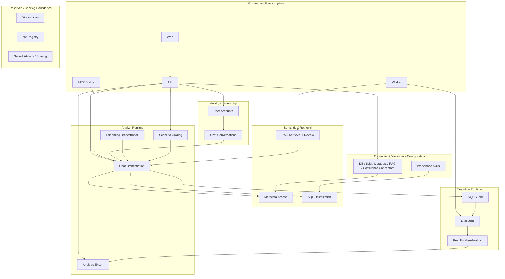

# Bounded Contexts

## Context Descriptions

| Context | Responsibility |
|---------|----------------|
| **Identity & Ownership** | Bootstrap user resolution today, resource ownership on chats and scenarios |
| **Connector Configuration** | All warehouse, LLM, metadata, RAG, and Confluence connector definitions |
| **Workspace Skills** | External markdown skill ingestion used by SQL optimization/orchestration |
| **Chat Orchestration** | Tool loop, capability surface, persistence of answer/evidence/SQL |
| **Streaming Orchestration** | SSE/WebSocket event production over the same governed chat core |
| **Scenario Catalog** | Reusable analyst flows with typed inputs and connector bindings |
| **Metadata Access** | OpenMetadata hydration and connector mapping |
| **RAG Retrieval + Review** | Insight retrieval plus pending/verified review workflow in Qdrant |
| **SQL Optimization** | Engine-aware prompt shaping and workspace-skill injection |
| **SQL Guard** | Read-only enforcement, limit normalization, violation reporting |
| **Execution** | Sync and queued execution against wired engines |
| **Result + Visualization** | Execution snapshot shaping and chart planning |
| **Analysis Export** | Deterministic HTML/PDF/notebook rendering from persisted snapshots |
| **Reserved Boundaries** | Separate workspaces/dbt/artifact domains are still backlog or placeholders |

## Architecture Rule

> Runtime applications (`apps/api`, `apps/worker`) stay thin. Product behavior belongs in `packages/backend`.
