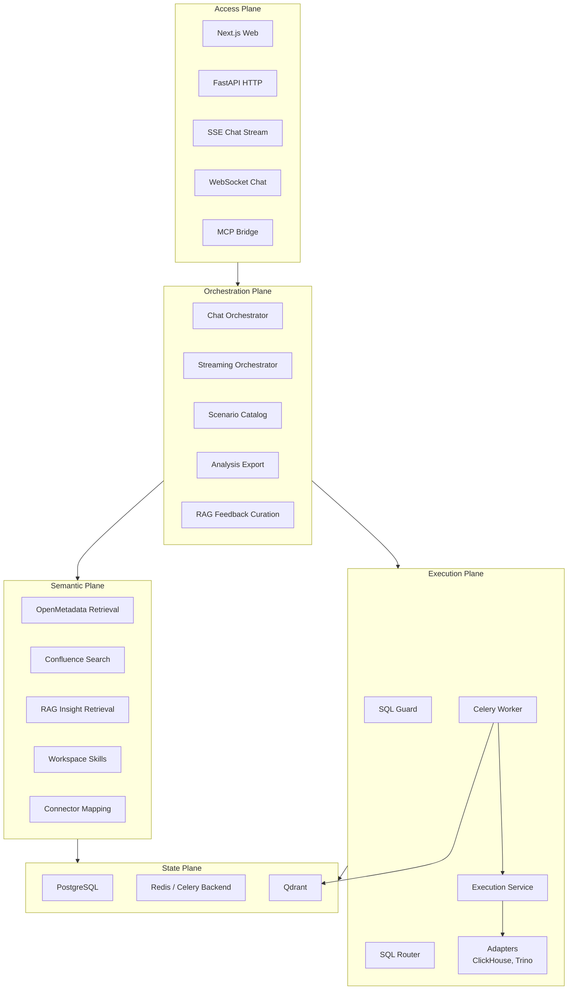

# System Layers Diagram

### Layer Descriptions

| Layer | Responsibility |
|-------|----------------|
| **Access** | Web UI plus HTTP/SSE/WebSocket/MCP entrypoints |
| **Orchestration** | Governed chat, streaming, scenarios, export rendering, feedback curation |
| **Semantic** | Metadata, RAG, Confluence, workspace-skill knowledge, connector mapping |
| **Execution** | Guarded SQL routing and warehouse execution, both sync and queued |
| **State** | Durable state in Postgres, async transport in Redis, reusable insights in Qdrant |
