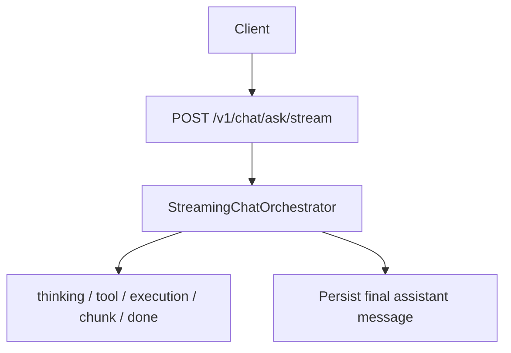
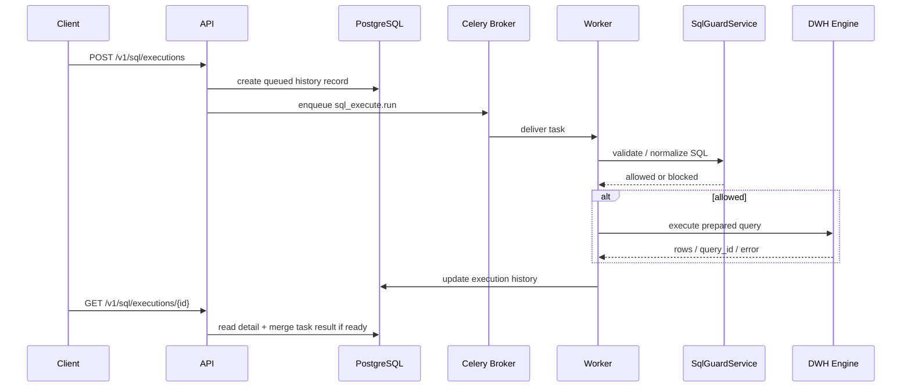
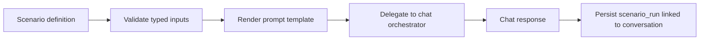
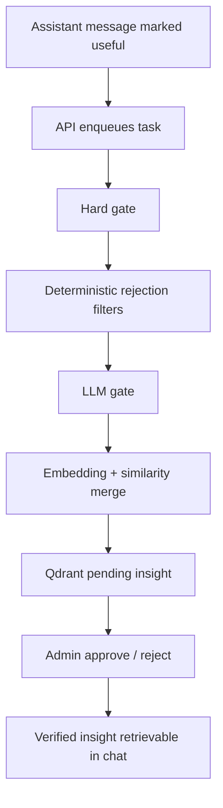

# Query Lifecycle

## Governed Chat Flow

```mermaid
flowchart LR
    question[Question] --> identity[Resolve current user]
    identity --> convo[Load or create conversation]
    convo --> capability[Build capability surface]
    capability --> tools[LLM tool loop]
    tools --> enrich[Metadata / RAG / Confluence / Skills]
    enrich --> sql[SQL draft + optimization]
    sql --> guard[SQL Guard]
    guard --> exec[Optional execution]
    exec --> result[Result + visualization plan]
    result --> persist[Persist assistant snapshot]
    persist --> answer[Answer to analyst]
```

## Streaming Transports

## Queue-Backed SQL Execution

## Scenario Run Flow

## RAG Feedback Pipeline

## Invariants

- **No execution without guard**: both sync and queued SQL paths go through `SqlGuardService`.
- **LLM never executes directly**: the model can draft SQL, but warehouses are reached only through `ExecutionService`.
- **Snapshots matter**: assistant messages persist SQL, evidence, warnings, connector choice, capability trace, optimization trace, and optional visualization.
- **Ownership is enforced before history reuse**: conversations and scenarios are resolved against the current workspace user.
- **Current auth is bootstrap-based**: full external auth is not the mainline runtime yet.
