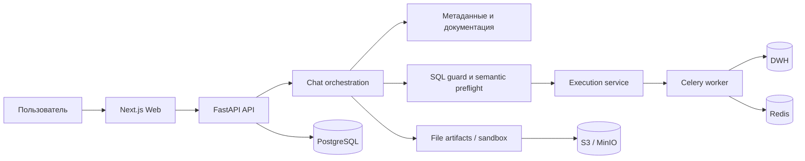

# Архитектура

## Runtime-контуры

- **Web** отвечает за диалог, каталог агентов, результаты и административный UI.
- **API** аутентифицирует запрос, загружает workspace policy и собирает use cases.
- **Worker** выполняет длительные SQL и фоновые задачи.
- **Sandbox** изолирует обработку входных и выходных файлов.
- **PostgreSQL** хранит control plane, разговоры, execution history и конфигурацию.
- **Redis/Celery** обеспечивает очередь и состояние фонового выполнения.
- **S3/MinIO** хранит артефакты и snapshots результатов.
- **Qdrant** используется для векторного поиска по управляемым знаниям.

## Инварианты

1. Модель не получает прямого сетевого доступа к DWH.
2. SQL проходит детерминированные policy и semantic checks.
3. Выбор источника и инструмента ограничен профилем агента.
4. Секреты разрешаются через secret backend и не возвращаются в API.
5. Итоговый ответ отделяет evidence от интерпретации.

Полные ADR, generated class diagrams, deployment runbooks и структура control-plane БД находятся в `docs/archive` и не публикуются.
