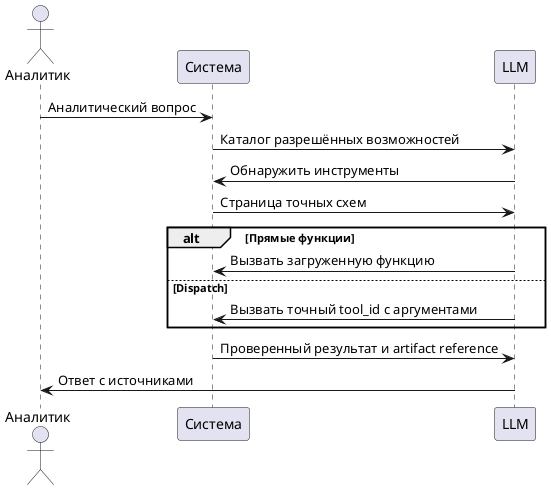

# FR-RH-001: Аналитический ответ на естественном языке

## Purpose

Зафиксировать наблюдаемое функциональное поведение соответствующей capability Rhetorica.

## Requirements

### Requirement: FR-RH-001 — Управляемый аналитический ответ

Система SHALL принимать аналитический вопрос на естественном языке и возвращать ответ, основанный только на доступных выбранному агенту источниках и инструментах.

**Use Cases:** UC-RH-1

#### Scenario: Успешный аналитический запрос

- **WHEN** аналитик задаёт вопрос с показателем, периодом и разрезом, а нужные источники доступны выбранному агенту
- **THEN** система возвращает ответ, данные выполнения и сведения об использованных источниках

#### Scenario: Недостаточно данных для ответа

- **WHEN** доступные источники не позволяют однозначно ответить на вопрос
- **THEN** система запрашивает уточнение или завершает ход с явным объяснением ограничения без выдуманного результата

### Requirement: FR-RH-001.1 — Детерминированное обнаружение MCP tools

Система SHALL позволять LLM запросить упорядоченный каталог разрешённых tools для точно указанного активного MCP-коннектора без предварительного включения полных схем этих tools в контекст модели.

**Use Cases:** UC-RH-1

#### Scenario: Просмотр каталога конкретного MCP-коннектора

- **WHEN** LLM указывает точное имя разрешённого активного MCP-коннектора и позицию страницы
- **THEN** система возвращает соответствующую страницу стабильных имён и описаний разрешённых tools этого коннектора без их полных входных схем

#### Scenario: Несколько однотипных MCP-коннекторов

- **WHEN** агенту разрешены два MCP-коннектора одного типа с одинаковыми remote tool names
- **THEN** система представляет каждый коннектор под его собственным стабильным именем и возвращает каталог только явно выбранного инстанса

### Requirement: FR-RH-001.2 — Точная загрузка схем MCP tools по запросу LLM

Система SHALL загружать в контекст LLM полные схемы только тех разрешённых MCP tools, которые LLM выбрала по точному имени коннектора и точным remote tool names, без автоматического ранжирования, подбора или замены со стороны backend.

**Use Cases:** UC-RH-1

#### Scenario: Загрузка выбранных схем

- **WHEN** LLM запрашивает загрузку существующих разрешённых remote tool names для точно указанного MCP-коннектора
- **THEN** система передаёт соответствующие полные схемы под уникальными exposed tool names как функции прямого режима либо как результат discovery в режиме dispatch

#### Scenario: Неточное имя не подменяется похожим

- **WHEN** LLM запрашивает отсутствующее имя коннектора или remote tool name
- **THEN** система возвращает явную ошибку и не загружает похожий коннектор или tool

### Requirement: FR-RH-001.3 — Управляемая моделью загрузка обычных tool-групп

Система SHALL предоставлять модели управляемую точную загрузку разрешённых групп инструментов с сохранением явно выбранных групп и MCP tools в той же сессии.

**Use Cases:** UC-RH-1

#### Scenario: Компактная начальная tool surface

- **WHEN** для выбранного агента доступны обычные runtime tools
- **THEN** начальная итерация содержит компактный каталог `name`/`description`, schemas точной загрузки/выгрузки групп и чтения применимых workspace skills либо стабильные schemas discovery/dispatch, но не schemas domain tools внутри ещё не загруженных групп

#### Scenario: Прямая загрузка из компактного каталога

- **WHEN** в начале хода доступна разрешённая tool-группа
- **THEN** LLM видит её точные `name` и `description` и может вызвать `load_tool_group` напрямую либо через dispatch без предварительного вызова `list_tool_groups`

#### Scenario: Workspace skills доступны до загрузки domain-групп

- **WHEN** выбранному агенту разрешён хотя бы один workspace skill
- **THEN** начальная итерация содержит `name` и `use_when` разрешённых skills и доступ к `read_workspace_skill` напрямую либо через discovery/dispatch без предварительной загрузки отдельной tool-группы

#### Scenario: Каталоги точных имён видимы модели

- **WHEN** LLM вызывает `list_tool_groups` или `list_mcp_tools`
- **THEN** следующая итерация получает ограниченную страницу точных доступных имён и компактных описаний без input schemas, с явным способом дочитать оставшиеся записи

#### Scenario: Страница MCP-каталога превышает бюджет результата

- **WHEN** запрошенные записи MCP-каталога вместе с описаниями превышают бюджет модельного результата
- **THEN** система сохраняет точные имена возвращённых записей и передаёт next_offset сразу после последней показанной записи для следующего вызова list_mcp_tools

#### Scenario: Точная загрузка выбранной группы

- **WHEN** LLM запрашивает существующую разрешённую tool-группу по точному имени
- **THEN** система делает все разрешённые schemas этой группы доступными в следующей итерации как прямые функции либо через discovery/dispatch и не загружает tools других групп

#### Scenario: Модель загружает несколько групп

- **WHEN** для выполнения запроса LLM последовательно или параллельно выбирает несколько разрешённых tool-групп
- **THEN** система сохраняет schemas всех выбранных групп доступными до завершения текущего хода

#### Scenario: Явно выбранные tools сохраняются между ходами

- **WHEN** LLM загрузила обычную tool-группу или точные remote tools конкретного MCP connector и пользователь продолжает ту же сессию
- **THEN** следующий ход восстанавливает доступ к их schemas в закреплённом режиме, сохраняя точную идентичность MCP connector instance

#### Scenario: Session manifest перепроверяется текущей policy

- **WHEN** ранее загруженная группа, MCP connector или remote tool стала неактивна, запрещена агенту либо отсутствует в актуальном catalog
- **THEN** система не восстанавливает недоступную schema и не подменяет её похожей группой, connector instance или tool

#### Scenario: Модель явно выгружает tools

- **WHEN** LLM вызывает точную операцию выгрузки ранее загруженной группы или MCP tools
- **THEN** система удаляет соответствующие schemas из следующих итераций и из session manifest без автоматического выбора замены

#### Scenario: Backend не выбирает группу по тексту запроса

- **WHEN** пользователь задаёт вопрос при наличии нескольких разрешённых tool-групп
- **THEN** backend не ранжирует, не подбирает и не загружает группы по словам вопроса, а оставляет выбор LLM

#### Scenario: Backend не перехватывает пользовательский intent

- **WHEN** пользователь спрашивает о возможностях ассистента либо LLM явно вызывает разрешённый `run_sql`
- **THEN** backend не подменяет ответ и не отклоняет tool call по keyword, small-talk или длине пользовательского текста

#### Scenario: Недоступная группа не подменяется похожей

- **WHEN** LLM запрашивает отсутствующее или запрещённое имя tool-группы
- **THEN** система возвращает явную ошибку и не загружает похожую или другую группу

#### Scenario: Capability без разрешённого runtime отсутствует

- **WHEN** после active, agent и request policy в capability-группе не остаётся ни одного разрешённого tool или коннектора
- **THEN** система не показывает эту группу, пустую connector section или отрицательный availability flag в контексте LLM

### Requirement: FR-RH-001.4 — Точный вызов найденного инструмента

Система SHALL в режиме dispatch выполнять запрос по точному tool_id только после проверки исходной схемы аргументов и текущего разрешения на этот инструмент.

**Use Cases:** UC-RH-1

#### Scenario: Выполнение найденного инструмента

- **WHEN** LLM обнаружила разрешённый инструмент и передала его tool_id с аргументами, соответствующими схеме
- **THEN** система выполняет тот же инструмент с теми же governance-проверками и аудитом, что в прямом режиме

#### Scenario: Разрешение отозвано

- **WHEN** ранее обнаруженный инструмент больше не разрешён выбранному агенту
- **THEN** система возвращает recoverable ошибку без выполнения инструмента

### Requirement: FR-RH-001.4.1 — Ограниченное обнаружение схем

Система SHALL возвращать запрошенную страницу детерминированно упорядоченных разрешённых схем без автоматического выполнения найденных инструментов.

**Use Cases:** UC-RH-1

#### Scenario: Каталог содержит сотни инструментов

- **WHEN** LLM запрашивает страницу схем со строкой поиска и ограничением количества
- **THEN** система возвращает только соответствующую ограничению страницу, точные идентификаторы и позицию следующей страницы
