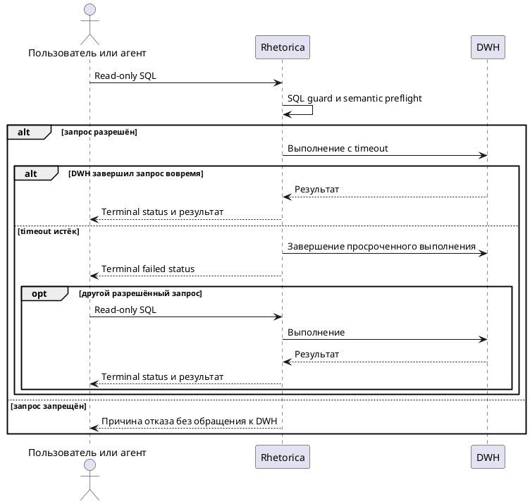

# FR-RH-004: Безопасное выполнение SQL

## Purpose

Зафиксировать наблюдаемое функциональное поведение соответствующей capability Rhetorica.

## Requirements

### Requirement: FR-RH-004 — Проверка SQL до DWH

Система SHALL применять детерминированный SQL guard и semantic preflight до передачи запроса в DWH-коннектор.

**Use Cases:** UC-RH-2

#### Scenario: Разрешённый read-only запрос

- **WHEN** пользователь или агент передаёт один read-only запрос, соответствующий policy и доступной схеме
- **THEN** система создаёт выполнение через выбранный DWH-коннектор и возвращает отслеживаемый статус

#### Scenario: Запрос изменяет данные

- **WHEN** SQL содержит DML, DDL или другой запрещённый оператор изменения данных
- **THEN** система отклоняет запрос до обращения к DWH и возвращает понятную причину отказа

### Requirement: FR-RH-004.1 — Ограниченное время выполнения DWH-запроса

Система SHALL переводить DWH-запрос в terminal status `failed` по истечении настроенного execution timeout без прерывания последующих или параллельных DWH-выполнений.

**Use Cases:** UC-RH-2

#### Scenario: DWH-операция завершается до timeout

- **WHEN** разрешённый DWH-запрос возвращает результат до истечения настроенного execution timeout
- **THEN** система сохраняет terminal status выполнения и возвращает результат вызывающему каналу

#### Scenario: Impala metadata-запрос превышает timeout

- **WHEN** разрешённый `DESCRIBE` через Impala не возвращает результат до истечения настроенного execution timeout
- **THEN** система сохраняет terminal status `failed` и возвращает вызывающему каналу ошибку timeout

#### Scenario: Запрос после Impala timeout

- **WHEN** один Impala-запрос завершён по execution timeout и после него поступает другой разрешённый DWH-запрос
- **THEN** система принимает новый запрос и возвращает его terminal status без перезапуска API runtime
