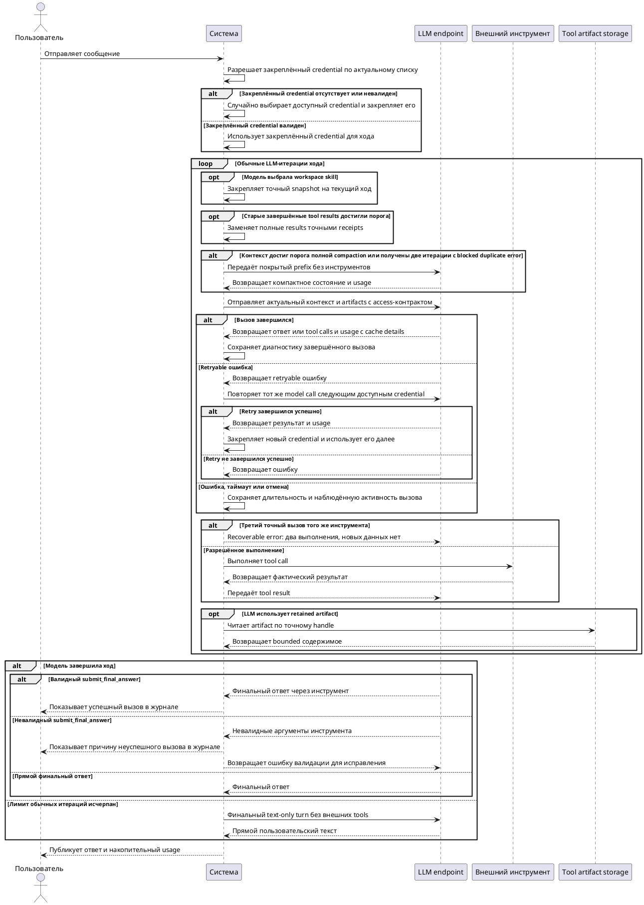

# FR-RH-005: Разговор и обратная связь

## Purpose

Зафиксировать наблюдаемое функциональное поведение соответствующей capability Rhetorica.
## Requirements
### Requirement: FR-RH-005 — Управление аналитическим разговором

Система SHALL сохранять сообщения, выбранный агент, связанные выполнения и артефакты в разговоре, принадлежащем текущему пользователю, SHALL позволять владельцу повторно открыть разрешённую историю разговора и SHALL позволять владельцу скрыть разговор посредством мягкого удаления без физического удаления его данных.

**Use Cases:** UC-RH-1, UC-RH-3, UC-RH-14

#### Scenario: Уточнение предыдущего ответа

- **WHEN** аналитик задаёт связанный следующий вопрос в существующем неудалённом разговоре
- **THEN** система использует разрешённую историю этого разговора и сохраняет новый ход в том же контексте

#### Scenario: Владелец открывает разговор со связанным SQL execution

- **WHEN** текущий authenticated user открывает принадлежащий ему неудалённый разговор, содержащий связанный SQL execution
- **THEN** система показывает сообщения и разрешённый результат execution без требования передать идентификатор владельца из клиента

#### Scenario: Необязательный результат execution недоступен

- **WHEN** сообщения неудалённого разговора доступны владельцу, но дополнительная гидратация execution detail завершилась ошибкой
- **THEN** система показывает историю сообщений без execution enrichment и не блокирует открытие разговора

#### Scenario: Чужой execution защищён

- **WHEN** authenticated user запрашивает execution другого пользователя
- **THEN** система отказывает в доступе независимо от переданных клиентом идентификаторов владельца

#### Scenario: Владелец удаляет разговор

- **WHEN** владелец удаляет разговор через пользовательский интерфейс или API
- **THEN** система помечает разговор удалённым, исключает его из списка и чтения для пользователя и сохраняет в базе разговор, сообщения и связанные записи

#### Scenario: Удалённый разговор нельзя продолжить

- **WHEN** пользователь пытается прочитать, изменить или продолжить ранее удалённый разговор
- **THEN** система отвечает так, как для недоступного разговора, и не добавляет в него новые данные

#### Scenario: Владелец открывает разговор с feedback ответа

- **WHEN** authenticated пользователь открывает свой неудалённый разговор, в котором есть feedback на assistant answer
- **THEN** система показывает ему его реакцию и развёрнутый feedback, не раскрывая feedback других пользователей или администраторов без соответствующего права

### Requirement: FR-RH-005.1 — Обратная связь и исправление

Система SHALL позволять владельцу conversation сохранить для assistant answer реакцию и, при развёрнутом feedback, текстовые поля «что пошло не так» и «как следовало ответить», SHALL сохранять автора, время и связь с исходным answer и SHALL позволять владельцу запустить явный repair turn для неудачного ответа, сохраняя исходный answer и feedback.

**Use Cases:** UC-RH-3, UC-RH-14

#### Scenario: Пользователь оставляет развёрнутый feedback

- **WHEN** владелец неудалённого conversation выбирает иконку 👎 в существующей карточке assistant answer, указывает, что пошло не так и как следовало ответить
- **THEN** система раскрывает форму только в этой карточке, сохраняет все указанные значения как feedback этого пользователя для данного answer, показывает выбранную иконку после закрытия формы и не создаёт LLM review

#### Scenario: Пользователь запускает исправление неудачного ответа

- **WHEN** владелец conversation с сохранённым негативным feedback запускает repair turn
- **THEN** система создаёт новый отслеживаемый ход с исходным answer и сохранённым feedback как явным контекстом исправления

### Requirement: FR-RH-005.2 — Накопительный учёт LLM-токенов разговора

Система SHALL накопительно учитывать для разговора раздельные суммы входящих, исходящих, прочитанных из prompt cache и записанных в prompt cache токенов из usage каждого завершённого LLM-вызова, относящегося к этому разговору, и SHALL учитывать cache tokens как подмножество входящих токенов без прибавления к общей сумме.

**Use Cases:** UC-RH-1, UC-RH-3

#### Scenario: Ход содержит несколько LLM-вызовов

- **WHEN** при обработке сообщения в разговоре завершаются несколько LLM-вызовов с usage, включая tool loop, compaction, forced finalization или repair
- **THEN** система один раз прибавляет входящие, исходящие и сообщённые cache tokens каждого такого вызова к соответствующим накопительным суммам разговора

#### Scenario: Контекст следующего вызова скомпактен

- **WHEN** перед очередным LLM-вызовом система сокращает контекст и провайдер возвращает usage этого вызова
- **THEN** система прибавляет фактические входящие, исходящие и сообщённые cache tokens из usage вызова без повторного учёта ранее сохранённой истории или диагностики

#### Scenario: Ход отменён после завершённого LLM-вызова

- **WHEN** пользователь отменяет ход после получения usage завершённого LLM-вызова и сообщение ассистента не сохраняется в истории
- **THEN** система прибавляет входящие, исходящие и сообщённые cache tokens этого вызова к накопительным суммам разговора

#### Scenario: Провайдер не сообщает cache usage

- **WHEN** usage завершённого LLM-вызова не содержит полей prompt cache
- **THEN** система сохраняет нулевые cache tokens и не учитывает вызов как сообщивший cache usage

### Requirement: FR-RH-005.2.1 — Чтение расхода токенов разговора

Система SHALL возвращать накопительные входящие, исходящие, общие, прочитанные из prompt cache и записанные в prompt cache токены, а также число LLM-вызовов с сообщённым cache usage при чтении доступного пользователю разговора.

**Use Cases:** UC-RH-1, UC-RH-3

#### Scenario: Пользователь читает расход разговора

- **WHEN** владелец получает список разговоров или открывает конкретный неудалённый разговор
- **THEN** система возвращает для разговора все накопительные категории токенов и число вызовов с cache usage, причём общие токены равны сумме входящих и исходящих

### Requirement: FR-RH-005.3 — Контекст сообщения внешнего канала

Система SHALL формировать контекст сообщения внешнего канала из разрешённой истории связанного разговора и соседних сообщений, отсутствующих в этой истории.

**Use Cases:** UC-RH-1, UC-RH-3

#### Scenario: Связанный разговор содержит историю и новые соседние сообщения

- **WHEN** пользователь обращается к ассистенту во внешнем канале, где связанный разговор уже содержит часть соседних сообщений
- **THEN** система передаёт LLM каждое сохранённое сообщение один раз и добавляет разрешённые соседние сообщения, которых нет в истории разговора

#### Scenario: Отдельное обращение использует обсуждение канала

- **WHEN** пользователь обращается к ассистенту отдельным сообщением вне существующей ветки разговора
- **THEN** система добавляет разрешённые предшествующие сообщения канала как соседний контекст без ранее сгенерированных ответов этого ассистента

#### Scenario: Разные ходы содержат одинаковый текст ответа

- **WHEN** история связанного разговора содержит разные пользовательские ходы с одинаковым текстом ответа ассистента
- **THEN** система передаёт LLM каждый ход истории без объединения или исключения по совпадению текста

### Requirement: FR-RH-005.3.1 — Актуальность текущего сообщения

Система SHALL передавать текущее сообщение пользователя LLM ровно один раз после вспомогательного контекста и сохранять его при сокращении соседних сообщений.

**Use Cases:** UC-RH-1, UC-RH-3

#### Scenario: Соседние сообщения превышают доступный объём контекста

- **WHEN** разрешённые соседние сообщения не помещаются в выделенный для них объём контекста
- **THEN** система сохраняет наиболее свежие из помещающихся соседних сообщений и передаёт текущее сообщение пользователя полностью как последнее пользовательское сообщение

### Requirement: FR-RH-005.4 — Замена длинного контекста компактным состоянием

Система SHALL при достижении настроенного порога model-facing контекста заменять покрытый prefix, заканчивающийся завершённым взаимодействием с инструментами, компактным состоянием и сохранять последующий контекст без изменений.

**Use Cases:** UC-RH-1, UC-RH-3

#### Scenario: Tool loop достигает порога контекста

- **WHEN** model-facing контекст достигает настроенного порога после получения результатов всех tool calls завершённого tool batch
- **THEN** следующий LLM-вызов получает компактное состояние вместо покрытого prefix и исходный контекст после границы замены

#### Scenario: Последний tool batch не завершён

- **WHEN** model-facing контекст достигает настроенного порога, но последний tool batch не содержит результатов для всех его tool calls
- **THEN** система сохраняет незавершённый tool batch в исходном виде и не разделяет связанные tool calls и tool results границей замены

### Requirement: FR-RH-005.4.1 — Точный реестр выполненных вызовов инструментов

Система SHALL включать в компактное состояние точный упорядоченный реестр покрытых выполненных tool calls с именем инструмента, переданными аргументами, наблюдаемым исходом и ссылкой на доступный полный artifact результата.

**Use Cases:** UC-RH-1, UC-RH-3

#### Scenario: Компактное состояние покрывает ранее выполненный вызов

- **WHEN** система заменяет prefix, содержащий завершённый tool call и его результат
- **THEN** следующий LLM-вызов получает в реестре фактическое имя инструмента, фактические аргументы, исход выполнения и artifact handle этого вызова

#### Scenario: LLM читает полный artifact после compaction

- **WHEN** LLM использует artifact handle из компактного состояния и получает bounded результат `inspect_tool_artifact`, `read_tool_artifact` или `find_tool_artifact_text`
- **THEN** следующий LLM-вызов получает этот результат по существующему контракту инструмента, включая доступные content, pagination, paths или matches

### Requirement: FR-RH-005.4.2 — Ограничение точных повторных вызовов

Система SHALL на третьей и каждой последующей попытке текущего хода вызвать инструмент с теми же именем и canonical JSON arguments возвращать LLM recoverable tool error без выполнения инструмента.

**Use Cases:** UC-RH-1, UC-RH-3

#### Scenario: LLM запрашивает третий точный вызов

- **WHEN** LLM дважды получила результаты выполненного инструмента и снова запрашивает в том же ходе инструмент с теми же именем и canonical JSON arguments
- **THEN** система не запускает инструмент и возвращает `ok=false`, `error_code=identical_tool_call_limit_reached`, `can_continue=true`, `new_evidence=false`, число предыдущих выполнений и сообщение «Этот запрос уже выполнялся 2 раза, результат идентичен, новых данных нет»

#### Scenario: LLM изменяет аргументы

- **WHEN** после ошибки лимита LLM запрашивает тот же инструмент с отличающимися canonical JSON arguments
- **THEN** система выполняет новый вызов по обычному контракту инструмента

### Requirement: FR-RH-005.4.3 — Детерминированное освобождение старых tool results

Система SHALL после достижения настроенного порога заменять старейшие полные результаты завершённых tool interactions компактными receipts, сохраняя настроенное число последних tool interactions без изменений и не применяя семантическую оценку релевантности.

**Use Cases:** UC-RH-1, UC-RH-3

#### Scenario: Старые результаты достигли порога освобождения

- **WHEN** LLM уже получила результаты завершённых tool interactions, объём освобождаемого содержимого достиг настроенного порога и более свежие interactions остаются в настроенном защищённом окне
- **THEN** следующий LLM-вызов получает вместо старейших полных результатов receipts с фактическими именем инструмента, аргументами, исходом, artifact handle и hash

#### Scenario: Освобождаемого содержимого недостаточно

- **WHEN** объём старых полных tool results меньше настроенного порога освобождения
- **THEN** система сохраняет model-facing tool results без изменений для сохранения стабильного prompt prefix

#### Scenario: Tool batch не завершён

- **WHEN** assistant tool batch не содержит результатов для всех заявленных tool calls
- **THEN** система не заменяет результаты этого batch и не разделяет связанные tool calls и tool results

### Requirement: FR-RH-005.4.4 — Bounded model-facing результат инструмента

Система SHALL ограничивать model-facing payload результата инструмента настроенными пределами символов и токенов, сохраняя полный необрезанный результат как доступный artifact.

**Use Cases:** UC-RH-1, UC-RH-3

#### Scenario: Результат превышает token limit

- **WHEN** сериализованный model-facing payload результата инструмента превышает настроенный token limit
- **THEN** система передаёт LLM детерминированно сокращённый payload в пределах лимита и artifact handle для bounded чтения полного результата

### Requirement: FR-RH-005.4.4.1 — Самоописываемый доступ к tool artifact

Система SHALL включать в каждую model-facing ссылку на retained tool artifact точные имена доступных инструментов bounded-чтения и нейтральное описание операции каждого инструмента без выбора действия за LLM.

**Use Cases:** UC-RH-1, UC-RH-3

#### Scenario: Результат инструмента сохранён как artifact

- **WHEN** система формирует model-facing payload результата MCP, RAG или другого инструмента с retained artifact handle
- **THEN** LLM получает рядом с handle карту `access` с операциями `inspect_tool_artifact`, `find_tool_artifact_text` и `read_tool_artifact` без рекомендованного маршрута

### Requirement: FR-RH-005.4.5 — Обнаружение model-owned памяти инструментов

Система SHALL описывать доступную LLM группу памяти инструментов через назначение, момент загрузки и границы самостоятельного выбора модели без семантического ранжирования artifacts.

**Use Cases:** UC-RH-1, UC-RH-3

#### Scenario: Модель получает каталог групп инструментов

- **WHEN** система формирует LLM-вызов с доступной группой памяти инструментов
- **THEN** каталог сообщает, что группа позволяет работать с результатами прошлых ходов, проверять сохранённые artifacts перед повторным внешним вызовом и самостоятельно выбирать дальнейшее действие

### Requirement: FR-RH-005.4.5.1 — Немедленный список сохранённых artifacts

Система SHALL предоставлять LLM схему перечисления сохранённых tool artifacts без предварительной загрузки полной группы памяти инструментов.

**Use Cases:** UC-RH-1, UC-RH-3

#### Scenario: Начальная итерация tool-enabled хода

- **WHEN** система отправляет первую LLM-итерацию хода, в котором доступны обычные инструменты или workspace skills
- **THEN** LLM получает callable schema списка сохранённых artifacts вместе с точными правилами выбора artifact и без схем остальных deferred-инструментов памяти

### Requirement: FR-RH-005.4.5.2 — Нейтральный маршрут после освобождения результата

Система SHALL включать в receipt освобождённого tool result равноправные маршруты чтения retained artifact, model-selected durable сохранения и повторного исходного tool call.

**Use Cases:** UC-RH-1, UC-RH-3

#### Scenario: Полный результат заменён receipt

- **WHEN** система удаляет полный tool result из активного model-facing контекста и сохраняет его artifact
- **THEN** receipt сообщает точный artifact handle, инструменты bounded-чтения, маршрут загрузки durable-memory инструментов и возможность повторить исходный вызов без автоматически выбранного действия

### Requirement: FR-RH-005.4.6 — Принудительная compaction после повторной блокировки

Система SHALL после двух LLM-итераций текущего хода с recoverable error `identical_tool_call_limit_reached` перед следующим LLM-вызовом запускать существующую полную compaction независимо от заполнения context window.

**Use Cases:** UC-RH-1, UC-RH-3

#### Scenario: Модель повторяет заблокированный вызов в следующей итерации

- **WHEN** после первой LLM-итерации с recoverable error `identical_tool_call_limit_reached` последующая LLM-итерация снова содержит хотя бы один заблокированный точный вызов
- **THEN** перед следующим LLM-вызовом система формирует compact checkpoint тем же способом, что при достижении настроенного порога полной compaction, даже если context window заполнено менее чем на 80 процентов

#### Scenario: Одна итерация содержит несколько заблокированных вызовов

- **WHEN** одна LLM-итерация содержит несколько tool calls с recoverable error `identical_tool_call_limit_reached`
- **THEN** система учитывает их как одну итерацию с ошибкой и не запускает принудительную compaction до второй LLM-итерации с такой ошибкой

### Requirement: FR-RH-005.5 — Предел LLM-итераций хода

Система SHALL допускать не более 100 LLM-итераций в одном orchestration turn.

**Use Cases:** UC-RH-1, UC-RH-3

#### Scenario: Длительный tool-enabled ход

- **WHEN** обработка сообщения требует более 20 LLM-итераций и модель продолжает возвращать допустимые новые tool calls
- **THEN** система продолжает orchestration turn до финального ответа или достижения предела 100 LLM-итераций

### Requirement: FR-RH-005.5.1 — Принудительное завершение исчерпанного tool loop

Система SHALL после исчерпания лимита обычных tool-loop итераций выполнить text-only финализацию без внешних tools и вернуть пользователю непустой пользовательский текст этой LLM-итерации как лучший доступный ответ, явное ограничение или один уточняющий вопрос.

**Use Cases:** UC-RH-1, UC-RH-3

#### Scenario: Metadata exploration не выбрал управляемый источник

- **WHEN** обычные tool-loop итерации исчерпаны после поиска метаданных без выбранного управляемого источника и без выполненного аналитического запроса
- **THEN** система запрещает новые внешние tool calls и запрашивает у LLM прямой финальный текст с недостающим контекстом или одним конкретным уточняющим вопросом вместо generic fallback

#### Scenario: Forced finalization возвращает пользовательский текст

- **WHEN** LLM endpoint возвращает непустой пользовательский текст в forced-finalization turn
- **THEN** система публикует этот текст как ответ без требования JSON payload и без повторного LLM-вызова для преобразования формата

#### Scenario: Forced finalization не возвращает пользовательский текст

- **WHEN** forced-finalization LLM-вызов завершается ошибкой или не содержит пользовательского текста
- **THEN** система завершает ход детерминированным техническим fallback и добавляет диагностическое предупреждение о сбое forced finalization

### Requirement: FR-RH-005.6 — Диагностика отдельных LLM-вызовов

Система SHALL сохранять в диагностике соответствующего сообщения для каждого начатого LLM-вызова в обработке сообщения идентификатор, порядковый номер, фазу, модель, время начала и окончания, длительность и исход, различающий успешное завершение, ошибку, таймаут и отмену.

**Use Cases:** UC-RH-1, UC-RH-3

#### Scenario: Несколько вызовов и compaction

- **WHEN** обработка сообщения выполняет вызов модели, compaction и следующий вызов модели
- **THEN** диагностика содержит три различные записи с последовательными номерами и фазами, привязанные к одному запуску и разговору

#### Scenario: Таймаут следующего вызова

- **WHEN** после успешного первого вызова второй LLM-вызов прерывается по таймауту
- **THEN** диагностика сохраняет обе записи, отмечает таймаут только второго вызова и включает его измеренную длительность в суммарное время LLM-вызовов

#### Scenario: Явная отмена

- **WHEN** пользователь отменяет обработку сообщения во время LLM-вызова
- **THEN** диагностика отмечает активный вызов отменённым и сохраняет его длительность без изменения исходов предыдущих вызовов

#### Scenario: Следующее сообщение не затирает диагностику

- **WHEN** после хода с таймаутом пользователь получает успешный ответ на следующее сообщение
- **THEN** диагностика первого assistant message сохраняет исход и измерения его вызовов независимо от диагностики нового сообщения

### Requirement: FR-RH-005.6.1 — Наблюдаемая активность потока

Система SHALL сохранять для потокового LLM-вызова время первого и последнего наблюдённого содержательного события, раздельные объёмы текста ответа, reasoning и аргументов инструментов в символах, а также тип полученного терминального события без копирования содержимого чанков в диагностику.

**Use Cases:** UC-RH-1, UC-RH-3

#### Scenario: Поток завершён успешно

- **WHEN** поток передаёт reasoning и текст ответа, затем сообщает об успешном завершении
- **THEN** диагностика сохраняет объёмы обеих категорий, времена первого и последнего содержательных событий и тип полученного события завершения

#### Scenario: Активная генерация прерывается

- **WHEN** поток передаёт reasoning, текст ответа и аргументы инструмента, затем прерывается по таймауту
- **THEN** диагностика сохраняет ненулевые объёмы соответствующих категорий и времена первого и последнего содержательных событий, не утверждая, что поток завершился успешно

#### Scenario: Таймаут без содержательных событий

- **WHEN** поток завершается таймаутом после служебного события начала ответа без содержательных чанков
- **THEN** времена первого и последнего содержательных событий остаются неизвестными, а их объёмы равны нулю

### Requirement: FR-RH-005.6.2 — Отсутствующий usage оборванного вызова

Система SHALL явно обозначать отсутствие сообщённого usage в диагностике оборванного LLM-вызова без расчёта токенов из наблюдённого текста.

**Use Cases:** UC-RH-1, UC-RH-3

#### Scenario: Провайдер не сообщил usage

- **WHEN** LLM-вызов прерывается до получения usage
- **THEN** запись вызова содержит признак отсутствующего usage и не добавляет предполагаемые токены к расходу разговора

### Requirement: FR-RH-005.7 — Закрепление LLM credential за conversation

Система SHALL при первом обращении пары conversation + LLM connector случайно выбирать один доступный LLM credential, закреплять его за этой парой и повторно использовать выбранный credential во всех model calls и следующих пользовательских ходах независимо от смены экземпляра приложения или его перезапуска.

**Use Cases:** UC-RH-1, UC-RH-3

#### Scenario: Первый LLM-вызов разговора

- **WHEN** система начинает первый LLM-вызов пары conversation + LLM connector с несколькими доступными credentials
- **THEN** система случайно выбирает один credential из актуального списка, сохраняет binding и выполняет LLM-вызов с выбранным credential

#### Scenario: Один ход содержит несколько model calls

- **WHEN** ход после создания или разрешения binding выполняет tool-loop итерации, compaction, forced finalization или другие model calls
- **THEN** система использует один разрешённый в начале хода credential для всех этих вызовов

#### Scenario: Следующий экземпляр продолжает разговор

- **WHEN** следующий пользовательский ход той же пары начинается в другом экземпляре приложения или после перезапуска
- **THEN** система разрешает ранее закреплённый credential через актуальный список и использует его

#### Scenario: Конкурентные первые обращения

- **WHEN** несколько экземпляров одновременно начинают первые обращения одной пары conversation + LLM connector без существующего закрепления
- **THEN** до отправки LLM-запроса все они используют один согласованный credential

### Requirement: FR-RH-005.7.1 — Переключение credential при retryable ошибке

Система SHALL при retryable ошибке конкретного model call повторять этот вызов со следующим доступным LLM credential и после успешного retry закреплять использованный credential за той же парой conversation + LLM connector.

**Use Cases:** UC-RH-1, UC-RH-3

#### Scenario: Retry со следующим credential успешен

- **WHEN** model call с закреплённым credential завершается retryable ошибкой и повтор этого вызова со следующим доступным credential завершается успешно
- **THEN** система закрепляет B за парой conversation + LLM connector, возвращает результат успешной попытки и использует B в следующих model calls и пользовательских ходах этой пары

#### Scenario: Retry со следующим credential неуспешен

- **WHEN** model call с закреплённым credential завершается retryable ошибкой, а повтор со следующим доступным credential завершается ошибкой
- **THEN** система не заменяет закрепление на credential неуспешной попытки

#### Scenario: Ошибка не допускает retry

- **WHEN** model call завершается ошибкой, которую действующий LLM error contract не классифицирует как retryable
- **THEN** система не переключает закреплённый credential из-за этой ошибки

### Requirement: FR-RH-005.7.2 — Восстановление выбора LLM credential

Система SHALL перед началом хода разрешать ранее выбранный credential пары conversation + LLM connector по актуальному набору доступных credentials; если ранее выбранный credential больше нельзя однозначно сопоставить с актуальным набором после удаления, замены или перестановки, система SHALL случайно выбирать и закреплять новый доступный credential до LLM-запроса, а при отсутствии доступных credentials SHALL возвращать существующую configuration error без отправки LLM-запроса.

**Use Cases:** UC-RH-1, UC-RH-3

#### Scenario: Ранее закреплённый credential больше не сопоставляется

- **WHEN** ранее закреплённый credential больше нельзя однозначно сопоставить с актуальным набором после удаления, замены или перестановки ключей
- **THEN** система случайно выбирает и закрепляет новый доступный credential до следующего LLM-вызова

#### Scenario: Доступных credentials нет

- **WHEN** система начинает ход для LLM connector без доступных credentials
- **THEN** система возвращает существующую ошибку конфигурации, не отправляет LLM-запрос и не создаёт binding

### Requirement: FR-RH-005.7.3 — Защита credential binding

Система SHALL исключать raw API key, Authorization header и содержимое секрета из сохраняемого состояния разговора, сообщений, diagnostics, логов и публичных API-ответов.

**Use Cases:** UC-RH-1, UC-RH-3

#### Scenario: Credential data не раскрывается

- **WHEN** система сохраняет persisted state, сообщение, diagnostics или logs либо возвращает публичный API-ответ после LLM-вызова
- **THEN** raw API key, Authorization header и содержимое секрета не попадают в эти данные

### Requirement: FR-RH-005.8 — Достоверный статус финального ответа

Система SHALL показывать в журнале выполнения успешное принятие валидного финального ответа через `submit_final_answer`.

**Use Cases:** UC-RH-1, UC-RH-3

#### Scenario: Модель завершает ход финальным инструментом

- **WHEN** LLM вызывает `submit_final_answer` с валидным ответом на сообщение пользователя
- **THEN** система публикует ответ пользователю и отмечает вызов инструмента успешным в журнале выполнения

#### Scenario: Невалидный финальный ответ

- **WHEN** LLM вызывает `submit_final_answer` с невалидными аргументами
- **THEN** система отмечает вызов неуспешным с причиной в журнале выполнения и возвращает модели ошибку валидации для исправления
