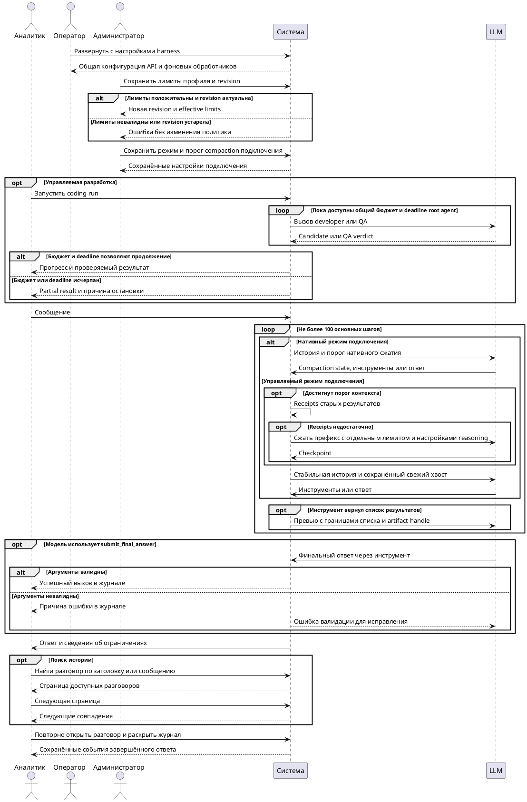

# FR-RH-005: Разговор и обратная связь

## Purpose

Зафиксировать наблюдаемое функциональное поведение соответствующей capability Rhetorica.

## Requirements

### Requirement: FR-RH-005 — Управление аналитическим разговором

Система SHALL предоставлять владельцу сохраняемый аналитический разговор с историей сообщений, выбранным агентом, связанными выполнениями и артефактами, доступный для повторного открытия до мягкого удаления владельцем.

**Use Cases:** UC-RH-1, UC-RH-3, UC-RH-14

#### Scenario: Уточнение предыдущего ответа

- **WHEN** аналитик задаёт связанный следующий вопрос в существующем неудалённом разговоре
- **THEN** система использует разрешённую историю этого разговора и сохраняет новый ход в том же контексте

#### Scenario: Владелец открывает разговор со связанным SQL execution

- **WHEN** текущий authenticated user открывает принадлежащий ему неудалённый разговор, содержащий связанный SQL execution
- **THEN** система показывает сообщения и разрешённый результат execution без требования передать идентификатор владельца из клиента

#### Scenario: Необязательный результат execution недоступен

- **WHEN** сообщения неудалённого разговора доступны владельцу, но дополнительная гидратация execution detail завершилась ошибкой
- **THEN** система показывает историю сообщений без execution enrichment и не блокирует открытие разговора

#### Scenario: Чужой execution защищён

- **WHEN** authenticated user запрашивает execution другого пользователя
- **THEN** система отказывает в доступе независимо от переданных клиентом идентификаторов владельца

#### Scenario: Владелец удаляет разговор

- **WHEN** владелец удаляет разговор через пользовательский интерфейс или API
- **THEN** система помечает разговор удалённым, исключает его из списка и чтения для пользователя и сохраняет в базе разговор, сообщения и связанные записи

#### Scenario: Удалённый разговор нельзя продолжить

- **WHEN** пользователь пытается прочитать, изменить или продолжить ранее удалённый разговор
- **THEN** система отвечает так, как для недоступного разговора, и не добавляет в него новые данные

#### Scenario: Владелец открывает разговор с feedback ответа

- **WHEN** authenticated пользователь открывает свой неудалённый разговор, в котором есть feedback на assistant answer
- **THEN** система показывает ему его реакцию и развёрнутый feedback, не раскрывая feedback других пользователей или администраторов без соответствующего права

### Requirement: FR-RH-005.1 — Обратная связь и исправление

Система SHALL позволять владельцу conversation сохранить для assistant answer реакцию и, при развёрнутом feedback, текстовые поля «что пошло не так» и «как следовало ответить», SHALL сохранять автора, время и связь с исходным answer и SHALL позволять владельцу запустить явный repair turn для неудачного ответа, сохраняя исходный answer и feedback.

**Use Cases:** UC-RH-3, UC-RH-14

#### Scenario: Пользователь оставляет развёрнутый feedback

- **WHEN** владелец неудалённого conversation выбирает иконку 👎 в существующей карточке assistant answer, указывает, что пошло не так и как следовало ответить
- **THEN** система раскрывает форму только в этой карточке, сохраняет все указанные значения как feedback этого пользователя для данного answer, показывает выбранную иконку после закрытия формы и не создаёт LLM review

#### Scenario: Пользователь запускает исправление неудачного ответа

- **WHEN** владелец conversation с сохранённым негативным feedback запускает repair turn
- **THEN** система создаёт новый отслеживаемый ход с исходным answer и сохранённым feedback как явным контекстом исправления

### Requirement: FR-RH-005.2 — Накопительный учёт LLM-токенов разговора

Система SHALL накопительно учитывать для разговора раздельные суммы входящих, исходящих, прочитанных из prompt cache и записанных в prompt cache токенов из usage каждого завершённого LLM-вызова, относящегося к этому разговору, с учётом cache tokens как подмножества входящих токенов без прибавления к общей сумме.

**Use Cases:** UC-RH-1, UC-RH-3

#### Scenario: Ход содержит несколько LLM-вызовов

- **WHEN** при обработке сообщения в разговоре завершаются несколько LLM-вызовов с usage, включая tool loop, compaction, forced finalization или repair
- **THEN** система один раз прибавляет входящие, исходящие и сообщённые cache tokens каждого такого вызова к соответствующим накопительным суммам разговора

#### Scenario: Контекст следующего вызова скомпактен

- **WHEN** перед очередным LLM-вызовом система сокращает контекст и провайдер возвращает usage этого вызова
- **THEN** система прибавляет фактические входящие, исходящие и сообщённые cache tokens из usage вызова без повторного учёта ранее сохранённой истории или диагностики

#### Scenario: Ход отменён после завершённого LLM-вызова

- **WHEN** пользователь отменяет ход после получения usage завершённого LLM-вызова и сообщение ассистента не сохраняется в истории
- **THEN** система прибавляет входящие, исходящие и сообщённые cache tokens этого вызова к накопительным суммам разговора

#### Scenario: Провайдер не сообщает cache usage

- **WHEN** usage завершённого LLM-вызова не содержит полей prompt cache
- **THEN** система сохраняет нулевые cache tokens и не учитывает вызов как сообщивший cache usage

### Requirement: FR-RH-005.2.1 — Чтение расхода токенов разговора

Система SHALL возвращать накопительные входящие, исходящие, общие, прочитанные из prompt cache и записанные в prompt cache токены, а также число LLM-вызовов с сообщённым cache usage при чтении доступного пользователю разговора.

**Use Cases:** UC-RH-1, UC-RH-3

#### Scenario: Пользователь читает расход разговора

- **WHEN** владелец получает список разговоров или открывает конкретный неудалённый разговор
- **THEN** система возвращает для разговора все накопительные категории токенов и число вызовов с cache usage, причём общие токены равны сумме входящих и исходящих

### Requirement: FR-RH-005.3 — Контекст сообщения внешнего канала

Система SHALL формировать контекст сообщения внешнего канала из разрешённой истории связанного разговора и соседних сообщений, отсутствующих в этой истории.

**Use Cases:** UC-RH-1, UC-RH-3

#### Scenario: Связанный разговор содержит историю и новые соседние сообщения

- **WHEN** пользователь обращается к ассистенту во внешнем канале, где связанный разговор уже содержит часть соседних сообщений
- **THEN** система передаёт LLM каждое сохранённое сообщение один раз и добавляет разрешённые соседние сообщения, которых нет в истории разговора

#### Scenario: Отдельное обращение использует обсуждение канала

- **WHEN** пользователь обращается к ассистенту отдельным сообщением вне существующей ветки разговора
- **THEN** система добавляет разрешённые предшествующие сообщения канала как соседний контекст без ранее сгенерированных ответов этого ассистента

#### Scenario: Разные ходы содержат одинаковый текст ответа

- **WHEN** история связанного разговора содержит разные пользовательские ходы с одинаковым текстом ответа ассистента
- **THEN** система передаёт LLM каждый ход истории без объединения или исключения по совпадению текста

### Requirement: FR-RH-005.3.1 — Актуальность текущего сообщения

Система SHALL сохранять текущий настоящий запрос пользователя дословно и ровно один раз в модельной истории при добавлении служебного контекста и сокращении соседних сообщений.

**Use Cases:** UC-RH-1, UC-RH-3

#### Scenario: Подключение требует завершающую роль user

- **WHEN** подключение требует последним сообщение роли user после результатов инструментов
- **THEN** система добавляет явно помеченное служебное продолжение и сохраняет настоящий запрос без повторного копирования

#### Scenario: Соседние сообщения превышают доступный объём контекста

- **WHEN** разрешённые соседние сообщения не помещаются в выделенный для них объём контекста
- **THEN** система сохраняет наиболее свежие из помещающихся соседних сообщений и передаёт текущий настоящий запрос пользователя полностью

### Requirement: FR-RH-005.4 — Замена длинного контекста компактным состоянием

Система SHALL для подключения без включённого нативного режима при достижении настроенного порога model-facing контекста заменять покрытый prefix, заканчивающийся завершённым взаимодействием с инструментами, компактным состоянием и сохранять последующий контекст без изменений.

**Use Cases:** UC-RH-1, UC-RH-3

#### Scenario: Tool loop достигает порога контекста

- **WHEN** model-facing контекст достигает настроенного порога после получения результатов всех tool calls завершённого tool batch
- **THEN** следующий LLM-вызов получает компактное состояние вместо покрытого prefix и исходный контекст после границы замены

#### Scenario: Последний tool batch не завершён

- **WHEN** model-facing контекст достигает настроенного порога, но последний tool batch не содержит результатов для всех его tool calls
- **THEN** система сохраняет незавершённый tool batch в исходном виде и не разделяет связанные tool calls и tool results границей замены

### Requirement: FR-RH-005.4.1 — Точный реестр выполненных вызовов инструментов

Система SHALL сохранять точный упорядоченный реестр покрытых выполненных tool calls в доступном artifact и включать его адрес в компактное состояние.

**Use Cases:** UC-RH-1, UC-RH-3

#### Scenario: Компактное состояние покрывает ранее выполненный вызов

- **WHEN** система заменяет prefix, содержащий завершённый tool call и его результат
- **THEN** следующий LLM-вызов получает адрес реестра для bounded-чтения фактического имени инструмента, аргументов, исхода выполнения и artifact handle результата

#### Scenario: LLM читает полный artifact после compaction

- **WHEN** LLM использует artifact handle из компактного состояния и получает bounded результат `inspect_tool_artifact`, `read_tool_artifact` или `find_tool_artifact_text`
- **THEN** следующий LLM-вызов получает этот результат по существующему контракту инструмента, включая доступные content, pagination, paths или matches

### Requirement: FR-RH-005.4.2 — Ограничение точных повторных вызовов

Система SHALL на третьей и каждой последующей попытке текущего хода вызвать инструмент с теми же именем и canonical JSON arguments возвращать LLM recoverable tool error без выполнения инструмента.

**Use Cases:** UC-RH-1, UC-RH-3

#### Scenario: LLM запрашивает третий точный вызов

- **WHEN** LLM дважды получила результаты выполненного инструмента и снова запрашивает в том же ходе инструмент с теми же именем и canonical JSON arguments
- **THEN** система не запускает инструмент и возвращает `ok=false`, `error_code=identical_tool_call_limit_reached`, `can_continue=true`, `new_evidence=false`, число предыдущих выполнений и сообщение «Этот запрос уже выполнялся 2 раза, результат идентичен, новых данных нет»

#### Scenario: LLM изменяет аргументы

- **WHEN** после ошибки лимита LLM запрашивает тот же инструмент с отличающимися canonical JSON arguments
- **THEN** система выполняет новый вызов по обычному контракту инструмента

### Requirement: FR-RH-005.4.3 — Мягкое освобождение старых результатов инструментов

Система SHALL при достижении порога заполнения входного бюджета заменять старые результаты завершённых batch компактными receipts с сохранением пар вызов/результат и доступа к полным artifacts.

**Use Cases:** UC-RH-1, UC-RH-3

#### Scenario: Старые результаты занимают контекст

- **WHEN** входной контекст достигает 70% доступного бюджета и содержит сокращаемые результаты старше трёх последних завершённых batch
- **THEN** система сохраняет последние три batch, текущий запрос и действующие инструкции дословно, заменяя старые результаты ссылками на полные artifacts

#### Scenario: Контекст ниже порога

- **WHEN** входной контекст занимает меньше 70% бюджета
- **THEN** система повторно передаёт уже показанные результаты без переписывания префикса

#### Scenario: Tool batch не завершён

- **WHEN** assistant tool batch не содержит результатов для всех заявленных tool calls
- **THEN** система не заменяет результаты этого batch и не разделяет связанные tool calls и tool results

### Requirement: FR-RH-005.4.4 — Bounded model-facing результат инструмента

Система SHALL ограничивать модельное представление данных инструмента заданным бюджетом, сохраняя полный результат в artifact для адресного дочитывания.

**Use Cases:** UC-RH-1, UC-RH-3

#### Scenario: Большой результат OpenMetadata

- **WHEN** ответ MCP содержит многомегабайтный JSON с описаниями метрик
- **THEN** модель получает представление не более 12 000 символов с доступными идентификаторами, признаком сокращения и точным artifact handle

#### Scenario: Большой результат другого инструмента

- **WHEN** инструмент чтения файла, документации, логов, SQL либо другого MCP возвращает большой результат
- **THEN** вся модельная JSON-оболочка ограничена 16 000 символов, для MCP действует предел 12 000 символов, а полный результат доступен по точному artifact handle

#### Scenario: Инструмент читает действующие инструкции

- **WHEN** модель читает выбранный workspace skill
- **THEN** система сохраняет полный текст инструкций и проверяет его вместимость вместе с остальным входным контекстом перед обращением к модели

### Requirement: FR-RH-005.4.4.1 — Самоописываемый доступ к tool artifact

Система SHALL передавать с сокращённым результатом точный artifact handle и описание доступного способа адресного дочитывания.

**Use Cases:** UC-RH-1, UC-RH-3

#### Scenario: Дочитывание MCP JSON

- **WHEN** сокращённый результат MCP содержит структурированные данные
- **THEN** модель получает artifact handle, JSON Pointer к данным и описание чтения полей и страниц через read_tool_artifact

### Requirement: FR-RH-005.4.5 — Обнаружение model-owned памяти инструментов

Система SHALL описывать доступную LLM группу памяти инструментов через назначение, момент загрузки и границы самостоятельного выбора модели без семантического ранжирования artifacts.

**Use Cases:** UC-RH-1, UC-RH-3

#### Scenario: Модель получает каталог групп инструментов

- **WHEN** система формирует LLM-вызов с доступной группой памяти инструментов
- **THEN** каталог сообщает, что группа позволяет работать с результатами прошлых ходов, проверять сохранённые artifacts перед повторным внешним вызовом и самостоятельно выбирать дальнейшее действие

### Requirement: FR-RH-005.4.5.1 — Немедленный список сохранённых artifacts

Система SHALL предоставлять модели доступ к перечислению сохранённых artifacts без предварительной загрузки группы памяти инструментов.

**Use Cases:** UC-RH-1, UC-RH-3

#### Scenario: Обнаружение прошлых результатов

- **WHEN** начинается ход с доступными обычными инструментами или workspace skills
- **THEN** модель может вызвать list_recent_tool_artifacts напрямую либо обнаружить его схему и вызвать через dispatch без загрузки tool_memory

### Requirement: FR-RH-005.4.5.2 — Доступ к результату после освобождения

Система SHALL сохранять в receipt освобождённого результата точный artifact handle и явный признак сокращённого представления.

**Use Cases:** UC-RH-1, UC-RH-3

#### Scenario: Дочитывание вместо потери результата

- **WHEN** старый результат заменён receipt при достижении порога контекста
- **THEN** модель видит причину сокращения и может дочитать исходные данные по сохранённому handle в пределах срока и объёма хранения

### Requirement: FR-RH-005.4.6 — Принудительная compaction после повторной блокировки

Система SHALL после двух итераций с блокировкой точного повторного вызова запрашивать сокращение старого завершённого префикса перед следующим вызовом модели с сохранением защищённого контекста.

**Use Cases:** UC-RH-1, UC-RH-3

#### Scenario: Модель повторяет заблокированный вызов

- **WHEN** в двух разных итерациях текущего хода зарегистрирован identical_tool_call_limit_reached и существует сокращаемый префикс
- **THEN** система формирует checkpoint для этого префикса независимо от заполнения окна, сохраняя свежий хвост дословно

#### Scenario: Одна итерация содержит несколько заблокированных вызовов

- **WHEN** одна LLM-итерация содержит несколько tool calls с recoverable error identical_tool_call_limit_reached
- **THEN** система учитывает их как одну итерацию с ошибкой и не запускает принудительную compaction до второй LLM-итерации с такой ошибкой

### Requirement: FR-RH-005.4.7 — Структурированный checkpoint продолжения

Система SHALL сохранять в checkpoint цель, ограничения, решения, подтверждённые факты, открытые вопросы, следующий шаг и ссылки на artifacts.

**Use Cases:** UC-RH-1, UC-RH-3

#### Scenario: Продолжение после сжатия старого префикса

- **WHEN** компактор возвращает допустимый checkpoint для завершённого префикса
- **THEN** следующий основной вызов получает эти поля и точный защищённый хвост, а полный журнал аргументов доступен отдельным artifact

### Requirement: FR-RH-005.4.8 — Ограничение вспомогательной compaction

Система SHALL ограничивать compaction десятью вызовами за пользовательский ход с лимитом ответа 2 048 токенов и исключением повторного сжатия одной границы.

**Use Cases:** UC-RH-1, UC-RH-3

#### Scenario: Вспомогательный бюджет исчерпан

- **WHEN** за ход уже выполнены десять compaction-вызовов
- **THEN** runtime продолжает только помещающиеся основные вызовы и не запускает одиннадцатую compaction

### Requirement: FR-RH-005.4.8.1 — Продолжение после непригодного сжатия

Система SHALL сохранять исходный допустимый контекст и продолжать основной цикл, если вспомогательная compaction завершилась ошибкой либо не уменьшила оценку входа.

**Use Cases:** UC-RH-1, UC-RH-3

#### Scenario: Невалидный checkpoint при допустимом входе

- **WHEN** компактор вернул невалидный JSON, а исходный вход помещается в доступный бюджет
- **THEN** следующий основной вызов получает неизменённую историю, система фиксирует неудачу compaction и не сжимает повторно ту же границу

### Requirement: FR-RH-005.4.8.2 — Отдельные настройки reasoning компактора

Система SHALL применять явно заданный для подключения уровень reasoning компактора только к вспомогательным вызовам сжатия.

**Use Cases:** UC-RH-1, UC-RH-3

#### Scenario: Сжатие без расходования ответа на reasoning

- **WHEN** подключение поддерживает отключение reasoning и для его компактора явно выбран этот режим
- **THEN** compaction выполняется без reasoning в пределах лимита 2 048 токенов, а настройки reasoning основного агента сохраняются

### Requirement: FR-RH-005.4.9 — Контролируемая остановка переполненного контекста

Система SHALL завершать ход с явным ограничением контекста, если защищённый вход не помещается в доступный бюджет после разрешённых сокращений.

**Use Cases:** UC-RH-1, UC-RH-3

#### Scenario: Инструкции и текущий запрос превышают окно

- **WHEN** после сохранения действующих инструкций и настоящего запроса оценка входа превышает окно подключения за вычетом одного резерва ответа
- **THEN** система возвращает ошибку ограничения контекста до отправки oversized-запроса провайдеру

### Requirement: FR-RH-005.5 — Предел LLM-итераций хода

Система SHALL допускать не более 100 LLM-итераций в одном orchestration turn.

**Use Cases:** UC-RH-1, UC-RH-3

#### Scenario: Длительный tool-enabled ход

- **WHEN** обработка сообщения требует более 20 LLM-итераций и модель продолжает возвращать допустимые новые tool calls
- **THEN** система продолжает orchestration turn до финального ответа или достижения предела 100 LLM-итераций

### Requirement: FR-RH-005.5.1 — Принудительное завершение исчерпанного tool loop

Система SHALL резервировать последние две итерации установленного лимита для финального ответа по активному контракту без выполнения новых внешних инструментов.

**Use Cases:** UC-RH-1, UC-RH-3

#### Scenario: Финализация на границе 100 шагов

- **WHEN** завершены 98 основных LLM-итераций
- **THEN** шаги 99 и 100 позволяют модели завершить ответ, а шаг 101 не выполняется

#### Scenario: Незавершённый вызов шага 98

- **WHEN** модель на шаге 98 выбрала разрешённый инструмент
- **THEN** система выполняет этот вызов до перехода к финализации на шаге 99

#### Scenario: Финализация без Structured Outputs

- **WHEN** активный контракт подключения разрешает plain-text ответ и LLM возвращает непустой текст на финальной итерации
- **THEN** система публикует этот текст без дополнительного LLM-вызова для преобразования формата

#### Scenario: Финализация исчерпала разрешённые шаги

- **WHEN** после ста основных LLM-итераций модель не вернула ответ по активному контракту
- **THEN** система завершает ход явной технической ошибкой с диагностикой достижения лимита

### Requirement: FR-RH-005.6 — Диагностика отдельных LLM-вызовов

Система SHALL сохранять в диагностике соответствующего сообщения для каждого начатого LLM-вызова в обработке сообщения идентификатор, порядковый номер, фазу, модель, время начала и окончания, длительность и исход, различающий успешное завершение, ошибку, таймаут и отмену.

**Use Cases:** UC-RH-1, UC-RH-3

#### Scenario: Несколько вызовов и compaction

- **WHEN** обработка сообщения выполняет вызов модели, compaction и следующий вызов модели
- **THEN** диагностика содержит три различные записи с последовательными номерами и фазами, привязанные к одному запуску и разговору

#### Scenario: Таймаут следующего вызова

- **WHEN** после успешного первого вызова второй LLM-вызов прерывается по таймауту
- **THEN** диагностика сохраняет обе записи, отмечает таймаут только второго вызова и включает его измеренную длительность в суммарное время LLM-вызовов

#### Scenario: Явная отмена

- **WHEN** пользователь отменяет обработку сообщения во время LLM-вызова
- **THEN** диагностика отмечает активный вызов отменённым и сохраняет его длительность без изменения исходов предыдущих вызовов

#### Scenario: Следующее сообщение не затирает диагностику

- **WHEN** после хода с таймаутом пользователь получает успешный ответ на следующее сообщение
- **THEN** диагностика первого assistant message сохраняет исход и измерения его вызовов независимо от диагностики нового сообщения

### Requirement: FR-RH-005.6.1 — Наблюдаемая активность потока

Система SHALL сохранять для потокового LLM-вызова время первого и последнего наблюдённого содержательного события, раздельные объёмы текста ответа, reasoning и аргументов инструментов в символах, а также тип полученного терминального события без копирования содержимого чанков в диагностику.

**Use Cases:** UC-RH-1, UC-RH-3

#### Scenario: Поток завершён успешно

- **WHEN** поток передаёт reasoning и текст ответа, затем сообщает об успешном завершении
- **THEN** диагностика сохраняет объёмы обеих категорий, времена первого и последнего содержательных событий и тип полученного события завершения

#### Scenario: Активная генерация прерывается

- **WHEN** поток передаёт reasoning, текст ответа и аргументы инструмента, затем прерывается по таймауту
- **THEN** диагностика сохраняет ненулевые объёмы соответствующих категорий и времена первого и последнего содержательных событий, не утверждая, что поток завершился успешно

#### Scenario: Таймаут без содержательных событий

- **WHEN** поток завершается таймаутом после служебного события начала ответа без содержательных чанков
- **THEN** времена первого и последнего содержательных событий остаются неизвестными, а их объёмы равны нулю

### Requirement: FR-RH-005.6.2 — Отсутствующий usage оборванного вызова

Система SHALL явно обозначать отсутствие сообщённого usage в диагностике оборванного LLM-вызова без расчёта токенов из наблюдённого текста.

**Use Cases:** UC-RH-1, UC-RH-3

#### Scenario: Провайдер не сообщил usage

- **WHEN** LLM-вызов прерывается до получения usage
- **THEN** запись вызова содержит признак отсутствующего usage и не добавляет предполагаемые токены к расходу разговора

### Requirement: FR-RH-005.7 — Закрепление LLM credential за conversation

Система SHALL при первом обращении пары conversation + LLM connector случайно выбирать один доступный LLM credential, закреплять его за этой парой и повторно использовать выбранный credential во всех model calls и следующих пользовательских ходах независимо от смены экземпляра приложения или его перезапуска.

**Use Cases:** UC-RH-1, UC-RH-3

#### Scenario: Первый LLM-вызов разговора

- **WHEN** система начинает первый LLM-вызов пары conversation + LLM connector с несколькими доступными credentials
- **THEN** система случайно выбирает один credential из актуального списка, сохраняет binding и выполняет LLM-вызов с выбранным credential

#### Scenario: Один ход содержит несколько model calls

- **WHEN** ход после создания или разрешения binding выполняет tool-loop итерации, compaction, forced finalization или другие model calls
- **THEN** система использует один разрешённый в начале хода credential для всех этих вызовов

#### Scenario: Следующий экземпляр продолжает разговор

- **WHEN** следующий пользовательский ход той же пары начинается в другом экземпляре приложения или после перезапуска
- **THEN** система разрешает ранее закреплённый credential через актуальный список и использует его

#### Scenario: Конкурентные первые обращения

- **WHEN** несколько экземпляров одновременно начинают первые обращения одной пары conversation + LLM connector без существующего закрепления
- **THEN** до отправки LLM-запроса все они используют один согласованный credential

### Requirement: FR-RH-005.7.1 — Переключение credential при retryable ошибке

Система SHALL при retryable ошибке конкретного model call повторять этот вызов со следующим доступным LLM credential и после успешного retry закреплять использованный credential за той же парой conversation + LLM connector.

**Use Cases:** UC-RH-1, UC-RH-3

#### Scenario: Retry со следующим credential успешен

- **WHEN** model call с закреплённым credential завершается retryable ошибкой и повтор этого вызова со следующим доступным credential завершается успешно
- **THEN** система закрепляет B за парой conversation + LLM connector, возвращает результат успешной попытки и использует B в следующих model calls и пользовательских ходах этой пары

#### Scenario: Retry со следующим credential неуспешен

- **WHEN** model call с закреплённым credential завершается retryable ошибкой, а повтор со следующим доступным credential завершается ошибкой
- **THEN** система не заменяет закрепление на credential неуспешной попытки

#### Scenario: Ошибка не допускает retry

- **WHEN** model call завершается ошибкой, которую действующий LLM error contract не классифицирует как retryable
- **THEN** система не переключает закреплённый credential из-за этой ошибки

### Requirement: FR-RH-005.7.2 — Восстановление выбора LLM credential

Система SHALL перед началом хода разрешать ранее выбранный credential пары conversation + LLM connector по актуальному набору доступных credentials; если ранее выбранный credential больше нельзя однозначно сопоставить с актуальным набором после удаления, замены или перестановки, система SHALL случайно выбирать и закреплять новый доступный credential до LLM-запроса, а при отсутствии доступных credentials SHALL возвращать существующую configuration error без отправки LLM-запроса.

**Use Cases:** UC-RH-1, UC-RH-3

#### Scenario: Ранее закреплённый credential больше не сопоставляется

- **WHEN** ранее закреплённый credential больше нельзя однозначно сопоставить с актуальным набором после удаления, замены или перестановки ключей
- **THEN** система случайно выбирает и закрепляет новый доступный credential до следующего LLM-вызова

#### Scenario: Доступных credentials нет

- **WHEN** система начинает ход для LLM connector без доступных credentials
- **THEN** система возвращает существующую ошибку конфигурации, не отправляет LLM-запрос и не создаёт binding

### Requirement: FR-RH-005.7.3 — Защита credential binding

Система SHALL исключать raw API key, Authorization header и содержимое секрета из сохраняемого состояния разговора, сообщений, diagnostics, логов и публичных API-ответов.

**Use Cases:** UC-RH-1, UC-RH-3

#### Scenario: Credential data не раскрывается

- **WHEN** система сохраняет persisted state, сообщение, diagnostics или logs либо возвращает публичный API-ответ после LLM-вызова
- **THEN** raw API key, Authorization header и содержимое секрета не попадают в эти данные

### Requirement: FR-RH-005.8 — Настраиваемые бюджеты агента

Система SHALL хранить для каждого профиля агента и workspace default assistant положительные лимиты итераций и времени с начальными значениями 100 итераций и 1200 секунд.

**Use Cases:** UC-RH-7

#### Scenario: Администратор задаёт лимиты специалиста

- **WHEN** администратор сохраняет для QA 20 итераций и 300 секунд с актуальной revision политики
- **THEN** система возвращает новую revision профиля с лимитами 20 итераций и 300 секунд

#### Scenario: Профиль создаётся без явных лимитов

- **WHEN** администратор создаёт профиль и не передаёт индивидуальные лимиты
- **THEN** система сохраняет и показывает 100 итераций и 1200 секунд

#### Scenario: Невалидный лимит отклонён

- **WHEN** административный запрос содержит нулевой, отрицательный или нецелый лимит итераций либо времени
- **THEN** система отклоняет весь запрос и сохраняет прежнюю policy revision без частичного обновления

### Requirement: FR-RH-005.8.1 — Долговечный общий бюджет root agent

Система SHALL до model invocation резервировать итерацию developer, QA или разрешённого subagent в едином долговечном ledger root agent для одной coding run. Система SHALL брать `max_iterations` и `max_runtime_seconds` из зафиксированной при admission agent policy root agent, сохранять первый deadline и не создавать новую budget identity при retry, compaction, ожидании или recovery.

**Use Cases:** UC-RH-17

#### Scenario: QA расходует общий лимит root agent

- **WHEN** root agent запустил coding run с лимитом три итерации, developer уже зарезервировал две итерации, а QA запрашивает model invocation
- **THEN** QA получает третью reservation того же ledger root agent, а следующий вызов developer или QA отклоняется без model invocation

#### Scenario: Повтор model request не расходует вторую итерацию

- **WHEN** developer повторяет один model request с тем же stable invocation ID после временного сбоя
- **THEN** ledger возвращает исходную reservation, iterations_used не увеличивается второй раз и первоначальный deadline не продлевается

#### Scenario: Retry после истечения первоначального deadline

- **WHEN** временный сбой произошёл после reservation developer или QA, а её сохранённый deadline истёк до retry
- **THEN** система не вызывает model executor повторно, сохраняет partial result через lifecycle stop path и возвращает `coding_runtime_limit_reached`

#### Scenario: Specialist сохраняет свой более строгий лимит

- **WHEN** manager с лимитом 100 итераций и 1200 секунд делегирует developer, чья policy ограничена одной итерацией и 30 секундами
- **THEN** task developer получает лимиты одна итерация и 30 секунд, не может зарезервировать вторую итерацию, а первая одновременно расходует общий ledger root agent

#### Scenario: Существующие specialist ledgers объединяются при обновлении

- **WHEN** принятый до обновления coding run содержит отдельные developer и QA ledgers с расходованными итерациями, а immutable root policy допускает 100 итераций
- **THEN** миграция создаёт один root ledger с лимитом 100 из admission snapshot, суммой уже израсходованных итераций и наиболее ранним deadline, после чего retry существующей invocation и новая reservation продолжают работу

### Requirement: FR-RH-005.9 — Передача лимитов в runtime snapshot

Система SHALL предоставлять сохранённые лимиты профиля в неизменяемом server-owned snapshot задачи без принятия значений лимитов из аргументов модели.

**Use Cases:** UC-RH-7

#### Scenario: Задача получает настроенные лимиты

- **WHEN** система принимает задачу для профиля с лимитами 20 итераций и 300 секунд
- **THEN** runtime snapshot содержит эти значения и revision политики, использованную при admission

#### Scenario: Модель подменяет лимит

- **WHEN** модель передаёт в аргументах делегирования большее значение итераций или времени
- **THEN** система сохраняет в snapshot лимиты из разрешённой серверной политики без расширения по аргументам модели

### Requirement: FR-RH-005.9.1 — Единый deadline durable AgentTask

Система SHALL применять минимальный deadline agent policy, coding run и environment profile ко всем model, tool, subprocess и SQL операциям AgentTask.

**Use Cases:** UC-RH-17

#### Scenario: Deadline истекает во время tool operation

- **WHEN** оставшееся время AgentTask меньше timeout запрошенной SQL или subprocess операции
- **THEN** система ограничивает операцию оставшимся временем, сохраняет partial result и не запускает дополнительный model finalization вызов

### Requirement: FR-RH-005.11 — Стабильная проекция служебного контекста

Система SHALL сохранять уже отправленные служебные события неизменными на прежних позициях истории до явного сокращения покрывающего их префикса.

**Use Cases:** UC-RH-1, UC-RH-3

#### Scenario: Следующий вызов после результата инструмента

- **WHEN** LLM получила время начала хода и служебный маркер, затем вернула вызов инструмента
- **THEN** следующий запрос содержит прежние события в прежнем порядке перед ответом модели и новые результаты после него

### Requirement: FR-RH-005.11.1 — Видимый бюджет основного агента

Система SHALL уведомлять LLM об оставшихся шагах перед шагами 51 и 91 и перед финализацией на шагах 99 и 100 при лимите 100 основных шагов.

**Use Cases:** UC-RH-1, UC-RH-3

#### Scenario: Продолжение после compaction

- **WHEN** compaction завершилась после пятидесятого основного шага
- **THEN** следующий основной вызов получает уведомление о 50 оставшихся шагах, а общее ограничение остаётся 100

### Requirement: FR-RH-005.11.2 — Ограниченное чтение полей JSON artifact

Система SHALL позволять LLM читать существующие поля сохранённого JSON artifact по точному JSON Pointer с пагинацией массивов.

**Use Cases:** UC-RH-1, UC-RH-3

#### Scenario: Чтение части массива

- **WHEN** LLM запрашивает поле-массив сохранённого artifact с offset и limit
- **THEN** система возвращает ограниченный срез массива, общее число элементов и next_offset без многократного JSON-экранирования

### Requirement: FR-RH-005.11.3 — Manifest model call

Система SHALL сохранять для каждого основного model call content-free manifest версий и хэшей контекста, размеров секций и причины изменения префикса.

**Use Cases:** UC-RH-1, UC-RH-8

#### Scenario: Изменение схем инструментов

- **WHEN** перед следующим model call изменяется набор схем
- **THEN** manifest фиксирует новый hash схем и причину tools_changed без копирования содержимого сообщений в диагностику

### Requirement: FR-RH-005.4.4.2 — Границы сокращённого списка результатов

Система SHALL независимо от MCP-коннектора и имени поля явно показывать границы сокращённого списка результатов: число исходных и показанных записей, число пропущенных записей и признак пропуска полей, сохраняя порядок и точные идентификаторы показанных записей.

**Use Cases:** UC-RH-1, UC-RH-3

#### Scenario: Все идентификаторы помещаются без больших описаний

- **WHEN** инструмент возвращает девять записей с точными идентификаторами и большими описаниями, а их краткие представления помещаются в бюджет превью
- **THEN** модель видит девять идентификаторов в исходном порядке, source_count=9, shown_count=9, items_omitted=0 и details_omitted=true; полный результат доступен через artifact

#### Scenario: Часть записей не помещается

- **WHEN** в бюджет превью помещаются только первые три записи из девяти
- **THEN** модель видит source_count=9, shown_count=3, items_omitted=6 и next_offset=3 для дочитывания исходного массива; эти счётчики описывают только возвращённый инструментом набор

#### Scenario: Первый идентификатор превышает бюджет

- **WHEN** даже точный идентификатор первой записи не помещается в бюджет превью
- **THEN** модель получает пустой список с shown_count=0, числом пропущенных записей и artifact handle для адресного чтения без укороченного идентификатора или зацикленного next_offset

#### Scenario: Список другого MCP с произвольным именем поля

- **WHEN** другой MCP возвращает большой список записей с идентификаторами в data, issues, nodes либо корневом JSON-массиве
- **THEN** превью сохраняет порядок, точные идентификаторы и счётчики границ списка по тому же контракту, что список results

### Requirement: FR-RH-005.11.4 — Воспроизводимая конфигурация harness при развёртывании

Система SHALL применять настройки harness из версионируемой конфигурации проекта одинаково к API и фоновым обработчикам с сохранением явных переопределений оператора.

**Use Cases:** UC-RH-1, UC-RH-8

#### Scenario: Развёртывание с настройками проекта

- **WHEN** приложение запускается через Compose либо Helm без локальных переопределений harness
- **THEN** API и фоновые обработчики используют стабильный контекст, ограниченные результаты и сертифицированные параллельные чтения в прямом режиме с отложенной загрузкой, лимитом 100 шагов и хранением полного artifact до 16 000 000 символов

#### Scenario: Обновление существующего развёртывания

- **WHEN** сохранённая конфигурация предыдущего релиза не содержит новых параметров harness
- **THEN** обновление использует значения из проекта для отсутствующих параметров, а изменение эффективной конфигурации перезапускает API и фоновые обработчики

#### Scenario: Явный откат оператором

- **WHEN** оператор задаёт false для стабильного контекста, политики результатов и сертифицированных параллельных чтений и повторно развёртывает приложение
- **THEN** API и фоновые обработчики отключают указанные режимы, сохраняя историю и artifacts разговоров

### Requirement: FR-RH-005.10 — Исполнение SQL без advisor

Система SHALL передавать SQL, одобренный SQL guard, schema/semantic preflight и авторизацией, на исполнение без автоматического переписывания, optimizer prompt, automatic hint или нового optimization event.

**Use Cases:** UC-RH-1, UC-RH-7

#### Scenario: Новый SQL-запрос исполняется без advisor

- **WHEN** аналитик отправляет разрешённый SQL-запрос в новом ходе
- **THEN** система передаёт в connector тот же SQL после предусмотренной guard-нормализации, не создаёт optimizer trace или synthetic tool call и возвращает обычный execution result

#### Scenario: Исторический разговор содержит optimizer trace

- **WHEN** владелец открывает сохранённый разговор, в сообщении которого есть optimizer trace или optimizer event
- **THEN** система отображает совместимые исторические данные без создания нового advisor-вызова и без ошибки чтения разговора

### Requirement: FR-RH-005.12 — Выбор нативного сжатия контекста подключения

Система SHALL позволять владельцу workspace включать для LLM connector с Responses API нативное сжатие контекста с положительным порогом в токенах и сохранять этот выбор в настройках подключения.

**Use Cases:** UC-RH-1, UC-RH-3

#### Scenario: Владелец включает нативное сжатие

- **WHEN** владелец workspace в форме LLM connector с Responses API включает нативное сжатие и задаёт порог 1000 токенов
- **THEN** система сохраняет включённый режим и порог 1000 токенов и показывает их при повторном открытии формы

#### Scenario: Неподдерживаемый endpoint

- **WHEN** владелец workspace включает нативное сжатие для LLM connector с endpoint `/chat/completions`
- **THEN** система отклоняет сохранение настройки с явной ошибкой о необходимости Responses API

### Requirement: FR-RH-005.12.1 — Передача нативного порога провайдеру

Система SHALL передавать сохранённый порог нативного сжатия в каждом основном Responses-запросе подключения с включённым нативным режимом.

**Use Cases:** UC-RH-1, UC-RH-3

#### Scenario: Основной вызов при включённом режиме

- **WHEN** обработка сообщения выполняет Responses-вызов через подключение с порогом нативного сжатия 1000 токенов
- **THEN** запрос к провайдеру содержит настройку compaction с порогом 1000 токенов

### Requirement: FR-RH-005.12.2 — Продолжение после нативного сжатия

Система SHALL сохранять возвращённое провайдером нативное компактное состояние как часть контекста продолжения разговора.

**Use Cases:** UC-RH-1, UC-RH-3

#### Scenario: Следующий вопрос после нативного сжатия

- **WHEN** провайдер вернул компактное состояние при обработке сообщения и аналитик задаёт следующий вопрос в том же разговоре
- **THEN** следующий запрос получает компактное состояние и новый вопрос без вспомогательного вызова компактора Rhetorica

### Requirement: FR-RH-005.13 — Сохранённый журнал ответа

Система SHALL восстанавливать журнал завершённого ответа из сохранённой истории независимо от браузерного кеша.

**Use Cases:** UC-RH-1, UC-RH-3

#### Scenario: Возврат с другого браузера

- **WHEN** владелец открывает в другом браузере разговор с завершённым ответом, содержащим вызовы инструментов, и раскрывает журнал
- **THEN** показаны сохранённые вызовы, доступные аргументы, результаты и порядок событий этого ответа

### Requirement: FR-RH-005.14 — Страницы разговоров

Система SHALL предоставлять владельцу последовательные страницы доступных неудалённых разговоров в порядке последнего обновления.

**Use Cases:** UC-RH-1

#### Scenario: Более двадцати пяти разговоров

- **WHEN** у владельца есть 40 разговоров и он переходит с первой страницы к следующей
- **THEN** список показывает оставшиеся разговоры и позволяет вернуться к первой странице

### Requirement: FR-RH-005.15 — Поиск разговоров

Система SHALL находить доступные владельцу неудалённые разговоры по вхождению введённого текста в заголовок или сообщение.

**Use Cases:** UC-RH-1

#### Scenario: Сообщение в старом разговоре

- **WHEN** владелец вводит «net_revenue», встречающийся только в сообщении разговора за пределами первой страницы
- **THEN** результаты содержат этот разговор и исключают разговоры другого владельца

### Requirement: FR-RH-005.13.1 — Компактный журнал выполнения

Система SHALL предоставлять раскрываемый журнал с кратким состоянием работы инструментов в сообщении ассистента.

**Use Cases:** UC-RH-1, UC-RH-3

#### Scenario: Аналитик раскрывает детали

- **WHEN** ответ содержит длинное рассуждение и два вызова инструментов, один из которых завершился ошибкой, и аналитик раскрывает журнал
- **THEN** видны краткое рассуждение и оба вызова; ошибка отмечена в сводке, полное рассуждение и непустые аргументы доступны отдельным раскрытием

### Requirement: FR-RH-005.16 — Достоверный статус финального ответа

Система SHALL показывать в журнале выполнения успешное принятие валидного финального ответа через `submit_final_answer`.

**Use Cases:** UC-RH-1, UC-RH-3

#### Scenario: Модель завершает ход финальным инструментом

- **WHEN** LLM вызывает `submit_final_answer` с валидным ответом на сообщение пользователя
- **THEN** система публикует ответ пользователю и отмечает вызов инструмента успешным в журнале выполнения

#### Scenario: Невалидный финальный ответ

- **WHEN** LLM вызывает `submit_final_answer` с невалидными аргументами
- **THEN** система отмечает вызов неуспешным с причиной в журнале выполнения и возвращает модели ошибку валидации для исправления
