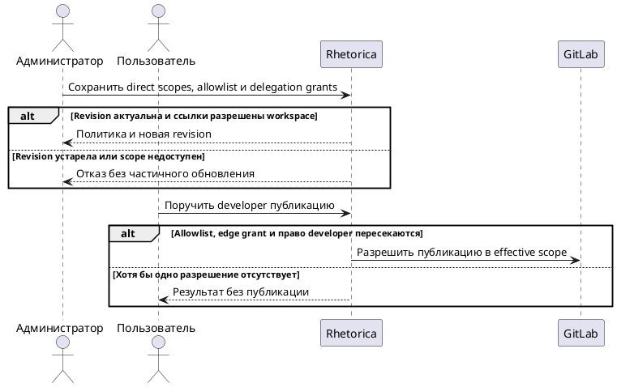

# FR-RH-006: Каталог агентов

## Purpose

Зафиксировать наблюдаемое функциональное поведение соответствующей capability Rhetorica.

## Requirements

### Requirement: FR-RH-006 — Выбор управляемого агента

Система SHALL показывать пользователю опубликованных агентов и ограничивать обнаружение, загрузку схем и выполнение runtime только разрешёнными выбранному агенту коннекторами, tools и workspace skills.

**Use Cases:** UC-RH-1, UC-RH-7

#### Scenario: Пользователь выбирает специализированного агента

- **WHEN** аналитик открывает опубликованного агента и начинает разговор
- **THEN** система применяет профиль агента и не расширяет discovery, загруженную tool surface или выполнение за пределы административной политики

#### Scenario: Запрещённый MCP-инстанс недоступен модели

- **WHEN** активный MCP-коннектор workspace не входит в разрешённый список выбранного агента
- **THEN** система не показывает его в контексте, не возвращает его каталог и не загружает его tool schemas

### Requirement: FR-RH-006.1 — Пользовательские реакции на агента

Система SHALL позволять пользователю добавить агента в избранное и поставить или снять отметку полезности.

**Use Cases:** UC-RH-1

#### Scenario: Агент добавлен в избранное

- **WHEN** пользователь отмечает доступного агента как избранного
- **THEN** система сохраняет реакцию для этого пользователя и отражает её в каталоге

### Requirement: FR-RH-006.2 — Раздельные GitLab write-права

Система SHALL позволять системному администратору отдельно настраивать собственные GitLab write-scopes профиля агента и workspace default assistant для операции публикации Draft MR.

**Use Cases:** UC-RH-7

#### Scenario: Администратор ограничивает direct publication

- **WHEN** системный администратор разрешает developer публикацию через доступный connector только в проект `analytics/dbt`, target branch `main` и пути `models/`
- **THEN** сохранённый direct scope разрешает эту комбинацию и не разрешает другой проект, target branch или путь

#### Scenario: GitLab read allowlist не создаёт write scope

- **WHEN** профиль имеет доступный GitLab connector для чтения, но его direct write-scopes пусты
- **THEN** система сохраняет read-доступ и отклоняет direct publication через этот connector

### Requirement: FR-RH-006.3 — Закрытые начальные полномочия

Система SHALL инициализировать новые и мигрированные профили и workspace default assistant пустыми direct write-scopes, allowlist субагентов и delegation grants.

**Use Cases:** UC-RH-7

#### Scenario: Новый профиль не получает опасные права

- **WHEN** системный администратор создаёт профиль без явных coding permissions
- **THEN** профиль не может публиковать, вызывать субагентов или делегировать публикацию

#### Scenario: Миграция сохраняет только прежний read-доступ

- **WHEN** существующий профиль с разрешённым GitLab connector проходит migration
- **THEN** connector остаётся доступным для чтения, а direct write-scopes, allowlist субагентов и delegation grants остаются пустыми

### Requirement: FR-RH-006.4 — Явный allowlist субагентов

Система SHALL разрешать вызов только активного субагента, который доступен тому же workspace и явно указан в allowlist вызывающего профиля.

**Use Cases:** UC-RH-7

#### Scenario: Разрешённый субагент доступен

- **WHEN** default assistant имеет active developer в своём allowlist и оба профиля доступны текущему workspace
- **THEN** система разрешает создать одноуровневую задачу developer

#### Scenario: Недоступный профиль указан в административном запросе

- **WHEN** административный запрос добавляет в allowlist inactive, отсутствующий или недоступный текущему workspace профиль
- **THEN** система отклоняет весь запрос без изменения действующей политики

#### Scenario: Администратор исправляет устаревшую ссылку

- **WHEN** разрешённый субагент был деактивирован или удалён после открытия policy editor
- **THEN** редактор показывает недоступную ссылку и позволяет удалить её вместе со связанным delegation grant до versioned save, а backend сохраняет fail-closed валидацию остальных ссылок

### Requirement: FR-RH-006.5 — Отдельный grant делегированной публикации

Система SHALL разрешать делегированную публикацию только в пересечении delegation grant вызывающего профиля, собственного direct write-scope субагента и immutable scope принятой задачи.

**Use Cases:** UC-RH-7

#### Scenario: Родитель без direct write делегирует публикацию

- **WHEN** direct write default assistant пуст, developer разрешён в allowlist, edge grant и direct scope developer совпадают с `analytics/dbt/main/models/`, а immutable scope задачи не шире
- **THEN** developer получает effective permission публикации только в `analytics/dbt/main/models/`, а default assistant не получает собственного direct write

#### Scenario: Пересечение scope сужает разрешение

- **WHEN** edge grant разрешает `models/` и `tests/`, direct scope developer разрешает только `models/`, а run scope разрешает `models/marts/`
- **THEN** effective delegated scope разрешает только `models/marts/`

### Requirement: FR-RH-006.6 — Allowlist не повышает полномочия

Система SHALL отклонять write субагента при отсутствии отдельного delegation grant или собственного direct write-scope субагента.

**Use Cases:** UC-RH-7

#### Scenario: Allowlist существует без edge grant

- **WHEN** developer включён в allowlist default assistant и имеет direct write, но edge grant отсутствует
- **THEN** developer может выполнить разрешённую read-only часть задачи, а публикация получает `publication_not_authorized` без GitLab mutation

#### Scenario: Edge grant существует без права исполнителя

- **WHEN** default assistant имеет edge grant на developer, но direct write-scope developer пуст
- **THEN** публикация получает `publication_not_authorized` без GitLab mutation

### Requirement: FR-RH-006.7 — Одноуровневое делегирование

Система SHALL отклонять создание новой delegation edge из уже делегированной задачи.

**Use Cases:** UC-RH-7

#### Scenario: Субагент пытается делегировать дальше

- **WHEN** developer, вызванный default assistant, пытается создать задачу другого субагента
- **THEN** система отклоняет вызов без создания новой задачи и без расширения полномочий developer

### Requirement: FR-RH-006.8 — Административная и ресурсная валидация политики

Система SHALL принимать изменение опасной политики только от системного администратора и только для активных connector, project, target, path и agent references, доступных целевому workspace.

**Use Cases:** UC-RH-7

#### Scenario: Системный администратор сохраняет валидную политику

- **WHEN** системный администратор передаёт актуальную revision и references, доступные целевому workspace
- **THEN** система атомарно сохраняет целую политику и возвращает её новую revision

#### Scenario: Owner без системной роли вызывает admin API

- **WHEN** owner workspace без системной роли admin отправляет write scope или delegation grant напрямую в API
- **THEN** система отклоняет запрос и сохраняет действующую политику без изменений

#### Scenario: Connector предоставлен другому workspace после открытия формы

- **WHEN** администратор открывает редактор, после чего resource grant connector отзывается до сохранения
- **THEN** backend отклоняет ссылку как недоступную и не сохраняет остальные поля запроса частично

### Requirement: FR-RH-006.9 — Атомарный аудит изменений полномочий

Система SHALL сохранять policy update и несекретный audit event в одной транзакции для каждого принятого изменения direct write, allowlist, delegation grant или runtime limits.

**Use Cases:** UC-RH-7

#### Scenario: Отзыв delegation grant сохранён

- **WHEN** системный администратор удаляет grant `default assistant → developer` с актуальной revision
- **THEN** новая policy revision и audit event с actor, workspace, target, временем и scope diff становятся видимы вместе без connector token

#### Scenario: Аудит не сохраняется

- **WHEN** запись audit event завершается ошибкой до commit транзакции
- **THEN** policy update также не становится видимым и прежняя revision остаётся действующей

### Requirement: FR-RH-006.10 — Защита от потерянного административного обновления

Система SHALL применять policy update только при совпадении переданной revision с текущей revision целевой политики и увеличивать revision ровно один раз при успешном сохранении.

**Use Cases:** UC-RH-7

#### Scenario: Два администратора сохраняют одну revision

- **WHEN** два административных запроса одновременно изменяют policy revision 4
- **THEN** ровно один запрос создаёт revision 5, второй получает conflict с текущей revision и не перезаписывает первое изменение

#### Scenario: Повтор запроса со старой revision

- **WHEN** клиент повторяет update с revision 4 после успешного создания revision 5
- **THEN** система возвращает conflict и действующая revision 5 остаётся без изменений

### Requirement: FR-RH-006.11 — Монотонная граница полномочий принятой задачи

Система SHALL вычислять разрешение внешней операции как пересечение immutable policy snapshot принятой задачи с текущей live-политикой и текущей доступностью ресурсов.

**Use Cases:** UC-RH-7

#### Scenario: Grant отозван во время задачи

- **WHEN** после admission задачи администратор отзывает delegation grant до внешней операции
- **THEN** следующая операция отклоняется без внешнего side effect

#### Scenario: Grant расширен во время задачи

- **WHEN** после admission задачи администратор добавляет более широкий scope до внешней операции
- **THEN** задача сохраняет прежнюю более узкую верхнюю границу и не получает новый scope

#### Scenario: Модель подменяет identity

- **WHEN** модель передаёт другой workspace, parent agent, executing agent или entry source в аргументах инструмента
- **THEN** evaluator использует server-owned execution principal и не расширяет разрешение по переданным значениям
