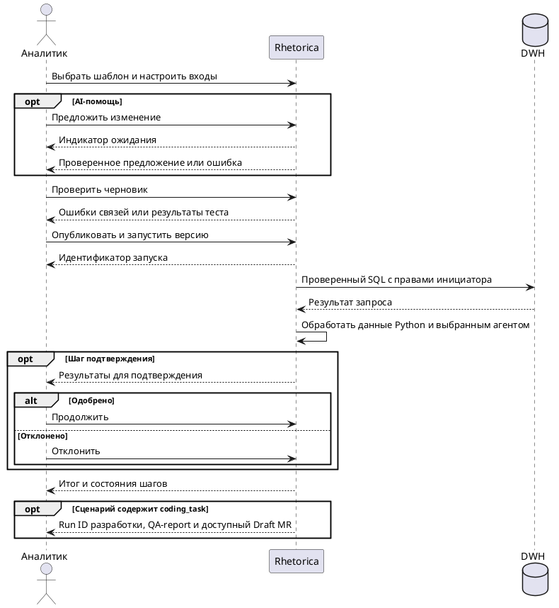

# FR-RH-008: Сохранённые сценарии

## Purpose

Определить наблюдаемое поведение редактора и исполнения версионированных аналитических сценариев.
## Requirements
### Requirement: FR-RH-008 — Каталог и запуск сценариев

Система SHALL запускать доступную опубликованную версию аналитического сценария с переданными параметрами и возвращать идентификатор отслеживаемого выполнения.

**Use Cases:** UC-RH-5

#### Scenario: Запуск опубликованной версии

- **WHEN** аналитик запускает сценарий «Отчёт по продажам» с параметром месяца
- **THEN** система возвращает идентификатор запуска с зафиксированной версией и параметрами, доступный для просмотра после закрытия браузера

### Requirement: FR-RH-008.1 — Визуальный редактор

Система SHALL предоставлять во фронтенде редактор графа сценария с узлами параметров, SQL, Python, LLM-агента, условия, параллельных веток, объединения, подтверждения и результата.

**Use Cases:** UC-RH-5

#### Scenario: Сборка аналитической цепочки

- **WHEN** автор связывает узлы параметров, SQL, Python, LLM и результата
- **THEN** редактор сохраняет граф, настройки каждого узла и расположение узлов в черновике

### Requirement: FR-RH-008.2 — Проверка связей данных

Система SHALL отклонять публикацию графа с циклом, недостижимым узлом, несовместимым типом входа или обязательной ссылкой на результат, который может быть пропущен.

**Use Cases:** UC-RH-5

#### Scenario: Совместимые входы

- **WHEN** автор передаёт табличный результат SQL в табличный вход Python через предшествующий узел
- **THEN** проверка принимает связь

#### Scenario: Ссылка на невыбранную ветвь

- **WHEN** обязательный вход итогового узла ссылается на результат только одной ветви условия без объединения
- **THEN** проверка указывает узел и ошибку потенциально отсутствующего результата

### Requirement: FR-RH-008.3 — Неизменяемые версии

Система SHALL создавать при публикации неизменяемую версию сценария независимо от последующих изменений черновика.

**Use Cases:** UC-RH-5

#### Scenario: Редактирование после запуска

- **WHEN** автор меняет SQL в черновике после запуска опубликованной версии 2
- **THEN** текущий запуск сохраняет SQL версии 2, а новый SQL доступен только в черновике до следующей публикации

### Requirement: FR-RH-008.4 — Владение сценариями

Система SHALL разрешать редактирование общего сценария администратору workspace, а личного сценария только владельцу.

**Use Cases:** UC-RH-5

#### Scenario: Публикация общего сценария

- **WHEN** администратор публикует общий сценарий
- **THEN** сценарий становится доступен пользователям workspace для запуска

#### Scenario: Чужой личный сценарий

- **WHEN** другой пользователь запрашивает черновик личного сценария
- **THEN** система не раскрывает определение сценария

### Requirement: FR-RH-008.5 — Аналитическое исполнение

Система SHALL исполнять каждый шаг с актуальными разрешениями инициатора в пределах разрешённых аналитических операций сценария и выбранного агента.

**Use Cases:** UC-RH-5

#### Scenario: SQL через разрешённый коннектор

- **WHEN** инициатор запускает SQL-шаг через доступный коннектор
- **THEN** запрос проходит действующую SQL-проверку и возвращает идентификатор исполнения с результатом в установленных лимитах

#### Scenario: Отзыв доступа

- **WHEN** доступ инициатора к агенту или коннектору отозван до выполнения следующего шага
- **THEN** шаг завершается явной ошибкой доступа без вызова запрещённого ресурса

### Requirement: FR-RH-008.6 — Изолированные контексты агентов

Система SHALL передавать LLM-шагу инструкции выбранного агента и явно связанные входы в отдельном контексте этого шага.

**Use Cases:** UC-RH-5

#### Scenario: Два разных агента

- **WHEN** первый LLM-шаг возвращает JSON, связанный со входом второго LLM-шага с другим агентом
- **THEN** второй агент получает связанный JSON без неявного наследования истории и инструментов первого шага

### Requirement: FR-RH-008.7 — Сохранённые промежуточные данные

Система SHALL передавать между шагами сохранённые результаты в пределах действующих лимитов с сохранением доступа к данным во время активного запуска.

**Use Cases:** UC-RH-5

#### Scenario: SQL в Python

- **WHEN** SQL возвращает больше строк, чем показывается в превью, и Python использует этот результат
- **THEN** Python получает сохранённый результат запроса, а не только строки превью

### Requirement: FR-RH-008.8 — Возобновление исполнения

Система SHALL продолжать принятый запуск после перезапуска исполнителя с учётом уже сохранённых состояний операций и результатов завершённых шагов.

**Use Cases:** UC-RH-5

#### Scenario: Сбой после сохранения результата

- **WHEN** исполнитель перезапускается после сохранения результата SQL-шагa до начала Python-шагa
- **THEN** выполнение продолжается с сохранённым результатом SQL без повторного выполнения завершённого шага

### Requirement: FR-RH-008.9 — Подтверждение инициатором

Система SHALL продолжать зависимые от подтверждения шаги только после одобрения инициатором показанных результатов.

**Use Cases:** UC-RH-5

#### Scenario: Одобрение после повторного открытия

- **WHEN** инициатор снова открывает ожидающий запуск и одобряет шаг
- **THEN** зависимые шаги продолжаются с теми результатами, которые были показаны для подтверждения

#### Scenario: Отклонение

- **WHEN** инициатор отклоняет подтверждение
- **THEN** запуск прекращается с причиной отклонения

### Requirement: FR-RH-008.10 — Наблюдаемость и отмена

Система SHALL предоставлять инициатору состояния шагов, входы, результаты, диагностические сведения и действие отмены запуска.

**Use Cases:** UC-RH-5

#### Scenario: Просмотр и отмена

- **WHEN** инициатор открывает выполняющийся запуск и нажимает отмену
- **THEN** система показывает запрос отмены, прекращает активные операции и показывает их окончательные состояния

### Requirement: FR-RH-008.11 — Тестирование черновика

Система SHALL позволять автору запускать черновик целиком или выбранный шаг на явно заданных тестовых входах без публикации.

**Use Cases:** UC-RH-5

#### Scenario: Проверка Python-шагa

- **WHEN** автор задаёт входной JSON для Python-шагa и запускает тест
- **THEN** редактор показывает результат, вывод процесса и соответствие ожидаемой выходной схеме

### Requirement: FR-RH-008.12 — AI-предложения

Система SHALL предоставлять автору проверенное предложение создания или изменения графа по описанию для просмотра перед применением к черновику.

**Use Cases:** UC-RH-5

#### Scenario: Предложение аналитического сценария

- **WHEN** автор просит добавить Python-расчёт после SQL и выбирает агента с поддержкой структурированного ответа
- **THEN** редактор показывает предложенные изменения графа и кода, которые сохраняются только после действия автора и не запускаются автоматически

### Requirement: FR-RH-008.13 — Идемпотентный запуск

Система SHALL возвращать существующий запуск при повторе одинакового запроса с тем же ключом идемпотентности от того же пользователя.

**Use Cases:** UC-RH-5

#### Scenario: Повтор после разрыва соединения

- **WHEN** клиент повторяет принятый запрос запуска после потери HTTP-ответа
- **THEN** API возвращает тот же идентификатор запуска без создания второго исполнения

### Requirement: FR-RH-008.14 — Совместимость prompt-сценариев

Система SHALL сохранять исполнение прежних prompt-сценариев и представлять их для редактирования одношаговым графом.

**Use Cases:** UC-RH-5

#### Scenario: Открытие прежнего сценария

- **WHEN** автор открывает сохранённый prompt-сценарий в новом редакторе
- **THEN** редактор показывает LLM-шаг с прежним шаблоном и параметрами, а прежняя версия остаётся доступной до публикации изменений

### Requirement: FR-RH-008.15 — Граница файлового канала

Система SHALL сохранять работу пользователя с файлами сценария в web-интерфейсе с проверкой владения файлами на backend.

**Use Cases:** UC-RH-5

#### Scenario: Файл во фронтенде

- **WHEN** инициатор связывает собственный загруженный файл со входом сценария во фронтенде
- **THEN** Python-шаг получает разрешённый файл, а результат можно открыть во фронтенде

#### Scenario: Файл из Mattermost

- **WHEN** Mattermost-запрос пытается использовать файловую операцию сценария
- **THEN** backend отклоняет операцию файлового канала

### Requirement: FR-RH-008.16 — Готовые цепочки

Система SHALL создавать черновик выбранного шаблона с соединёнными шагами и типизированными ссылками на их данные.

**Use Cases:** UC-RH-5

#### Scenario: Обработка SQL-файла

- **WHEN** автор выбирает шаблон SQL → Python → LLM и доступные коннектор и агента
- **THEN** черновик содержит последовательную цепочку, Python читает полный файловый выход SQL, итог содержит ответ агента и обработанные файлы

### Requirement: FR-RH-008.17 — Настройка входов через формы

Система SHALL предоставлять выбор параметра или результата предшествующего шага для входа с определением типа выбранного значения.

**Use Cases:** UC-RH-5

#### Scenario: Выбор файла

- **WHEN** автор выбирает файловый выход предшествующего SQL в настройках входа Python
- **THEN** редактор создаёт файловую ссылку с именем входа, доступным для изменения, без ручного JSON

#### Scenario: Постоянное значение

- **WHEN** автор выбирает числовую константу для входа limit
- **THEN** редактор принимает число в числовом поле и сохраняет числовой тип значения

### Requirement: FR-RH-008.18 — Состояние AI-предложения

Система SHALL показывать состояние ожидания AI-предложения до получения проверяемого предложения или понятной ошибки с возможностью повторить запрос.

**Use Cases:** UC-RH-5

#### Scenario: Получение предложения

- **WHEN** автор отправляет запрос добавить Python-обработку
- **THEN** редактор показывает индикатор работы и время ожидания, затем предлагает сравнить изменения перед применением

#### Scenario: Неполный ответ модели

- **WHEN** модель возвращает незавершённый JSON вместо определения графа
- **THEN** редактор сообщает о неполном ответе модели, сохраняет запрос и черновик и позволяет повторить генерацию

### Requirement: FR-RH-008.19 — Разработка в сценарии

Система SHALL предоставлять узел coding_task для запуска разработки через общие правила coding runs.

**Use Cases:** UC-RH-5

#### Scenario: Разработка в сценарии

- **WHEN** analyst запускает опубликованный dbt-сценарий с доступными коннекторами и специалистами
- **THEN** узел возвращает coding run ID, итоговый QA-report и URL созданного Draft MR

### Requirement: FR-RH-008.20 — Сценарий не выдаёт права

Система SHALL отклонять операции coding_task вне прав выбранных агентов и цепочки делегирования.

**Use Cases:** UC-RH-5

#### Scenario: Сценарий не выдаёт права

- **WHEN** пользователь добавляет write-агента в узел без разрешения на его вызов
- **THEN** run сообщает об отсутствии разрешения до выделения coding sandbox

### Requirement: FR-RH-008.21 — Готовый шаблон dbt-разработки

Система SHALL предоставлять шаблон dbt-сценария с явной настройкой существующих ресурсов и специалистов.

**Use Cases:** UC-RH-5

#### Scenario: Шаблон ещё не настроен

- **WHEN** analyst открывает шаблон, для которого не выбран коннектор или не выданы delegation grants
- **THEN** UI показывает отсутствующие настройки; шаблон не выдаёт разрешения автоматически

#### Scenario: Настроенный шаблон

- **WHEN** администратор настроил profiles и grants, analyst выбрал доступные коннекторы и опубликовал сценарий
- **THEN** сценарий выполняет developer → QA → Draft MR через тот же coding use case, что и веб-чат
