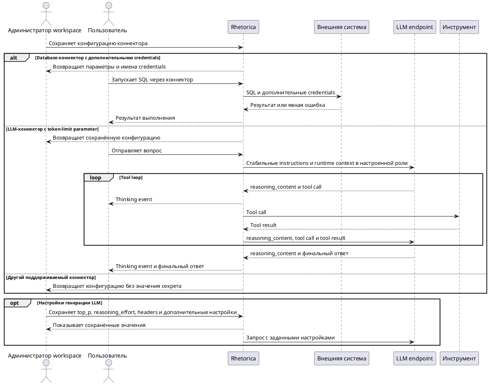

# FR-RH-009: Администрирование коннекторов

## Purpose

Зафиксировать наблюдаемое функциональное поведение соответствующей capability Rhetorica.

## Requirements

### Requirement: FR-RH-009 — Управление конфигурацией источников

Система SHALL позволять администратору workspace создавать, изменять, удалять, синхронизировать и проверять поддерживаемые коннекторы через административный API и UI.

**Use Cases:** UC-RH-6

#### Scenario: Администратор подключает новый источник

- **WHEN** администратор сохраняет валидную конфигурацию и секрет для коннектора
- **THEN** система сохраняет несекретные поля, ссылку на секрет и возвращает состояние готовности без значения секрета

### Requirement: FR-RH-009.1 — Секрет не раскрывается

Система SHALL исключать сохранённые пароли, токены и ключи из ответов list/get/update коннектора.

**Use Cases:** UC-RH-6

#### Scenario: Конфигурация прочитана через API

- **WHEN** авторизованный администратор запрашивает существующий коннектор
- **THEN** система возвращает индикатор наличия секрета, но не его значение

### Requirement: FR-RH-009.2 — Управление режимом рассуждений LLM

Система SHALL передавать явно заданный администратором режим рассуждений chat template в каждый Chat Completions запрос выбранного LLM-коннектора.

**Use Cases:** UC-RH-6

#### Scenario: Включение рассуждений для LLM-коннектора

- **WHEN** Chat Completions запрос использует LLM-коннектор с настройкой `chat_template_enable_thinking=true`
- **THEN** система передаёт внешней LLM-модели `chat_template_kwargs.enable_thinking=true`

#### Scenario: Отключение рассуждений для LLM-коннектора

- **WHEN** Chat Completions запрос использует LLM-коннектор с настройкой `chat_template_enable_thinking=false`
- **THEN** система передаёт внешней LLM-модели `chat_template_kwargs.enable_thinking=false`

### Requirement: FR-RH-009.2.1 — Непрерывность рассуждения в tool loop

Система SHALL передавать фактически возвращённый `reasoning_content` вместе с соответствующим assistant tool call в последующие LLM-вызовы текущего хода.

**Use Cases:** UC-RH-1, UC-RH-3

#### Scenario: Thinking-enabled модель вызывает инструмент

- **WHEN** LLM возвращает непустой `reasoning_content` вместе с tool call
- **THEN** следующий LLM-запрос текущего хода содержит неизменённый `reasoning_content`, исходный tool call и его фактический результат

### Requirement: FR-RH-009.2.2 — Отдельное отображение рассуждения

Система SHALL публиковать фактически возвращённый непустой `reasoning_content` отдельным thinking-событием без смешивания с пользовательским ответом.

**Use Cases:** UC-RH-1, UC-RH-3

#### Scenario: LLM возвращает отдельное рассуждение

- **WHEN** Chat Completions ответ содержит непустой `reasoning_content`
- **THEN** streaming-клиент получает его в thinking-событии, а видимый текст ответа формируется только из `content`

### Requirement: FR-RH-009.3 — Явный default LLM-коннектор

Система SHALL использовать для стандартного ассистента активный LLM-коннектор с явным признаком `is_default`.

**Use Cases:** UC-RH-6

#### Scenario: Стандартный ассистент использует default LLM-коннектор

- **WHEN** пользователь отправляет вопрос стандартному ассистенту без выбранного агента и в workspace настроен активный default LLM-коннектор
- **THEN** система отправляет LLM-запрос через этот коннектор независимо от времени изменения остальных коннекторов

#### Scenario: Default LLM-коннектор отсутствует

- **WHEN** пользователь отправляет вопрос стандартному ассистенту без выбранного агента и в workspace нет активного default LLM-коннектора
- **THEN** система возвращает явную ошибку отсутствующего LLM-коннектора и не выбирает коннектор по времени изменения

### Requirement: FR-RH-009.3.1 — Единственный default в workspace

Система SHALL хранить не более одного default LLM-коннектора в каждом workspace.

**Use Cases:** UC-RH-6

#### Scenario: Администратор назначает новый default

- **WHEN** администратор сохраняет активный LLM-коннектор с `is_default=true`
- **THEN** система атомарно назначает его default и снимает признак default с прежнего LLM-коннектора того же workspace

### Requirement: FR-RH-009.3.2 — Default доступен только активному коннектору

Система SHALL отклонять назначение неактивного LLM-коннектора как default.

**Use Cases:** UC-RH-6

#### Scenario: Неактивный коннектор назначается default

- **WHEN** администратор сохраняет LLM-коннектор с `is_active=false` и `is_default=true`
- **THEN** система отклоняет запрос и сохраняет текущий default без изменений

### Requirement: FR-RH-009.4 — Выбор поля лимита генерации LLM

Система SHALL передавать настроенный лимит генерации Chat Completions через единственное выбранное администратором поле `max_tokens` или `max_completion_tokens`.

**Use Cases:** UC-RH-6

#### Scenario: Провайдер использует max_completion_tokens

- **WHEN** администратор сохраняет LLM-коннектор с `max_tokens_parameter=max_completion_tokens` и `max_tokens=12000`
- **THEN** каждый Chat Completions запрос этого коннектора содержит `max_completion_tokens=12000` и не содержит `max_tokens`

#### Scenario: Провайдер использует max_tokens

- **WHEN** администратор сохраняет LLM-коннектор с `max_tokens_parameter=max_tokens` и положительным значением `max_tokens`
- **THEN** каждый Chat Completions запрос этого коннектора содержит настроенное значение в поле `max_tokens` и не содержит `max_completion_tokens`

### Requirement: FR-RH-009.4.1 — Совместимость существующих LLM-коннекторов

Система SHALL интерпретировать отсутствие `max_tokens_parameter` как выбор `max_tokens`.

**Use Cases:** UC-RH-6

#### Scenario: Чтение существующего коннектора

- **WHEN** сохранённая конфигурация LLM-коннектора не содержит `max_tokens_parameter`
- **THEN** административный API возвращает `max_tokens_parameter=max_tokens`, а Chat Completions запрос использует поле `max_tokens`

### Requirement: FR-RH-009.5 — Дополнительные параметры database-коннектора

Система SHALL обеспечивать сохранение и повторное редактирование поддерживаемых backend произвольных дополнительных параметров database-коннектора через административный API и UI.

**Use Cases:** UC-RH-6

#### Scenario: Администратор изменяет коннектор с произвольным параметром

- **WHEN** администратор сохраняет database-коннектор с дополнительным параметром `client_tag="data-governance"` и затем повторно открывает его форму
- **THEN** API и UI возвращают параметр с тем же именем, типом и значением, а повторное сохранение не удаляет его

### Requirement: FR-RH-009.5.1 — Защита дополнительных credentials

Система SHALL хранить значения дополнительных credentials database-коннектора в secret store и исключать эти значения из ответов административного API.

**Use Cases:** UC-RH-6

#### Scenario: Администратор читает Trino-коннектор с сохранёнными credentials

- **WHEN** Trino-коннектор содержит дополнительные credentials `td_user` и `td_password`
- **THEN** административный API возвращает их имена и индикаторы наличия без значений, а UI позволяет сохранить существующие секреты без повторного ввода

### Requirement: FR-RH-009.5.2 — Передача дополнительных Trino credentials

Система SHALL передавать сохранённые дополнительные credentials выбранного Trino-коннектора внешнему каталогу при каждом SQL-выполнении через этот коннектор.

**Use Cases:** UC-RH-1, UC-RH-6

#### Scenario: Trino обращается к каталогу с credential passthrough

- **WHEN** пользователь запускает read-only SQL через Trino-коннектор с сохранёнными `td_user` и `td_password`
- **THEN** внешний каталог получает оба credential и возвращает результат без перехода на SSO-аутентификацию текущего пользователя

### Requirement: FR-RH-009.6 — Настройка top_p LLM-коннектора

Система SHALL применять явно заданный администратором top_p выбранного LLM-коннектора при отправке запросов генерации.

**Use Cases:** UC-RH-6

#### Scenario: Явный параметр sampling

- **WHEN** администратор сохраняет top_p=0.95 и пользователь запускает генерацию через этот коннектор
- **THEN** запрос внешней LLM содержит top_p=0.95

#### Scenario: Дефолт провайдера

- **WHEN** администратор оставляет top_p пустым или очищает сохранённое значение
- **THEN** API возвращает top_p=null и последующие запросы генерации не содержат top_p

#### Scenario: Неверный диапазон

- **WHEN** администратор передаёт top_p=1.1
- **THEN** API отклоняет настройку и сохраняет прежнюю конфигурацию

### Requirement: FR-RH-009.6.1 — Полнота формы LLM-коннектора

Система SHALL обеспечивать просмотр и повторное редактирование всех поддерживаемых несекретных настроек LLM-коннектора через административную форму без потери значений и типов.

**Use Cases:** UC-RH-6

#### Scenario: Повторное сохранение настроенного через API коннектора

- **WHEN** администратор открывает коннектор с temperature=null, max_tokens=null, top_p=0.95, заголовком X-Client=analytics и дополнительными настройками chat_template_enable_thinking=false и llm_retry_attempts=2
- **THEN** форма показывает эти значения, и сохранение формы сохраняет каждое значение и его тип

#### Scenario: Удаление дополнительной опции

- **WHEN** администратор удаляет ключ llm_retry_attempts из дополнительных настроек и сохраняет форму
- **THEN** повторное открытие формы и чтение API не содержат этот ключ

### Requirement: FR-RH-009.6.2 — Явное отклонение неподдерживаемых фазовых overrides

Система SHALL отклонять непустое значение устаревшего поля phase_capable вместо молчаливого игнорирования настроек фаз.

**Use Cases:** UC-RH-6

#### Scenario: Обычная конфигурация без overrides

- **WHEN** администратор сохраняет валидный LLM-коннектор без фазовых overrides
- **THEN** API сохраняет конфигурацию

#### Scenario: Неподдерживаемый override

- **WHEN** администратор передаёт phase_capable={"tool_loop":false}
- **THEN** API возвращает ошибку валидации и сохраняет прежнюю конфигурацию

### Requirement: FR-RH-009.7 — Роль динамического runtime context LLM-коннектора

Система SHALL позволять администратору выбрать роль `developer` или `user` для динамического runtime context LLM-коннектора и передавать этот контекст во внешнюю LLM с выбранной ролью.

**Use Cases:** UC-RH-1, UC-RH-6

#### Scenario: Responses endpoint требует роль user

- **WHEN** LLM-коннектор настроен с `runtime_context_role=user` и пользователь отправляет сообщение
- **THEN** внешний Responses endpoint получает динамический runtime context в последнем элементе `input` с ролью `user`

#### Scenario: Роль явно не настроена

- **WHEN** LLM-коннектор не содержит `runtime_context_role`
- **THEN** Responses endpoint получает runtime context с ролью `developer`, а Chat Completions endpoint — с ролью `user`

#### Scenario: Роль не поддерживается

- **WHEN** администратор сохраняет LLM-коннектор со значением `runtime_context_role`, отличным от `developer` и `user`
- **THEN** административный API отклоняет конфигурацию

### Requirement: FR-RH-009.7.1 — Стабильный префикс LLM-запроса

Система SHALL размещать изменяемый runtime context после истории текущего LLM-вызова без изменения стабильных instructions при выборе поддерживаемой роли.

**Use Cases:** UC-RH-1, UC-RH-6

#### Scenario: Последовательные вызовы содержат разное время

- **WHEN** два последовательных LLM-вызова используют один коннектор и отличаются значениями времени или номера итерации в runtime context
- **THEN** оба запроса содержат одинаковые instructions, а изменяемый runtime context находится после истории каждого запроса

### Requirement: FR-RH-009.8 — Уровень reasoning LLM-коннектора

Система SHALL позволять администратору workspace выбирать и сохранять необязательный `reasoning_effort` LLM-коннектора через административный API и UI независимо от провайдера.

**Use Cases:** UC-RH-6

#### Scenario: Явно выбранный уровень

- **WHEN** администратор сохраняет `reasoning_effort=high` через форму LLM-коннектора и вновь открывает коннектор
- **THEN** административный API и форма показывают `reasoning_effort=high`

#### Scenario: Значение не выбрано

- **WHEN** администратор очищает `reasoning_effort` и сохраняет LLM-коннектор
- **THEN** административный API возвращает `reasoning_effort=null`

### Requirement: FR-RH-009.8.1 — Применение уровня reasoning

Система SHALL передавать явно выбранный `reasoning_effort` в запросы генерации через соответствующий LLM-коннектор.

**Use Cases:** UC-RH-6

#### Scenario: Запрос к выбранному провайдеру

- **WHEN** пользователь запускает генерацию через LLM-коннектор с `reasoning_effort=high`
- **THEN** запрос к выбранному LLM endpoint содержит уровень `high`

#### Scenario: Уровень не выбран

- **WHEN** пользователь запускает генерацию через LLM-коннектор с `reasoning_effort=null`
- **THEN** запрос к LLM endpoint не содержит уровня reasoning

#### Scenario: Провайдер отклоняет уровень

- **WHEN** выбранный LLM endpoint отклоняет сохранённый `reasoning_effort`
- **THEN** вызов завершается явной ошибкой endpoint без подмены выбранного уровня
