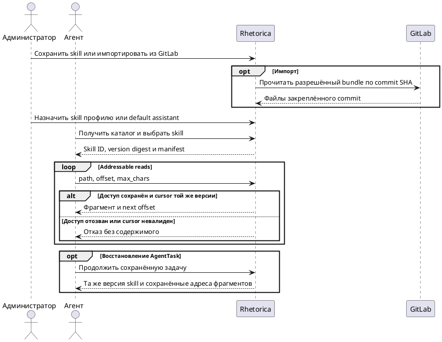

# FR-RH-010: Управление skills и агентами

## Purpose

Зафиксировать наблюдаемое функциональное поведение соответствующей capability Rhetorica.

## Requirements

### Requirement: FR-RH-010 — Workspace skills

Система SHALL позволять системному администратору управлять versioned workspace skills с явными назначениями default assistant и профилям агентов, а агенту SHALL предоставлять каталог доступных skills и bounded-чтение файлов закреплённой версии.

**Use Cases:** UC-RH-7, UC-RH-17

#### Scenario: Skill назначен developer

- **WHEN** системный администратор сохраняет валидный skill и назначает его developer profile
- **THEN** новый ход developer получает этот skill в каталоге и может прочитать только файлы разрешённой версии

#### Scenario: Default assistant выбирает назначенный skill

- **WHEN** системный администратор разрешил default assistant skill `trino-guide` и модель выбирает его из каталога
- **THEN** reader возвращает фрагмент закреплённой версии, а неназначенный skill в каталог не включается

### Requirement: FR-RH-010.1 — Публикация профиля агента

Система SHALL валидировать инструкции и allowlists профиля до публикации пользователям.

**Use Cases:** UC-RH-7

#### Scenario: Профиль с неизвестным коннектором

- **WHEN** администратор пытается опубликовать агента со ссылкой на недоступный коннектор
- **THEN** система отклоняет конфигурацию или явно помечает capability как недоступную

### Requirement: FR-RH-010.2 — Exact turn-scoped skill activation

Система SHALL закреплять неизменяемую версию выбранного skill для адресного чтения в текущем пользовательском ходе, SHALL сохранять binding и адреса прочитанных фрагментов при compaction и SHALL выбирать актуальную версию заново для следующего хода.

Долговечное закрепление skill в `AgentTask` относится к пакету F: `AgentTask` создаётся и сохраняется его runtime, а не обычным ходом чата.

**Use Cases:** UC-RH-7

#### Scenario: Обновление после первого фрагмента

- **WHEN** агент прочитал начало `guide.md`, после чего администратор обновил skill
- **THEN** следующий фрагмент в том же ходе возвращается из первоначально закреплённой версии

#### Scenario: Восстановление после compaction

- **WHEN** полный текст прочитанного фрагмента освобождён при compaction
- **THEN** сохранённые skill ID, version digest, путь и offset позволяют повторно получить тот же фрагмент

#### Scenario: Следующий ход использует актуальный каталог

- **WHEN** пользователь начинает новый ход после обновления skill
- **THEN** предыдущая активация завершена, а новый ход выбирает skill из актуального доступного каталога без переноса полного текста

### Requirement: FR-RH-010.2.1 — Skill binding durable AgentTask

Система SHALL сохранять для AgentTask immutable skill-version binding и адреса прочитанных фрагментов без сохранения полного текста skill, чтобы восстановленная задача повторно читала ту же версию, а новая задача выбирала актуальную версию.

**Use Cases:** UC-RH-17

#### Scenario: Worker восстанавливает developer задачу

- **WHEN** developer task прочитал `rules/trino.md` версии `v1`, затем skill обновили до `v2` и worker перезапустился
- **THEN** восстановленная task читает `rules/trino.md` версии `v1` по сохранённому адресу, а новая task получает каталог с `v2`

#### Scenario: Чтение skill не отменяет завершение task

- **WHEN** developer или QA во время вызова читает новый fragment закреплённой версии и reader сохраняет его адрес в AgentTask
- **THEN** completion checkpoint использует актуальную версию AgentTask, сохраняет новый адрес и не повторяет уже завершённый внешний вызов

### Requirement: FR-RH-010.3 — Чтение skill по частям

Система SHALL возвращать manifest и содержимое файлов разрешённого skill ограниченными страницами и фрагментами с version digest, total size, next offset и признаком truncation.

**Use Cases:** UC-RH-7

#### Scenario: Агент читает большой файл по частям

- **WHEN** агент запрашивает первые 4000 символов `rules/trino.md` из bundle длиной 12000 символов
- **THEN** система возвращает указанный фрагмент, общий размер, version digest, `next_offset=4000` и `truncated=true`

#### Scenario: Агент запрашивает manifest bundle

- **WHEN** агент запрашивает страницу manifest skill с каталогами `rules` и `docs`
- **THEN** система возвращает ограниченную страницу сохранённых путей, типов и размеров той же версии и cursor для следующей страницы

#### Scenario: Агент передаёт небезопасный путь или cursor другой версии

- **WHEN** агент передаёт traversal path, неизвестный путь или cursor, созданный для другого version digest
- **THEN** система отклоняет запрос без чтения локальной файловой системы и без возврата содержимого skill

### Requirement: FR-RH-010.4 — Импорт skill из GitLab

Система SHALL импортировать skill bundle только из существующего доступного GitLab-коннектора с закреплением commit SHA, нормализацией путей и ограничением суммарного размера bundle.

**Use Cases:** UC-RH-7

#### Scenario: Администратор импортирует skill

- **WHEN** системный администратор импортирует `skills/dbt/SKILL.md` из разрешённого проекта через существующий GitLab-коннектор
- **THEN** система сохраняет bundle с commit SHA, digest и исходным путём без исполнения repository assets, добавления tools/grants или изменения network permissions

#### Scenario: Bundle содержит script или symbolic link

- **WHEN** импортируемый bundle содержит script asset или symbolic link
- **THEN** система не исполняет script, отклоняет unsafe path и сохраняет только допустимые нормализованные файлы в пределах лимитов

### Requirement: FR-RH-010.5 — Миграция optimizer skills

Система SHALL сохранять бывшие `sql_optimization_advisor` skills как `chat_instruction`, сохраняя идентификатор, content, bundle, provenance и явные profile assignments, но без новой видимости default assistant.

**Use Cases:** UC-RH-7

#### Scenario: Обновление содержит legacy optimizer skill

- **WHEN** migration обрабатывает existing optimizer skill с несколькими файлами bundle и profile links
- **THEN** сохранённый skill имеет тот же ID, content, bundle, provenance и profile links, capability family `chat_instruction` и `visible_to_default_assistant=false`

### Requirement: FR-RH-010.6 — Повторная проверка доступа к skill

Система SHALL проверять текущий доступ к закреплённому skill перед каждым чтением его manifest или файлов.

**Use Cases:** UC-RH-7

#### Scenario: Назначение отозвано после первого фрагмента

- **WHEN** администратор удаляет назначение skill developer после чтения `SKILL.md`
- **THEN** следующий запрос `rules/trino.md` отклонён без содержимого, даже при сохранённом version digest

### Requirement: FR-RH-010.7 — Представление skill в редакторе

Система SHALL показывать системному администратору обычные назначения skill developer, QA и default assistant, GitLab provenance с commit SHA и manifest файлов без автоматической передачи полного bundle в prompt.

**Use Cases:** UC-RH-7

#### Scenario: Администратор открывает большой imported bundle

- **WHEN** системный администратор открывает skill с большим bundle, импортированный из GitLab
- **THEN** редактор показывает назначения, commit SHA и список файлов, не загружая весь bundle в model-facing prompt
