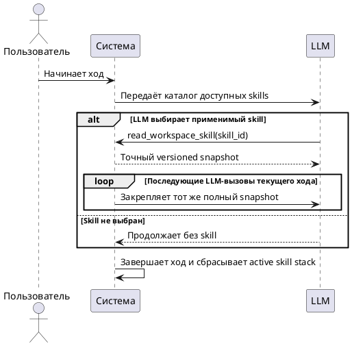

# FR-RH-010: Управление skills и агентами

## Purpose

Зафиксировать наблюдаемое функциональное поведение соответствующей capability Rhetorica.

## Requirements

### Requirement: FR-RH-010 — Workspace skills

Система SHALL позволять администратору создавать и изменять versioned workspace skills с явной видимостью для стандартного ассистента и профилей агентов и SHALL позволять LLM выбирать доступный skill через управляемый runtime snapshot.

**Use Cases:** UC-RH-7

#### Scenario: Skill назначен агенту

- **WHEN** администратор сохраняет валидный skill и включает его в профиль агента
- **THEN** следующий ход этого агента получает версию skill через управляемый runtime snapshot

#### Scenario: Стандартный ассистент выбирает доступный skill

- **WHEN** LLM стандартного ассистента сопоставляет запрос пользователя с каталогом и запрашивает доступный workspace skill
- **THEN** система возвращает точный versioned snapshot и активирует его для текущего хода

### Requirement: FR-RH-010.1 — Публикация профиля агента

Система SHALL валидировать инструкции и allowlists профиля до публикации пользователям.

**Use Cases:** UC-RH-7

#### Scenario: Профиль с неизвестным коннектором

- **WHEN** администратор пытается опубликовать агента со ссылкой на недоступный коннектор
- **THEN** система отклоняет конфигурацию или явно помечает capability как недоступную

### Requirement: FR-RH-010.2 — Exact turn-scoped skill activation

Система SHALL после выбора workspace skill моделью закреплять полный неизменённый snapshot инструкций во всех последующих LLM-вызовах текущего пользовательского хода, SHALL завершать эту активацию вместе с ходом и SHALL сохранять audit activation без копии текста skill в переносимом контексте следующего хода.

**Use Cases:** UC-RH-7

#### Scenario: Tool loop продолжается после выбора skill

- **WHEN** LLM прочитала workspace skill и текущий ход требует дополнительных LLM-вызовов
- **THEN** каждый последующий вызов текущего хода получает идентичный полный snapshot skill без summarization или truncation

#### Scenario: Пользователь начинает следующий ход

- **WHEN** предыдущий ход с активированным workspace skill завершён и пользователь отправляет новое сообщение
- **THEN** система не переносит текст skill в model-facing digest, а LLM заново выбирает применимые skills из актуального каталога

#### Scenario: Читается audit активации

- **WHEN** runtime trace содержит активацию workspace skill
- **THEN** trace сообщает skill identifier, content hash, scope `turn` и инициатора `model` без полного текста инструкций
