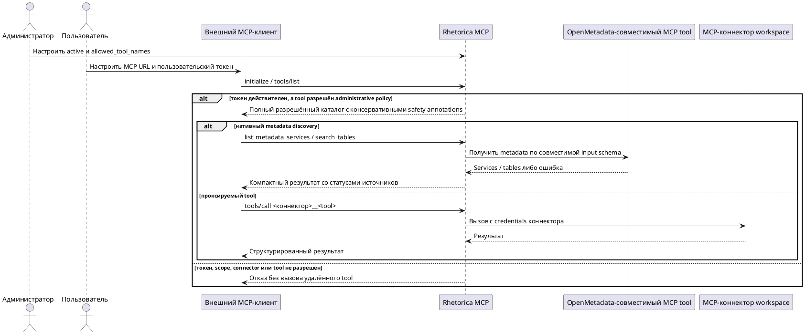

# FR-RH-012 — Внешний доступ через API и MCP

## Purpose

Обеспечить безопасный, управляемый пользователем и совместимый со стандартом внешний доступ к Rhetorica через API и Model Context Protocol.
## Requirements
### Requirement: FR-RH-012 — Внешний доступ через API и MCP

Система SHALL предоставлять аутентифицированному внешнему клиенту доступ к разрешённым данным и операциям API и MCP только в workspace и от имени пользователя выданного токена.

**Use Cases:** UC-RH-10, UC-RH-13

#### Scenario: Внешний клиент обращается к Rhetorica

- **WHEN** внешний клиент отправляет действующий пользовательский токен с необходимым scope
- **THEN** система выполняет разрешённую операцию от имени владельца токена в его workspace и не принимает workspace из model-controlled аргументов

### Requirement: FR-RH-012.1 — Управление персональными токенами

Система SHALL позволять пользователю через UI и API выпускать, просматривать и отзывать собственные Personal Access Tokens с именем и выбранными scopes, показывая секрет только в ответе на выпуск и сохраняя токен в необратимо проверяемом виде.

**Use Cases:** UC-RH-10

#### Scenario: Пользователь выпускает токен

- **WHEN** пользователь задаёт имя, срок и разрешённые scopes и подтверждает выпуск
- **THEN** система один раз показывает новый секрет и добавляет в список только безопасные metadata без секрета

#### Scenario: Пользователь отзывает токен

- **WHEN** пользователь отзывает один из своих действующих токенов
- **THEN** последующий API или MCP-запрос с этим токеном получает отказ в доступе

### Requirement: FR-RH-012.2 — Долгоживущий отзывный доступ

Система SHALL выпускать Personal Access Token на выбранный срок 90, 180 или 365 дней и SHALL при включённом автоматическом продлении сдвигать окончание действия на исходный срок после успешного аутентифицированного использования.

**Use Cases:** UC-RH-10

#### Scenario: Токен выпущен на минимальный срок

- **WHEN** пользователь выбирает минимальный доступный срок Personal Access Token
- **THEN** система устанавливает `expires_at` не ранее чем через 90 дней после выпуска

#### Scenario: Автоматическое продление включено

- **WHEN** действующий токен с автоматическим продлением успешно аутентифицирует запрос
- **THEN** система продлевает `expires_at` до исходного срока от момента использования и отражает новый срок в metadata токена

### Requirement: FR-RH-012.3 — Совместимый Streamable HTTP transport

Система SHALL обслуживать MCP только на endpoint `/mcp` по согласованной версии протокола Streamable HTTP и SHALL корректно обрабатывать lifecycle, tool, resource и prompt запросы поддерживаемых OpenAI, Anthropic и MCP Inspector клиентов.

**Use Cases:** UC-RH-10

#### Scenario: MCP-клиент подключается к серверу

- **WHEN** совместимый MCP-клиент отправляет `initialize`, затем запрашивает доступные capabilities
- **THEN** система согласует поддерживаемую версию протокола и возвращает tools, resources и prompts через стандартные MCP-ответы

#### Scenario: Клиент использует удалённый legacy transport

- **WHEN** клиент обращается к `/mcp/messages`, `/mcp/sse` или MCP WebSocket endpoint
- **THEN** система не публикует transport route и не обрабатывает MCP-запрос

### Requirement: FR-RH-012.4 — Безопасная и понятная MCP tool surface

Система SHALL публиковать для каждого MCP tool точные input и output schemas, понятные title и description, применимые safety annotations и структурированный результат с model-readable сообщением об ошибке.

**Use Cases:** UC-RH-10

#### Scenario: Клиент обнаруживает MCP tools

- **WHEN** клиент запрашивает `tools/list`
- **THEN** система возвращает компактный набор tools с различимыми назначениями, схемами результатов и корректными признаками чтения, изменения, идемпотентности и внешнего взаимодействия

#### Scenario: Выполнение tool завершается доменной ошибкой

- **WHEN** валидный `tools/call` не может выполнить запрошенную операцию из-за входных данных или состояния Rhetorica
- **THEN** система возвращает `isError=true`, безопасный понятный текст и структурированный код ошибки без внутреннего stack trace

### Requirement: FR-RH-012.5 — Минимальные scopes внешнего клиента

Система SHALL ограничивать каждый API и MCP-запрос scopes токена и возвращать отказ без выполнения операции, если необходимый scope отсутствует.

**Use Cases:** UC-RH-10

#### Scenario: Read-only токен вызывает изменяющую операцию

- **WHEN** токен с доступом только на чтение вызывает изменяющий API endpoint или MCP tool
- **THEN** система возвращает `403` и не изменяет состояние

### Requirement: FR-RH-012.6 — Согласованные MCP scopes

Система SHALL включать `mcp:read` в effective scopes каждого PAT и OAuth grant, содержащего `mcp:execute`.

**Use Cases:** UC-RH-10, UC-RH-12

#### Scenario: Пользователь запрашивает execute-only PAT

- **WHEN** пользователь выпускает PAT со scope `mcp:execute` без `mcp:read`
- **THEN** система возвращает PAT metadata с effective scopes `mcp:read` и `mcp:execute`, позволяющими выполнить MCP lifecycle и изменяющий tool

#### Scenario: Клиент запрашивает execute-only OAuth grant

- **WHEN** OAuth authorization request содержит scope `mcp:execute` без `mcp:read`
- **THEN** consent и выданный grant содержат effective scopes `mcp:read` и `mcp:execute`

### Requirement: FR-RH-012.7 — Tools MCP-коннекторов workspace во внешнем MCP

Система SHALL публиковать и выполнять во внешнем MCP только активные tools активных MCP-коннекторов workspace владельца токена, прошедшие административную `allowed_tool_names` policy, используя каталожные exposed имена, синхронизированные input schemas, governed выполнение и credentials коннектора на стороне системы.

**Use Cases:** UC-RH-13

#### Scenario: Клиент обнаруживает разрешённые tools коннекторов workspace

- **WHEN** клиент с действующим токеном запрашивает `tools/list`
- **THEN** система возвращает нативные tools и полный набор tools активных MCP-коннекторов workspace владельца токена, прошедших административную `allowed_tool_names` policy, не включая запрещённые tools и tools других workspace

#### Scenario: Клиент вызывает разрешённый tool коннектора

- **WHEN** клиент со scope `mcp:execute` вызывает активный tool активного коннектора, прошедший административную `allowed_tool_names` policy, с аргументами по синхронизированной input schema
- **THEN** система выполняет tool на удалённом MCP-сервере с credentials коннектора и возвращает структурированный результат с именами коннектора и удалённого tool

#### Scenario: Администратор запретил tool коннектора

- **WHEN** непустой `allowed_tool_names` активного коннектора не содержит имя синхронизированного tool
- **THEN** система не публикует tool в `tools/list`, отклоняет его прямой `tools/call` и не обращается к удалённому MCP-серверу

#### Scenario: Аргументы не соответствуют схеме каталога

- **WHEN** клиент вызывает tool коннектора с аргументами, нарушающими input schema каталога
- **THEN** система возвращает `isError=true` с кодом `mcp_tool_arguments_invalid` и не обращается к удалённому MCP-серверу

#### Scenario: Имя tool совпадает с нативным

- **WHEN** exposed имя разрешённого tool коннектора совпадает с именем нативного tool Rhetorica
- **THEN** система публикует и выполняет нативный tool, а tool коннектора не показывает

### Requirement: FR-RH-012.7.1 — Полный разрешённый каталог внешних MCP tools

Система SHALL возвращать полный набор разрешённых tools MCP-коннекторов workspace без фиксированного локального ограничения количества записей.

**Use Cases:** UC-RH-13

#### Scenario: Разрешённый каталог содержит более 500 tools

- **WHEN** active и административная `allowed_tool_names` policy разрешают 501 tool MCP-коннекторов workspace
- **THEN** ответ `tools/list` содержит все 501 разрешённый tool вместе с нативными tools

### Requirement: FR-RH-012.7.2 — Консервативные safety annotations проксируемых tools

Система SHALL публиковать проксируемый MCP tool с консервативными safety annotations, которые не объявляют tool недеструктивным без доверенной административной классификации его поведения.

**Use Cases:** UC-RH-13

#### Scenario: Каталог не содержит доверенной классификации destructive behavior

- **WHEN** разрешённый проксируемый tool публикуется через `tools/list` без доверенной административной классификации destructive behavior
- **THEN** tool помечается как potentially destructive и внешний MCP-клиент может применить approval UX до вызова

### Requirement: FR-RH-012.8 — Поиск таблиц во внешнем MCP с приоритетом OpenMetadata

Система SHALL предоставлять во внешнем MCP tool `search_tables`, который по запросу на естественном языке и необязательным точным именам OpenMetadata service и database connector возвращает единый ранжированный набор компактных кандидатов из OpenMetadata и runtime-каталогов с раздельной идентичностью источников и диагностикой каждой выполненной ступени.

**Use Cases:** UC-RH-13

#### Scenario: Клиент выбрал OpenMetadata service и database connector

- **WHEN** клиент вызывает `search_tables` с `service_name` и `connector_name`
- **THEN** система ограничивает OpenMetadata точным service, ограничивает runtime точным connector и возвращает у каждого кандидата фактический metadata service либо runtime connector без автоматической связи по типу движка

#### Scenario: OpenMetadata и runtime возвращают одноимённые таблицы из разных источников

- **WHEN** ступени возвращают одинаковые database, schema и table для разных OpenMetadata services либо database connectors
- **THEN** система сохраняет отдельного кандидата для каждого источника и не смешивает их описание, колонки или исполняемый connector

#### Scenario: Витрина найдена в OpenMetadata по сервисам workspace

- **WHEN** OpenMetadata возвращает подходящую таблицу и runtime-поиск завершается
- **THEN** система возвращает кандидатов обоих источников после общего ранжирования, а `tried` содержит обе выполненные ступени с их статусом и количеством найденных

#### Scenario: OpenMetadata не находит, runtime-каталог находит

- **WHEN** все доступные ступени OpenMetadata успешно завершаются без кандидатов, а runtime-каталог возвращает подходящую таблицу
- **THEN** система возвращает runtime-кандидата с точным `connector`, а `tried` отличает успешные нулевые OpenMetadata-ступени от ошибок источника

#### Scenario: Источник поиска недоступен

- **WHEN** OpenMetadata или runtime-каталог возвращает ошибку во время `search_tables`
- **THEN** система продолжает доступные ступени и помечает сбойную ступень статусом `failed` с безопасным описанием ошибки вместо успешного нулевого результата

#### Scenario: Таблица из служебного скоупа

- **WHEN** среди кандидатов есть таблицы из схем `sandbox`, `test`, `tmp`, `dev` и подобных
- **THEN** система помечает их `suspicious = true` и располагает после остальных, не исключая из результата

#### Scenario: Подсказка коннектора во внешнем surface

- **WHEN** администратор задал `usage_description` MCP-коннектора
- **THEN** description каждого tool этого коннектора во внешнем MCP начинается с `[<имя коннектора>] <usage_description>` независимо от количества коннекторов и tools в workspace

### Requirement: FR-RH-012.9 — Обнаружение database services OpenMetadata

Система SHALL предоставлять во внешнем MCP read-only tool `list_metadata_services`, который через активный OpenMetadata-совместимый MCP tool workspace возвращает полный список доступных database services с точными именами, fully qualified names, типами и компактными описаниями.

**Use Cases:** UC-RH-13

#### Scenario: Клиент выбирает metadata service перед поиском таблиц

- **WHEN** клиент вызывает `list_metadata_services`, а OpenMetadata содержит больше одной страницы доступных database services
- **THEN** система читает все страницы, возвращает каждый доступный service один раз и позволяет передать его точное имя в `search_tables.service_name`

#### Scenario: Несколько коннекторов публикуют search_metadata

- **WHEN** активные MCP-коннекторы workspace публикуют одноимённые remote tools `search_metadata` с разными input schemas
- **THEN** система вызывает tool, чья синхронизированная input schema поддерживает параметры OpenMetadata discovery, и не вызывает несовместимый tool

#### Scenario: OpenMetadata service discovery недоступен

- **WHEN** в workspace нет активного OpenMetadata-совместимого search tool либо удалённый вызов завершается ошибкой
- **THEN** система возвращает model-readable ошибку и не выдаёт пустой список за успешно прочитанный каталог
