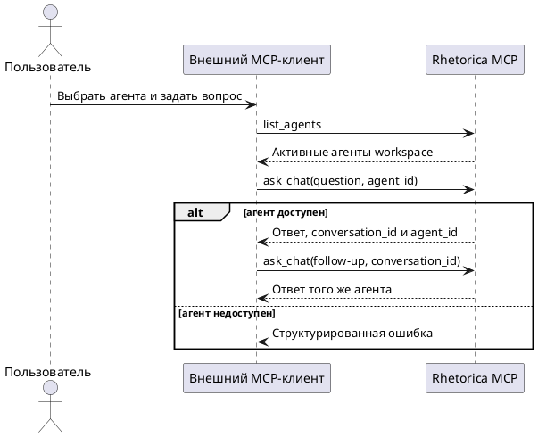

# FR-RH-017 — Политика агента в MCP-чате

## Purpose

Обеспечить внешнему MCP-клиенту управляемый выбор workspace-агента и многоходовый диалог с неизменной политикой выбранного агента.

## Requirements

### Requirement: FR-RH-017 — Политика агента в MCP-чате

Система SHALL выполнять каждый MCP chat turn с prompt, runtime settings и ограничениями ресурсов агента, закреплённого за conversation.

**Use Cases:** UC-RH-11

#### Scenario: Новый диалог с выбранным агентом

- **WHEN** аутентифицированный MCP-клиент вызывает chat tool с идентификатором активного агента своего workspace
- **THEN** система создаёт conversation с этим агентом, применяет его настройки к ответу и возвращает идентификаторы conversation и агента

### Requirement: FR-RH-017.1 — Каталог агентов MCP

Система SHALL предоставлять через read-only MCP tool каталог активных агентов workspace с идентификатором, названием, описанием и безопасными признаками доступных возможностей без раскрытия admin prompt и секретов коннекторов.

**Use Cases:** UC-RH-11

#### Scenario: Клиент обнаруживает агентов

- **WHEN** аутентифицированный MCP-клиент запрашивает каталог агентов
- **THEN** система возвращает только активных агентов workspace владельца токена и model-readable metadata для осознанного выбора

### Requirement: FR-RH-017.2 — Закрепление агента за conversation

Система SHALL закреплять выбранного агента за новой MCP conversation и SHALL восстанавливать этого агента для последующих turn по `conversation_id`, когда клиент не повторяет `agent_id`.

**Use Cases:** UC-RH-11

#### Scenario: Клиент продолжает диалог

- **WHEN** MCP-клиент отправляет follow-up с `conversation_id` созданного agent-aware диалога без `agent_id`
- **THEN** система выполняет turn с агентом, закреплённым за conversation, и возвращает его `agent_id`

#### Scenario: Клиент пытается сменить агента

- **WHEN** MCP-клиент передаёт для существующей conversation `agent_id`, отличный от закреплённого
- **THEN** система отклоняет вызов со структурированным кодом `conversation_agent_locked` и не добавляет сообщения

### Requirement: FR-RH-017.3 — Изоляция agent-aware MCP-чата

Система SHALL отклонять выбор отсутствующего или неактивного агента и доступ к conversation другого пользователя либо workspace до запуска chat turn.

**Use Cases:** UC-RH-11

#### Scenario: Агент недоступен владельцу токена

- **WHEN** MCP-клиент передаёт `agent_id`, который отсутствует, неактивен или принадлежит другому workspace
- **THEN** система возвращает структурированный код `agent_not_found` без раскрытия metadata агента

#### Scenario: Conversation недоступна владельцу токена

- **WHEN** MCP-клиент передаёт `conversation_id`, не принадлежащий владельцу токена в его workspace
- **THEN** система возвращает структурированный код `conversation_not_found` и не запускает chat turn
