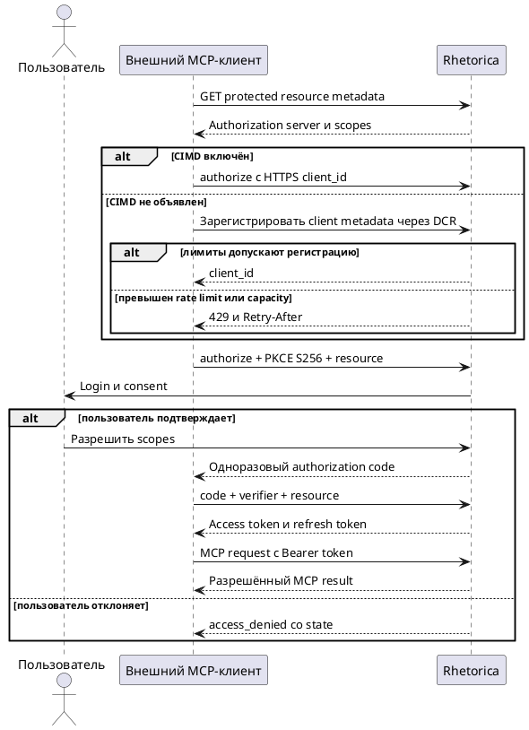

# FR-RH-018 — OAuth onboarding внешнего MCP-клиента

## Purpose

Обеспечить стандартное браузерное подключение внешнего MCP-клиента к Rhetorica без ручной передачи долгоживущего пользовательского секрета.

## Requirements

### Requirement: FR-RH-018 — OAuth onboarding внешнего MCP-клиента

Система SHALL позволять совместимому внешнему MCP-клиенту получить ограниченный доступ к `/mcp` от имени вошедшего пользователя после его явного браузерного согласия.

**Use Cases:** UC-RH-12

#### Scenario: Пользователь подключает MCP-клиент

- **WHEN** внешний клиент обнаруживает OAuth endpoints, запускает Authorization Code flow и пользователь подтверждает запрошенные MCP scopes
- **THEN** клиент получает доступ к `/mcp` от имени пользователя без ручной передачи PAT

### Requirement: FR-RH-018.1 — Обнаружение OAuth endpoints

Система SHALL публиковать для MCP resource проверяемые Protected Resource Metadata и Authorization Server Metadata с адресами authorization, token и revocation endpoints, поддерживаемыми scopes, PKCE S256 и признаком Client ID Metadata Documents только при включённой CIMD capability.

**Use Cases:** UC-RH-12

#### Scenario: Клиент начинает onboarding только с MCP URL

- **WHEN** клиент получает `401` от `/mcp` или запрашивает well-known metadata для MCP resource
- **THEN** он получает `resource_metadata` и metadata, достаточные для запуска включённого OAuth flow через CIMD либо DCR

### Requirement: FR-RH-018.2 — Проверенная identity внешнего клиента

Система SHALL принимать HTTPS Client ID Metadata Document как основной способ identity клиента при объявленной поддержке CIMD и SHALL предоставлять Dynamic Client Registration как fallback с точной регистрацией redirect URIs.

**Use Cases:** UC-RH-12

#### Scenario: Клиент предоставляет metadata document

- **WHEN** authorization request содержит HTTPS `client_id`, metadata которого объявляет допустимый redirect URI и публичный Authorization Code client, а CIMD включён
- **THEN** система проверяет документ и продолжает flow только с объявленным redirect URI

#### Scenario: Клиент прежней версии регистрируется динамически

- **WHEN** совместимый клиент отправляет допустимые metadata в registration endpoint
- **THEN** система возвращает client credentials для последующего Authorization Code flow

#### Scenario: Deployment использует DCR fallback

- **WHEN** оператор отключил CIMD из-за недоступности внешних client metadata documents
- **THEN** authorization server metadata не объявляет поддержку CIMD, HTTPS `client_id` не запускает внешний запрос, а DCR registration остаётся доступной

### Requirement: FR-RH-018.3 — Защищённое согласие пользователя

Система SHALL до выдачи authorization code аутентифицировать пользователя, показать identity клиента и запрошенные scopes и получить явное подтверждение либо отказ.

**Use Cases:** UC-RH-12

#### Scenario: Пользователь подтверждает scopes

- **WHEN** вошедший пользователь подтверждает показанные MCP scopes для проверенного клиента
- **THEN** система перенаправляет клиента на зарегистрированный redirect URI с одноразовым code и исходным `state`

#### Scenario: Пользователь отказывает в доступе

- **WHEN** пользователь отклоняет consent
- **THEN** система перенаправляет клиента на зарегистрированный redirect URI с `access_denied` и исходным `state` без выпуска токенов

### Requirement: FR-RH-018.4 — OAuth token lifecycle

Система SHALL обменивать одноразовый code только при правильном PKCE S256 verifier и RFC 8707 resource, выпускать короткоживущий access token и при refresh атомарно ротировать access и refresh tokens.

**Use Cases:** UC-RH-12

#### Scenario: Клиент обменивает code

- **WHEN** клиент отправляет неиспользованный code, совпадающие client identity, redirect URI, PKCE verifier и MCP resource
- **THEN** система возвращает Bearer access token, refresh token, срок access token и выданные scopes

#### Scenario: Клиент обновляет доступ

- **WHEN** клиент отправляет действующий refresh token для того же client и MCP resource
- **THEN** система отзывает прежнюю пару и возвращает новую пару токенов без расширения scopes

### Requirement: FR-RH-018.5 — Проверка protected MCP resource

Система SHALL выполнять MCP-запрос с OAuth access token только при совпадении audience resource, владельца, срока и необходимого scope и SHALL возвращать стандартный Bearer challenge без выполнения операции при отказе.

**Use Cases:** UC-RH-12

#### Scenario: Access token разрешает MCP tool

- **WHEN** клиент передаёт действующий audience-bound access token со scope, требуемым MCP-операцией
- **THEN** система выполняет операцию в workspace владельца токена

#### Scenario: Access token непригоден

- **WHEN** access token отсутствует, просрочен, отозван, выпущен для другого resource или не содержит необходимый scope
- **THEN** система возвращает `401 invalid_token` либо `403 insufficient_scope` с `resource_metadata` и не запускает MCP-операцию

### Requirement: FR-RH-018.6 — Отзыв OAuth grant

Система SHALL по revocation request отзывать token family клиента так, чтобы ранее выданные access и refresh tokens больше не предоставляли доступ.

**Use Cases:** UC-RH-12

#### Scenario: Клиент отзывает grant

- **WHEN** аутентифицированный клиент отправляет access или refresh token в revocation endpoint
- **THEN** последующие MCP и refresh запросы всей связанной token family получают отказ

### Requirement: FR-RH-018.7 — Ограничение частоты DCR

Система SHALL ограничивать число успешных DCR-регистраций одного сетевого источника в настроенном временном окне.

**Use Cases:** UC-RH-12

#### Scenario: Источник превышает лимит регистрации

- **WHEN** сетевой источник уже создал настроенное максимальное число DCR clients в текущем окне
- **THEN** следующая регистрация получает `429`, стабильный OAuth error и `Retry-After` без создания записи

### Requirement: FR-RH-018.8 — Ограничение ёмкости DCR

Система SHALL прекращать создание DCR clients при достижении настроенной общей ёмкости хранилища клиентов.

**Use Cases:** UC-RH-12

#### Scenario: Хранилище DCR clients заполнено

- **WHEN** после безопасной retention cleanup число сохранённых DCR clients равно настроенной ёмкости
- **THEN** новый registration request получает `429` без увеличения числа записей

### Requirement: FR-RH-018.9 — Retention OAuth-записей

Система SHALL удалять OAuth transactions, authorization codes и token families после окончания их срока хранения и SHALL удалять неактивные DCR clients только при отсутствии связанных действующих OAuth-записей.

**Use Cases:** UC-RH-12

#### Scenario: Cleanup освобождает безопасно устаревшие записи

- **WHEN** OAuth-запись стала недействительной и превысила настроенный retention либо DCR client не использовался дольше настроенного срока и не имеет действующих зависимостей
- **THEN** система удаляет запись до расчёта доступной DCR capacity, сохраняя данные активных grants и refresh replay detection
