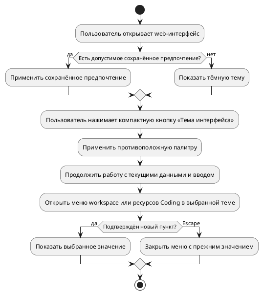

# FR-RH-019 - Выбор темы web-интерфейса

## Purpose

Обеспечить выбор светлой или тёмной темы для web-интерфейса с сохранением пользовательской работы и последнего предпочтения в браузере.
## Requirements
### Requirement: FR-RH-019 - Выбор темы web-интерфейса

Система SHALL переключать светлую и тёмную тему одним нажатием кнопки «Тема интерфейса», доступной на странице входа и в общей оболочке web-интерфейса.

**Use Cases:** UC-RH-14

#### Scenario: Пользователь выбирает светлую тему до входа

- **WHEN** пользователь открывает страницу входа в тёмной теме и нажимает кнопку «Тема интерфейса»
- **THEN** страница сразу отображается в светлой палитре без открытия меню выбора

#### Scenario: Повторное нажатие возвращает прежнюю тему

- **WHEN** пользователь в светлой теме повторно нажимает кнопку «Тема интерфейса»
- **THEN** страница сразу отображается в тёмной палитре

#### Scenario: Переключение с клавиатуры

- **WHEN** пользователь переводит фокус на кнопку «Тема интерфейса» клавишей Tab и нажимает Enter либо пробел
- **THEN** тема переключается на противоположную, а фокус остаётся на кнопке

### Requirement: FR-RH-019.1 - Сохранение предпочтения в браузере

Система SHALL восстанавливать допустимое сохранённое предпочтение темы между посещениями и использовать тёмную тему при отсутствии допустимого сохранённого значения.

**Use Cases:** UC-RH-14

#### Scenario: Возврат к сохранённой светлой теме

- **WHEN** пользователь выбрал «Светлая», закрыл страницу и снова открывает Rhetorica в том же браузере с доступным хранилищем
- **THEN** интерфейс и выбор темы восстановлены в режиме «Светлая»

#### Scenario: Хранилище недоступно или содержит неизвестное значение

- **WHEN** при открытии страницы сохранённое предпочтение отсутствует, имеет неизвестное значение, включая `system`, или чтение хранилища завершается ошибкой
- **THEN** интерфейс открывается в тёмной теме и позволяет выбрать другую тему для текущей страницы

#### Scenario: Запись предпочтения заблокирована браузером

- **WHEN** пользователь выбирает «Светлая», а браузер отклоняет запись предпочтения
- **THEN** текущая страница переходит в светлую тему и продолжает работу

#### Scenario: Системная палитра меняется

- **WHEN** пользователь выбрал «Светлая» и системная палитра меняется на тёмную
- **THEN** интерфейс остаётся светлым

### Requirement: FR-RH-019.2 - Согласованность открытых вкладок

Система SHALL применять изменение или удаление сохранённого предпочтения темы к другим открытым вкладкам Rhetorica в том же браузерном хранилище.

**Use Cases:** UC-RH-14

#### Scenario: Предпочтение изменено в соседней вкладке

- **WHEN** пользователь выбирает «Светлая» в одной вкладке при открытой второй вкладке Rhetorica
- **THEN** вторая вкладка показывает светлую тему и выбранный режим «Светлая»

#### Scenario: Предпочтение удалено

- **WHEN** сохранённое предпочтение темы удаляется либо хранилище очищается из другой вкладки
- **THEN** открытая вкладка возвращается к тёмной теме по умолчанию

#### Scenario: Задержанное событие другой вкладки

- **WHEN** другая вкладка сохраняет «Светлая», затем текущая вкладка выбирает «Тёмная» и получает задержанное событие о прежнем значении «Светлая»
- **THEN** текущая вкладка сохраняет последнюю записанную тему «Тёмная»

### Requirement: FR-RH-019.3 - Правильная тема при первом отображении

Система SHALL применять фактическую палитру сохранённого предпочтения до первого отображения страницы с согласованным состоянием при запуске клиентского интерфейса.

**Use Cases:** UC-RH-14

#### Scenario: Загрузка сохранённой светлой темы

- **WHEN** пользователь открывает страницу с сохранённой светлой темой при включённом JavaScript
- **THEN** первый показ страницы использует светлую палитру и запуск клиента сохраняет её без ошибки согласования серверной и клиентской разметки

### Requirement: FR-RH-019.4 - Сохранение текущей работы

Система SHALL сохранять текущие маршрут, диалог, введённый текст, открытые формы и данные результатов при смене темы.

**Use Cases:** UC-RH-14

#### Scenario: Смена темы во время работы

- **WHEN** пользователь с непустым черновиком сообщения, результатами запроса и открытой формой меняет тему
- **THEN** маршрут, диалог, текст черновика, поля и видимость формы, строки таблицы и данные графика сохраняются

### Requirement: FR-RH-019.5 - Оформление экранов и состояний

Система SHALL применять фактическую тему к оболочке, входу, чату, Markdown, SQL-блокам, таблицам, документации, административным формам, модальным окнам и состояниям элементов управления.

**Use Cases:** UC-RH-14

#### Scenario: Работа в светлой теме

- **WHEN** пользователь в светлой теме открывает чат с Markdown, SQL и таблицей, затем документацию и административную форму
- **THEN** фон, текст, ссылки, код, границы, поля и состояния hover, focus, selection, loading, empty, disabled и error используют светлую палитру

#### Scenario: Возврат к тёмной теме

- **WHEN** пользователь переключает открытые экраны и элементы из светлой темы в тёмную
- **THEN** они используют тёмную палитру

### Requirement: FR-RH-019.6 - Обновление графиков

Система SHALL применять фактическую тему к открытым графикам, включая подписи, оси, легенду и подсказки.

**Use Cases:** UC-RH-14

#### Scenario: Смена темы открытого графика

- **WHEN** пользователь меняет светлую тему на тёмную при открытом графике с результатами запроса
- **THEN** график сохраняет данные и отображает подписи, оси, легенду и подсказки в тёмной палитре

### Requirement: FR-RH-019.7 - Экспорт графика в выбранной теме

Система SHALL экспортировать PNG графика с фоном и палитрой фактической темы на момент экспорта.

**Use Cases:** UC-RH-14

#### Scenario: Экспорт после переключения темы

- **WHEN** пользователь переключает график в светлую тему и выбирает экспорт PNG
- **THEN** изображение использует светлый фон и светлую палитру элементов графика при сохранении исходных данных

### Requirement: FR-RH-019.8 - Обновление диаграмм документации

Система SHALL отображать существующие и новые Mermaid-диаграммы в фактической теме.

**Use Cases:** UC-RH-14

#### Scenario: Переключение темы документа с диаграммой

- **WHEN** пользователь меняет тему открытого документа с Mermaid-диаграммой
- **THEN** диаграмма повторно отображается в новой палитре с тем же содержанием

### Requirement: FR-RH-019.9 - Оформление редакторов

Система SHALL применять фактическую тему к редактору SQL и редактору сценариев с сохранением редактируемого содержимого.

**Use Cases:** UC-RH-14

#### Scenario: Переключение темы в редакторе

- **WHEN** пользователь меняет тему при открытом SQL-редакторе либо редакторе сценария с несохранёнными изменениями
- **THEN** редактор использует новую палитру и сохраняет текст SQL, узлы и связи сценария

### Requirement: FR-RH-019.10 - Состояние кнопки темы

Система SHALL показывать текущее состояние темы на кнопке «Тема интерфейса» видимым названием и программно определяемым состоянием нажатия с подсказкой следующего действия.

**Use Cases:** UC-RH-14

#### Scenario: Отображение светлой темы

- **WHEN** интерфейс использует светлую тему
- **THEN** кнопка показывает иконку и название «Светлая», доступное имя «Тема интерфейса», нажатое состояние `aria-pressed=true` и подсказку переключения на тёмную тему

#### Scenario: Отображение тёмной темы

- **WHEN** интерфейс использует тёмную тему
- **THEN** кнопка показывает иконку и название «Тёмная», доступное имя «Тема интерфейса», ненажатое состояние `aria-pressed=false` и подсказку переключения на светлую тему

### Requirement: FR-RH-019.11 - Компактная кнопка в шапке workspace

Система SHALL отображать кнопку «Тема интерфейса» в шапке workspace с той же высотой, что и индикатор статуса API.

**Use Cases:** UC-RH-14

#### Scenario: Кнопка рядом с индикатором API

- **WHEN** пользователь открывает workspace на настольном или мобильном экране и видит кнопку темы рядом с индикатором статуса API
- **THEN** видимые границы кнопки и индикатора имеют одинаковую высоту, а текст и иконка темы помещаются внутри кнопки

### Requirement: FR-RH-019.5.1 — Меню выбора workspace и ресурсов Coding

Система SHALL показывать меню выбора workspace и ресурсов Coding в фактической теме с визуальной отметкой выбранного пункта.

**Use Cases:** UC-RH-14, UC-RH-17

#### Scenario: Открытие списка пространств

- **WHEN** пользователь в тёмной теме раскрывает workspace с текущим значением default
- **THEN** меню использует тёмную палитру, отмечает default выбранным и показывает название и роль пользователя для каждого пространства

#### Scenario: Выбор ресурса в светлой теме

- **WHEN** пользователь в светлой теме открывает список окружений Coding и выбирает доступное окружение
- **THEN** список использует светлую палитру, закрывается после выбора и показывает выбранное окружение в поле

### Requirement: FR-RH-019.5.1.1 — Клавиатурное управление меню выбора

Система SHALL позволять выбирать доступные пункты меню workspace и ресурсов Coding с клавиатуры.

**Use Cases:** UC-RH-14, UC-RH-17

#### Scenario: Подтверждение выбора

- **WHEN** пользователь переводит фокус на селектор, открывает его Enter, перемещается стрелками к другому доступному пункту и нажимает Enter
- **THEN** применяется этот пункт и меню закрывается

#### Scenario: Отмена выбора внутри панели

- **WHEN** пользователь перемещает фокус между пунктами раскрытого меню в панели настроек Coding и нажимает Escape
- **THEN** меню закрывается с прежним значением, фокус возвращается к селектору и панель остаётся открытой
