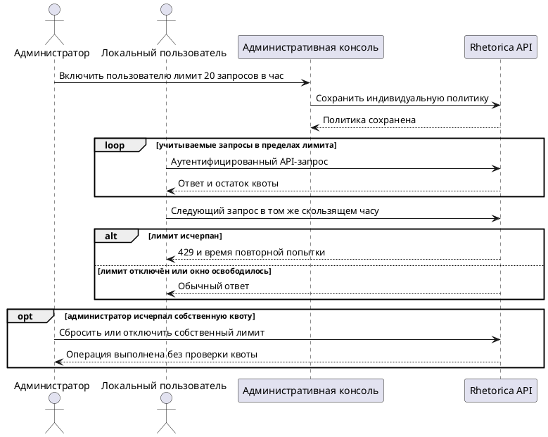

# FR-RH-020 Specification

## Purpose

Позволить администратору ограничивать частоту API-запросов отдельной локальной учётной записи без изменения доступа остальных пользователей workspace.

## Requirements

### Requirement: FR-RH-020 — Индивидуальный лимит API-запросов

Система SHALL применять скользящий часовой лимит к аутентифицированным API-запросам только той локальной учётной записи, для которой администратор включил индивидуальную политику.

**Use Cases:** UC-RH-15

#### Scenario: Запросы выбранной учётной записи проходят в пределах лимита

- **WHEN** для локальной учётной записи установлен лимит 20 запросов в час и она выполняет двадцатый учитываемый запрос за последние 60 минут
- **THEN** система выполняет запрос и сообщает нулевой остаток доступных запросов

#### Scenario: Учётная запись без политики сохраняет прежнее поведение

- **WHEN** локальная учётная запись без индивидуального лимита выполняет аутентифицированные API-запросы
- **THEN** система не отклоняет их по индивидуальному часовому лимиту

### Requirement: FR-RH-020.1 — Управление лимитом в административной консоли

Система SHALL позволять администратору workspace просматривать, включать, изменять и отключать положительный целочисленный часовой лимит для каждой локальной учётной записи своего workspace через административные API и UI.

**Use Cases:** UC-RH-15

#### Scenario: Администратор включает индивидуальный лимит

- **WHEN** администратор задаёт локальной учётной записи положительное количество запросов в час
- **THEN** система сохраняет политику, показывает её в списке пользователей и применяет к последующим учитываемым запросам этой учётной записи

#### Scenario: Администратор отключает индивидуальный лимит

- **WHEN** администратор отключает действующий лимит локальной учётной записи
- **THEN** система удаляет индивидуальную политику, очищает накопленное использование и показывает для учётной записи отсутствие ограничения

#### Scenario: Администратор передаёт недопустимый лимит

- **WHEN** администратор пытается сохранить нулевое, отрицательное или нецелое количество запросов в час
- **THEN** система отклоняет изменение с ошибкой валидации и сохраняет предыдущую политику

### Requirement: FR-RH-020.2 — Единый учёт запросов пользователя

Система SHALL суммировать учитываемые запросы пользователя по стабильному идентификатору учётной записи независимо от используемой session, Personal Access Token или OAuth credential.

**Use Cases:** UC-RH-15

#### Scenario: Пользователь меняет тип credential

- **WHEN** пользователь выполняет часть запросов через browser session, а остальные через Personal Access Token или OAuth credential в пределах того же скользящего часа
- **THEN** система учитывает их в одной квоте этой учётной записи

### Requirement: FR-RH-020.3 — Отказ после исчерпания лимита

Система SHALL отклонять учитываемый запрос сверх индивидуального лимита ответом `429 Too Many Requests` с целым числом секунд до ближайшей повторной попытки и актуальными сведениями о лимите и остатке.

**Use Cases:** UC-RH-15

#### Scenario: Двадцать первый запрос отклонён

- **WHEN** для учётной записи установлен лимит 20 запросов в час и она выполняет двадцать первый учитываемый запрос до выхода самого раннего запроса из 60-минутного окна
- **THEN** система не вызывает целевой API handler и возвращает `429` с `Retry-After`, `RateLimit-Limit: 20`, `RateLimit-Remaining: 0` и `RateLimit-Reset`

#### Scenario: Скользящее окно освободилось

- **WHEN** время самого раннего учтённого запроса вышло за пределы последних 60 минут и пользователь повторяет ранее отклонённый запрос
- **THEN** система выполняет запрос и отражает обновлённый остаток квоты

### Requirement: FR-RH-020.4 — Сброс текущего использования

Система SHALL позволять администратору workspace очистить текущее использование индивидуального лимита локальной учётной записи через административные API и UI.

**Use Cases:** UC-RH-15

#### Scenario: Администратор сбрасывает использование

- **WHEN** администратор запускает сброс для локальной учётной записи с включённым лимитом
- **THEN** система обнуляет использование текущего скользящего часа, не изменяет величину лимита и показывает полный доступный остаток

### Requirement: FR-RH-020.5 — Восстановление собственной квоты администратора

Система SHALL выполнять запрос администратора на сброс или отключение собственного индивидуального лимита без учёта и проверки этой квоты.

**Use Cases:** UC-RH-15

#### Scenario: Администратор исчерпал собственную квоту

- **WHEN** администратор исчерпал собственный часовой лимит и вызывает сброс или отключение этого лимита для своей учётной записи
- **THEN** система выполняет административную операцию, не возвращает `429` и применяет обновлённую политику к последующим запросам
