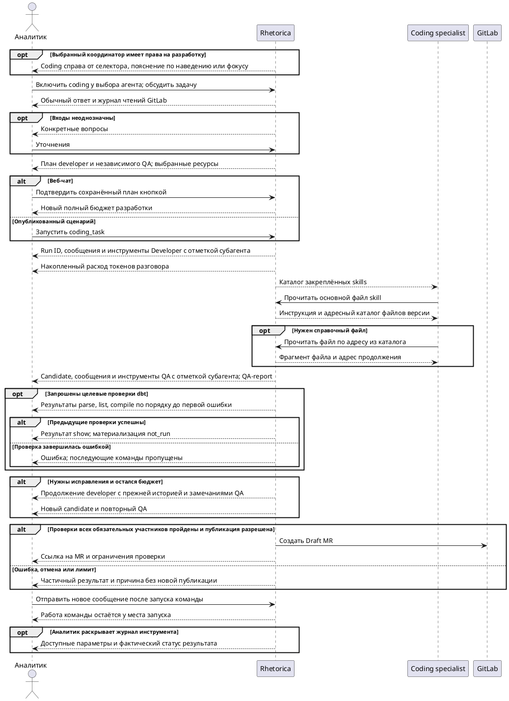

# FR-RH-021: Долговечные coding runs

## Purpose

Дать аналитику наблюдаемый и восстанавливаемый путь от разрешённого задания
разработки до immutable candidate, независимого QA-отчёта и, когда разрешено,
Draft MR без удержания HTTP-соединения и расширения полномочий агента.

## Requirements

### Requirement: FR-RH-021 — Запуск разработки

Система SHALL создавать наблюдаемый coding run по разрешённому запросу пользователя веб-интерфейса.

**Use Cases:** UC-RH-17

#### Scenario: Запуск разработки

- **WHEN** analyst подтверждает в чате план добавления net_revenue в fct_orders доступного dbt-проекта
- **THEN** возвращается run ID и отображаются этапы подготовки, разработки, QA и публикации

#### Scenario: Аналитик начинает разработку

- **WHEN** analyst из web-чата просит изменить разрешённый dbt-проект с выбранными repo, environment и специалистами
- **THEN** система возвращает run ID до завершения разработки и сохраняет доступный владельцу прогресс фаз

### Requirement: FR-RH-021.1 — Независимая проверка

Система SHALL предоставлять QA неизменяемую версию изменений, подготовленных developer.

**Use Cases:** UC-RH-18

#### Scenario: Независимая проверка

- **WHEN** developer передаёт candidate с digest abc и QA начинает проверку
- **THEN** QA проверяет candidate abc, а его отчёт содержит тот же digest

#### Scenario: QA проверяет candidate developer

- **WHEN** developer завершает candidate с digest `abc`, а затем меняет свою рабочую копию
- **THEN** QA проверяет candidate `abc`, а его отчёт содержит digest `abc` и не включает поздние изменения developer

### Requirement: FR-RH-021.2 — Восстановление запуска

Система SHALL продолжать прерванный coding run с сохранёнными результатами и оставшимися бюджетами.

**Use Cases:** UC-RH-17

#### Scenario: Восстановление запуска

- **WHEN** worker перезапускается после сохранения candidate и 12 итераций developer
- **THEN** run возобновляется с тем же candidate и уже потраченными 12 итерациями

#### Scenario: Worker перезапускается после candidate

- **WHEN** worker прекращает работу после сохранения candidate и использования двенадцати итераций developer
- **THEN** восстановленный run использует тот же candidate и продолжает с уже использованными двенадцатью итерациями без повтора завершённой внешней операции

### Requirement: FR-RH-021.3 — Отмена запуска

Система SHALL останавливать незавершённые операции coding run по запросу его владельца.

**Use Cases:** UC-RH-17

#### Scenario: Отмена запуска

- **WHEN** владелец отменяет run с активным SQL-запросом и subprocess
- **THEN** система запрашивает отмену SQL, завершает subprocess и сохраняет частичный результат без новой публикации

#### Scenario: Владелец отменяет активную проверку

- **WHEN** владелец отменяет run с активным SQL-запросом и subprocess
- **THEN** система запрашивает отмену активных операций, сохраняет полученные artifact references и не создаёт новый Draft MR

#### Scenario: Publisher завершает работу после отмены

- **WHEN** run уже сохранён как отменённый, а publisher позднее возвращает receipt для того же candidate и QA-report
- **THEN** система сохраняет ссылку на receipt для аудита, но сохраняет статус `cancelled`, причину отмены и partial result без перехода в `succeeded`

#### Scenario: Publisher возвращает receipt при ожидающей отмене

- **WHEN** владелец уже перевёл run в `cancel_requested`, а publisher до выполнения cancellation activity возвращает receipt
- **THEN** система сохраняет receipt для аудита и оставляет статус `cancel_requested`, после чего cancellation activity сохраняет partial result и завершает run со статусом `cancelled`

#### Scenario: Activity исчерпала retry

- **WHEN** sandbox, publisher или другая coding activity исчерпывает retry в Temporal после временных попыток
- **THEN** система до завершения workflow best-effort отменяет активные операции, сохраняет partial result с причиной `execution_failed` и переводит run в terminal `failed` без текста внешней ошибки в workflow history

### Requirement: FR-RH-021.4 — Идемпотентный запуск

Система SHALL возвращать один coding run для повторного запроса владельца с тем же idempotency key и входами.

**Use Cases:** UC-RH-17

#### Scenario: Идемпотентный запуск

- **WHEN** браузер повторяет запрос запуска после потери ответа
- **THEN** возвращается исходный run ID без второй задачи

#### Scenario: Браузер повторяет принятый запрос

- **WHEN** браузер повторяет запрос запуска после потери HTTP-ответа с тем же key и input digest
- **THEN** система возвращает исходный run ID без второго workflow или sandbox

#### Scenario: Key использован с другими входными данными

- **WHEN** браузер повторяет idempotency key с иным input digest
- **THEN** система отклоняет запрос без изменения исходного coding run

### Requirement: FR-RH-021.5 — Ограничение канала

Система SHALL отклонять coding-запуски вне аутентифицированного web-контекста до выделения sandbox.

**Use Cases:** UC-RH-17

#### Scenario: Ограничение канала

- **WHEN** Mattermost сообщает source=web и просит запустить разработку
- **THEN** запуск отклонён, sandbox не выделен

#### Scenario: Внешний источник подменяет source

- **WHEN** Mattermost, PAT, OAuth или внешний MCP передаёт payload с `source=web_chat`
- **THEN** система отклоняет запуск по trusted auth context и не выделяет sandbox

### Requirement: FR-RH-021.6 — Ограниченные результаты проверки

Система SHALL отображать отдельно успешные, неуспешные, заблокированные и невыполненные проверки candidate.

**Use Cases:** UC-RH-18

#### Scenario: Ограниченные результаты проверки

- **WHEN** parse проходит, а incremental materialization не выполнялась из-за read-only режима
- **THEN** отчёт показывает passed для parse и not_run для materialization

#### Scenario: Материализация не выполняется в read-only режиме

- **WHEN** parse завершился успешно, а incremental materialization не запускалась из-за read-only ограничения
- **THEN** QA-report показывает `passed` для parse и `not_run` для materialization, не выдавая developer stdout за доказательство

### Requirement: FR-RH-021.7 — Наблюдение за фоновой задачей

Система SHALL сохранять доступный владельцу прогресс coding run независимо от соединения браузера.

**Use Cases:** UC-RH-17, UC-RH-18

#### Scenario: Повторное открытие чата

- **WHEN** аналитик закрывает браузер во время developer и позднее открывает исходный разговор
- **THEN** показываются тот же run, дерево задач, исполнители, израсходованные итерации, оставшееся время, diff и доступный QA-report

#### Scenario: Аналитик возвращается к фоновому run

- **WHEN** аналитик закрывает браузер во время developer и позже запрашивает события после последнего cursor
- **THEN** система возвращает только более новые события в исходном порядке вместе с актуальными task status и budget usage без raw skill body или DWH rows

### Requirement: FR-RH-021.8 — Обсуждение разработки в чате

Система SHALL в режиме coding обычного веб-чата формировать с выбранным основным агентом план разработки с отдельными поручениями developer и QA и критериями проверки.

**Use Cases:** UC-RH-17

#### Scenario: План после уточнения задачи

- **WHEN** аналитик включает coding переключателем рядом с выбором агента, задаёт изменение net_revenue и отвечает на вопрос координатора о трактовке refunds
- **THEN** координатор показывает в том же диалоге согласованную задачу, план developer, независимую проверку QA, критерии готовности и выбранный проект с целевой веткой

#### Scenario: Разрешённый developer получает задачу

- **WHEN** default assistant из аутентифицированного web-контекста выбирает доступный developer из своего allowlist
- **THEN** система создаёт task ID с immutable policy snapshot до выделения sandbox и возвращает его вызывающему контексту

#### Scenario: Делегированная задача пытается вызвать ещё одного агента

- **WHEN** developer с parent task ID запрашивает создание задачи другого specialist
- **THEN** система отклоняет запрос без создания новой delegation edge

### Requirement: FR-RH-021.9 — Подтверждение разработки

Система SHALL запускать разработку из веб-чата только после явного подтверждения владельцем актуального сохранённого плана кнопкой в чате.

**Use Cases:** UC-RH-17

#### Scenario: Подтверждение актуального плана

- **WHEN** владелец нажимает «Подтвердить разработку» под согласованным планом
- **THEN** система повторно проверяет ресурсы и права и возвращает один coding run для подтверждённого плана

#### Scenario: План уточнён после показа кнопки

- **WHEN** аналитик отправляет новое уточнение и подтверждает прежний план из другой вкладки
- **THEN** система отклоняет устаревшее подтверждение; обсуждение не выделяет sandbox и не запускает специалистов

#### Scenario: Materialization не выполнена, но обязательные проверки пройдены

- **WHEN** QA-report содержит только допустимый `not_run` для materialization, а обязательные проверки и live write delegation действуют
- **THEN** система разрешает Draft MR с явно указанным ограничением materialization

#### Scenario: Публикация не разрешена

- **WHEN** candidate и QA-report готовы, но effective delegation grant отсутствует
- **THEN** система сохраняет candidate и QA-report с причиной `publication_not_authorized` без GitLab mutation

### Requirement: FR-RH-021.10 — Доступный переключатель Coding

Система SHALL показывать переключатель Coding справа от селектора агента только при наличии у выбранного координатора прав на запуск разработки.

**Use Cases:** UC-RH-17

#### Scenario: Разрешённый координатор

- **WHEN** аналитик выбирает координатора с разрешёнными независимыми developer и QA и доступным GitLab-коннектором
- **THEN** справа от селектора появляется Coding

#### Scenario: Координатор без разрешения

- **WHEN** аналитик выбирает агента без разрешения на вызов developer и QA
- **THEN** переключатель Coding отсутствует и coding mode выключается

### Requirement: FR-RH-021.11 — Подсказка режима Coding

Система SHALL раскрывать описание планирования, явного подтверждения разработки и недостающих ресурсов при наведении или клавиатурном фокусе на переключателе Coding.

**Use Cases:** UC-RH-17

#### Scenario: Пользователь изучает режим

- **WHEN** аналитик наводит указатель или переводит клавиатурный фокус на Coding
- **THEN** появляется подсказка о подготовке плана, подтверждении разработки и недостающих ресурсах, которая скрывается после ухода указателя и фокуса

### Requirement: FR-RH-021.12 — Отдельный бюджет обсуждения

Система SHALL учитывать обращения к модели до подтверждения плана в обычном лимите итераций чата отдельно от бюджета разработки.

**Use Cases:** UC-RH-17

#### Scenario: Подтверждение после исследования репозитория

- **WHEN** координатор прочитал 12 файлов и сформировал план в пределах обычного лимита чата, а аналитик подтверждает этот план при coding-лимите 200 итераций
- **THEN** разработка получает новый бюджет без вычета обращений при обсуждении; начальные счётчики задач равны нулю

#### Scenario: Обсуждение исчерпало лимит

- **WHEN** координатор исчерпал обычный лимит чата до сохранения плана
- **THEN** чат сообщает об исчерпании лимита обсуждения; бюджет разработки не выделяется

### Requirement: FR-RH-021.13 — Журнал обсуждения

Система SHALL показывать текст ответа координатора и начало и результат его инструментов в обычном чате по мере подготовки плана с понятными названиями операций без служебного счётчика LLM-вызовов.

**Use Cases:** UC-RH-17

#### Scenario: Координатор читает руководство проекта

- **WHEN** координатор обращается к LLM и вызывает чтение AGENTS.md из выбранного GitLab-проекта до подтверждения разработки
- **THEN** журнал показывает «Чтение файла GitLab», путь AGENTS.md и завершение чтения до итогового ответа; текст «Coding координатор: обращение к LLM 1/100» отсутствует, coding run ещё не создан

### Requirement: FR-RH-021.14 — Журнал работы специалистов

Система SHALL показывать сообщения и начало и результат инструментов Developer и QA в том же чате с указанием роли субагента и восстанавливать сохранённый журнал при открытии разговора.

**Use Cases:** UC-RH-17, UC-RH-18

#### Scenario: Разработка и независимая проверка в чате

- **WHEN** после подтверждения плана Developer читает models/fct_orders.sql, изменяет модель и передаёт результат QA, который запускает dbt parse
- **THEN** чат показывает инструменты и сообщения каждого специалиста в обычном оформлении сообщений с отметкой Developer или QA; чтение и проверка имеют отдельные результаты

#### Scenario: Возвращение к длинному журналу

- **WHEN** владелец возвращается к разговору, в котором сохранено 202 события coding run
- **THEN** чат восстанавливает события обеих страниц без пропуска завершения инструмента после двухсотого события и без повторения уже показанных событий при обновлении

### Requirement: FR-RH-021.15 — Политика компактирования подключения

Система SHALL применять к обсуждению Coding и задачам Developer и QA режим и порог нативного компактирования выбранного LLM-подключения без дополнительного ручного сжатия при включённом нативном режиме.

**Use Cases:** UC-RH-17, UC-RH-18

#### Scenario: Нативное компактирование специалиста

- **WHEN** Developer использует подключение с включённым нативным компактированием и порогом 180000 токенов и провайдер возвращает компактное состояние
- **THEN** следующий запрос сохраняет это состояние и последующий контекст, применяет порог 180000 токенов и не вызывает вспомогательный ручной компактор по отдельному процентному порогу Coding

### Requirement: FR-RH-021.16 — Продолжение контекста специалиста

Система SHALL сохранять историю сообщений и результатов инструментов каждого специалиста между последовательными поручениями в одном coding run.

**Use Cases:** UC-RH-17, UC-RH-18

#### Scenario: Исправление после QA

- **WHEN** QA возвращает замечание к models/test_model.sql и developer получает поручение исправить candidate
- **THEN** developer получает собственную предыдущую историю чтений, изменений и проверок вместе с новым замечанием, сохраняя использованный бюджет

#### Scenario: Повтор операции после перезапуска

- **WHEN** worker перезапускается после сохранённого ответа модели в текущем поручении
- **THEN** повтор использует сохранённый ответ без повторного списания итерации и без дублирования сообщений поручения в истории специалиста; при потере sandbox восстанавливаются сохранённые изменения, а не исходное дерево

### Requirement: FR-RH-021.17 — Учёт токенов Coding

Система SHALL включать фактические input, output и cache token usage обсуждения, специалистов и компактирования Coding в накопленные счётчики исходного разговора без повторного учёта сохранённого ответа при восстановлении.

**Use Cases:** UC-RH-17, UC-RH-18

#### Scenario: Разработка после обсуждения

- **WHEN** координатор потратил 100 входных и 20 выходных токенов, специалист — 300 и 40, а компактор — 50 и 10
- **THEN** счётчики разговора увеличены на 450 входных и 70 выходных токенов; usage coding-вызовов сохранён с идентификатором задачи и отдельно от оценки размера контекста

#### Scenario: Повтор сохранённого ответа

- **WHEN** worker повторно получает из журнала ответ специалиста, usage которого уже сохранён
- **THEN** счётчики разговора и расход этого вызова не увеличиваются

### Requirement: FR-RH-021.18 — Ограниченный контекст инструментов

Система SHALL передавать специалисту результаты инструментов в пределах настроенного бюджета контекста с явной отметкой сокращения и адресом для постраничного чтения полного результата.

**Use Cases:** UC-RH-17, UC-RH-18

#### Scenario: Большой вывод проверки

- **WHEN** проверка возвращает вывод, превышающий бюджет одного результата, и специалист продолжает работу
- **THEN** модель получает ограниченное представление с исходным статусом проверки и идентификатором результата, по которому может прочитать полный сохранённый вывод частями без повторного запуска проверки

#### Scenario: Накопление старых результатов

- **WHEN** результаты нескольких чтений превышают бюджет сохранения полных выводов в контексте
- **THEN** следующие обращения модели получают старые результаты как сокращённые записи с адресами чтения; полная история специалиста остаётся доступна для восстановления

### Requirement: FR-RH-021.19 — Обязательные участники проверки

Система SHALL позволять администратору команды назначать обязательных участников независимой проверки для публикации candidate.

**Use Cases:** UC-RH-17, UC-RH-18

#### Scenario: Команда с двумя обязательными проверяющими

- **WHEN** администратор сохраняет участников «SQL reviewer» и «Performance reviewer» как обязательных, а оба успешно проверяют текущий candidate
- **THEN** команда удовлетворяет условию обязательных проверок для публикации

#### Scenario: Проверка пропущена

- **WHEN** координатор просит публикацию после успешной проверки только SQL reviewer
- **THEN** публикация отклоняется с указанием отсутствующей обязательной проверки Performance reviewer

### Requirement: FR-RH-021.20 — Изменения candidate относительно базы

Система SHALL предоставлять проверяющему участнику изменения текущего candidate относительно закреплённой базы репозитория.

**Use Cases:** UC-RH-18

#### Scenario: Проверка нового файла в чистом снимке

- **WHEN** участник проверяет candidate с новым файлом models/smoke.sql
- **THEN** он получает список изменённых путей и diff добавленного файла относительно базы независимо от локальной Git-истории снимка

### Requirement: FR-RH-021.21 — Выборочное чтение инструкций

Система SHALL предоставлять coding-участнику каталог закреплённой версии
выбранного skill с описанием назначения, адресом основного файла и точными
адресами доступных справочных файлов, указывая для каждого файла его тип и
размер без предварительной загрузки содержимого справочных файлов.

**Use Cases:** UC-RH-17

#### Scenario: Выбор dbt reference-файла

- **WHEN** coding-участник читает основной файл закреплённого dbt skill, который
  ссылается на конфигурацию Cosmos
- **THEN** ответ содержит каталог той же версии с точным адресом, типом и
  размером файла конфигурации, после чего участник может адресно прочитать этот
  файл без угадывания пути

#### Scenario: Большой справочный файл

- **WHEN** участник адресно читает справочный файл, который превышает лимит
  одного ответа
- **THEN** система возвращает первый фрагмент с признаком сокращения и адресом
  следующего фрагмента той же закреплённой версии

### Requirement: FR-RH-021.22 — Последовательные целевые проверки dbt

Система SHALL предоставлять coding-участнику последовательную проверку выбранных dbt-моделей командами parse, list, compile и show с отдельным результатом каждой выполненной команды.

**Use Cases:** UC-RH-17, UC-RH-18

#### Scenario: Стандартная проверка модели

- **WHEN** участник запрашивает проверку smoke_ok в разрешённом dbt-проекте
- **THEN** результат содержит отдельные фактические статусы parse, list, compile и show; материализация отмечена как not_run

#### Scenario: Компиляция не удалась

- **WHEN** compile выбранной модели возвращает ошибку
- **THEN** show не запускается, а результат содержит завершённые проверки и ошибку compile

### Requirement: FR-RH-021.23 — Положение работы команды в чате

Система SHALL сохранять положение работы coding-команды в хронологии разговора по времени запуска.

**Use Cases:** UC-RH-17

#### Scenario: Новое сообщение после запуска

- **WHEN** аналитик запускает команду, отправляет следующий вопрос и затем перезагружает страницу
- **THEN** работа команды остаётся перед новым вопросом, включая события команды, полученные после этого вопроса

### Requirement: FR-RH-021.24 — Детали инструментов участников

Система SHALL показывать в раскрываемом журнале coding-участника доступные параметры вызова и фактический статус результата инструмента.

**Use Cases:** UC-RH-17, UC-RH-18

#### Scenario: Выполнение команды

- **WHEN** участник выполняет разрешённую команду dbt parse и пользователь раскрывает журнал
- **THEN** видны команда без секретов и её exit code; отсутствующие параметры не представлены пустым блоком JSON

### Requirement: FR-RH-021.23.1 — Сводка работы команды

Система SHALL позволять свернуть работу coding-команды до сводки её состояния и числа успешно завершивших работу участников.

**Use Cases:** UC-RH-17

#### Scenario: Команда завершена

- **WHEN** аналитик сворачивает блок завершённой команды с developer и QA, а затем раскрывает его
- **THEN** свёрнутый блок показывает завершение двух участников, а раскрытый восстанавливает сообщения и журналы с исходными временными отметками
