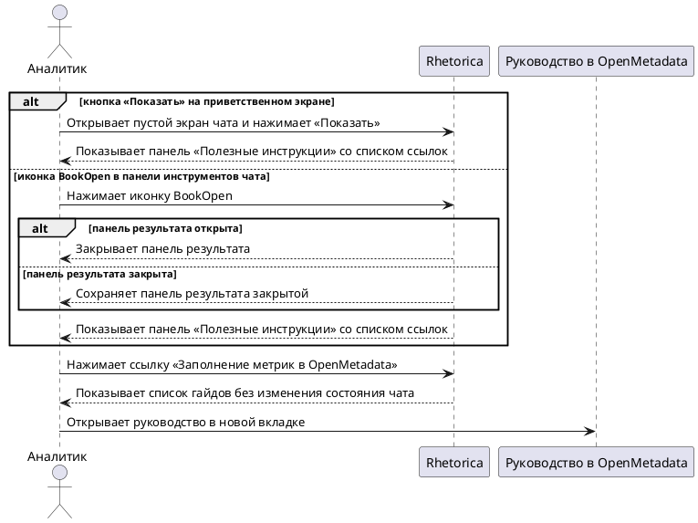

# FR-RH-022 — Просмотр полезных инструкций из чата

## Purpose
Обеспечить аналитику доступ к гайдам и инструкциям из рабочего чата без выхода из текущего контекста анализа.

## Requirements

### Requirement: FR-RH-022 — Просмотр полезных инструкций из чата

Система SHALL предоставлять аналитику панель «Полезные инструкции» со списком ссылок на гайды, открываемую из панели инструментов чата и с приветственного экрана, и открывать каждую ссылку списка в новой вкладке браузера.

**Use Cases:** UC-RH-16

#### Scenario: Аналитик открывает панель полезных инструкций

- **WHEN** аналитик нажимает кнопку «Показать» в секции «Полезные инструкции» на приветственном экране или иконку BookOpen в панели инструментов чата
- **THEN** система открывает панель «Полезные инструкции» со списком ссылок на гайды, а на узких экранах панель закрывает содержимое чата

#### Scenario: Аналитик открывает гайд из панели

- **WHEN** аналитик нажимает ссылку «Заполнение метрик в OpenMetadata» в открытой панели «Полезные инструкции»
- **THEN** руководство по описанию метрик открывается в новой вкладке браузера, а текущий чат сохраняет состояние

#### Scenario: Аналитик возвращается к панели результата

- **WHEN** панель «Полезные инструкции» открыта и аналитик открывает панель результата
- **THEN** система закрывает панель «Полезные инструкции» и показывает панель результата

