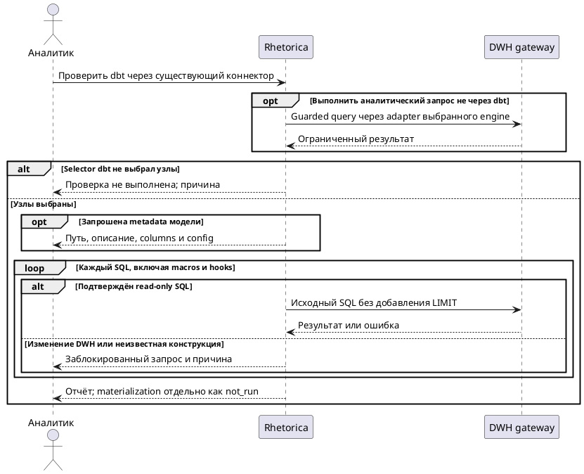

## Purpose

Разработка dbt-проектов с чтением доступных данных Trino без изменения данных и метаданных DWH.

## Requirements

### Requirement: FR-RH-023 — Проверка dbt через существующее подключение

Система SHALL исполнять разрешённые dbt-проверки через доступный Trino-коннектор workspace запуска.

**Use Cases:** UC-RH-17

#### Scenario: Проверка dbt через существующее подключение

- **WHEN** analyst выбирает существующий lake и запускает compile/show для изменённой модели
- **THEN** проверки используют параметры lake без повторного ввода credentials

### Requirement: FR-RH-023.1 — Запрет изменения DWH

Система SHALL отклонять запросы coding run, изменяющие данные или метаданные подключённого DWH.

**Use Cases:** UC-RH-17

#### Scenario: Запрет изменения DWH

- **WHEN** макрос run_query во время dbt compile отправляет DELETE FROM iceberg.sales.orders
- **THEN** команда завершается отказом до выполнения DELETE в DWH

#### Scenario: Обход через shell

- **WHEN** скрипт напрямую запускает dbt build или HTTP-клиент с DDL
- **THEN** прямое соединение с DWH недоступно, gateway блокирует SQL изменения; данные и метаданные остаются прежними

### Requirement: FR-RH-023.2 — Непроверенная конструкция SQL

Система SHALL отклонять SQL coding run, для которого не подтверждён read-only характер.

**Use Cases:** UC-RH-17

#### Scenario: Непроверенная конструкция SQL

- **WHEN** скрипт отправляет passthrough-запрос или EXPLAIN ANALYZE INSERT
- **THEN** gateway возвращает отказ, запрос не передаётся Trino

### Requirement: FR-RH-023.3 — Семантика проверок

Система SHALL сохранять семантику SQL dbt-проверки без автоматического добавления LIMIT.

**Use Cases:** UC-RH-17

#### Scenario: Семантика проверок

- **WHEN** data test проверяет отсутствие отрицательных значений во всех доступных строках
- **THEN** проверка выполняет исходный read-only SQL либо сообщает превышение лимита, не выдавая усечённый результат за успех

### Requirement: FR-RH-023.4 — Непроверяемая материализация

Система SHALL отмечать проверку материализации, требующую записи, как невыполненную в read-only режиме.

**Use Cases:** UC-RH-18

#### Scenario: Непроверяемая материализация

- **WHEN** QA оценивает incremental-модель без её материализации
- **THEN** отчёт содержит not_run с причиной, а не passed на основании production relation

#### Scenario: Production relation не доказывает candidate

- **WHEN** data test выполнен на существующей production relation вместо изменённой модели
- **THEN** отчёт обозначает результат как проверку baseline и не ставит passed проверке candidate на его основании

### Requirement: FR-RH-023.5 — Изоляция credentials

Система SHALL исключать credentials подключённого DWH из окружения и ответов coding-инструментов.

**Use Cases:** UC-RH-17

#### Scenario: Изоляция credentials

- **WHEN** скрипт читает dbt profile и переменные окружения
- **THEN** скрипт не получает credentials Trino, а видит только ограниченный endpoint запуска

### Requirement: FR-RH-023.6 — Набор dbt-команд

Система SHALL предоставлять управляемые parse, ls, compile, show и data tests без сохранения failures.

**Use Cases:** UC-RH-17

#### Scenario: Разрешённые проверки

- **WHEN** агент выбирает parse, ls, compile, show и data test с store_failures=false для поддерживаемой модели
- **THEN** инструмент выполняет команды через выбранный read-only профиль и возвращает фактические результаты

#### Scenario: Metadata выбранной модели

- **WHEN** агент выполняет list с selector новой модели `smoke_select_one`
- **THEN** результат содержит JSON с её unique_id, именем, путём SQL-файла, описанием, columns и config для проверки без чтения полного manifest

#### Scenario: Пустая выборка проверки

- **WHEN** selector команды list, compile, show или data test не выбирает ни одного исполняемого узла
- **THEN** результат сообщает, что проверка не выполнена, и не имеет статуса passed

#### Scenario: Команда материализации

- **WHEN** агент вызывает run, build, seed, snapshot, clone или run-operation
- **THEN** управляемый инструмент отклоняет команду до её запуска

#### Scenario: Сохранение неуспешных строк теста

- **WHEN** data test имеет effective store_failures=true или materialization сохранения failures
- **THEN** проверка отклонена до обращения, изменяющего DWH

### Requirement: FR-RH-023.7 — Database-agnostic query capability

Система SHALL выдавать coding task read-only query capability из выбранного доступного database connector поддерживаемого движка без передачи upstream credentials.

**Use Cases:** UC-RH-17

#### Scenario: Запрос через не-Trino connector

- **WHEN** агент с разрешением на существующий ClickHouse, Greenplum или Impala connector выполняет одиночный аналитический SQL
- **THEN** gateway повторно проверяет live workspace и agent access, применяет SQL guard выбранного движка и возвращает ограниченный результат без раскрытия endpoint или credentials
