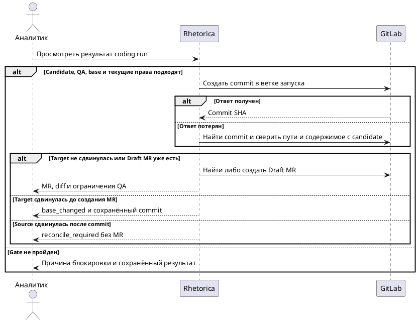

## Purpose

Автоматическая публикация проверенного изменения в Draft MR существующего GitLab-проекта с явной авторизацией.

## Requirements

### Requirement: FR-RH-024 — Создание Draft MR

Система SHALL публиковать проверенный candidate в отдельную ветку и Draft MR разрешённого GitLab-проекта.

**Use Cases:** UC-RH-18

#### Scenario: Создание Draft MR

- **WHEN** candidate abc прошёл обязательные проверки и исполнитель имеет write grant для проекта analytics/dbt и main
- **THEN** созданы ветка feature/rhetorica/run-id и Draft MR с candidate abc, merge не выполняется

### Requirement: FR-RH-024.1 — Проверенная версия изменений

Система SHALL отклонять публикацию candidate без соответствующего успешного обязательного QA-отчёта.

**Use Cases:** UC-RH-18

#### Scenario: Проверенная версия изменений

- **WHEN** после QA candidate abc заменяется на def
- **THEN** публикация def отклонена до повторной проверки

### Requirement: FR-RH-024.2 — Идемпотентная публикация

Система SHALL возвращать существующий результат повторной публикации одного coding run.

**Use Cases:** UC-RH-18

#### Scenario: Идемпотентная публикация

- **WHEN** GitLab создал MR, но ответ потерян и worker повторяет операцию
- **THEN** система находит созданный MR и возвращает его URL без дубликата

#### Scenario: Потеря ответа commit API

- **WHEN** GitLab создал commit, ответ потерян, worker восстановился
- **THEN** система сначала сверяет созданный commit и затем продолжает создание MR без второго commit

#### Scenario: Чужой commit с теми же путями

- **WHEN** в ветке запуска есть commit с тем же parent, trailers и набором путей, но содержимое файлов отличается от candidate
- **THEN** система переводит публикацию в reconcile_required и не создаёт MR

#### Scenario: Source branch сдвинулась после commit

- **WHEN** commit создан, затем head ветки запуска указывает на другой SHA до поиска или создания Draft MR
- **THEN** система переводит публикацию в reconcile_required и не привязывает MR к непроверенному commit

### Requirement: FR-RH-024.3 — Ограниченные файлы

Система SHALL отклонять публикацию файлов вне разрешённого набора проекта.

**Use Cases:** UC-RH-18

#### Scenario: Ограниченные файлы

- **WHEN** candidate dbt-профиля содержит изменение .gitlab-ci.yml
- **THEN** публикация блокируется с указанием запрещённого пути

#### Scenario: Credentials YAML в разрешённом каталоге

- **WHEN** candidate содержит models/credentials.yaml
- **THEN** публикация блокируется с указанием запрещённого пути

#### Scenario: Access token в YAML настроек

- **WHEN** candidate содержит models/settings.yml со строкой access_token
- **THEN** публикация блокируется как обнаруженный секрет

### Requirement: FR-RH-024.4 — Описание ограничений QA

Система SHALL включать в Draft MR результаты проверок и невыполненные аспекты проверки.

**Use Cases:** UC-RH-18

#### Scenario: Описание ограничений QA

- **WHEN** compile успешен, incremental build не выполнялся
- **THEN** описание MR явно сообщает оба результата

### Requirement: FR-RH-024.5 — Повторная авторизация публикации

Система SHALL отклонять публикацию после отзыва любого разрешения использованной цепочки делегирования.

**Use Cases:** UC-RH-18

#### Scenario: Повторная авторизация публикации

- **WHEN** перед публикацией администратор удаляет write delegation от default assistant к developer
- **THEN** publisher отказывает независимо от сохранённого ранее snapshot

#### Scenario: Отзыв между commit и MR

- **WHEN** commit создан, затем grant отозван до отправки MR API
- **THEN** новый MR не создаётся, пользователю доступен partial receipt существующего commit; ветка автоматически не удаляется

### Requirement: FR-RH-024.6 — Недостаточный scope коннектора

Система SHALL возвращать ошибку недостаточных прав выбранного GitLab-коннектора без автоматической замены коннектора.

**Use Cases:** UC-RH-18

#### Scenario: Недостаточный scope коннектора

- **WHEN** write разрешён политикой Rhetorica, но GitLab token имеет только read_api
- **THEN** run сообщает о необходимости изменить существующий коннектор без обращения к другому token

### Requirement: FR-RH-024.7 — Изменение базы публикации

Система SHALL требовать повторной проверки candidate при изменении base SHA до создания commit и до создания нового Draft MR.

**Use Cases:** UC-RH-18

#### Scenario: Target branch продвинулась

- **WHEN** QA проверил candidate от base abc, а перед commit целевая ветка указывает на def
- **THEN** публикация остановлена с base_changed; продолжение требует нового candidate и QA, force push не выполняется

#### Scenario: Target branch продвинулась после commit

- **WHEN** commit от base abc создан, а перед созданием Draft MR целевая ветка указывает на def
- **THEN** система возвращает base_changed с сохранённым commit, новый MR не создаётся; уже найденный Draft MR того же запуска возвращается без повторной проверки head

### Requirement: FR-RH-024.8 — Блокирующие результаты QA

Система SHALL блокировать автоматическую публикацию при ошибке обязательной проверки или исчерпании бюджета.

**Use Cases:** UC-RH-18

#### Scenario: Compile завершился ошибкой

- **WHEN** QA обнаружил compilation error в изменённой модели
- **THEN** MR не создаётся; ошибка возвращается developer на исправление при оставшемся бюджете

#### Scenario: Материализация недоступна

- **WHEN** обязательные gates пройдены, а incremental materialization отмечена not_run из-за read-only режима
- **THEN** Draft MR создаётся с явно указанным ограничением проверки

### Requirement: FR-RH-024.9 — Ограниченные операции GitLab

Система SHALL ограничивать write-возможности coding run созданием служебной ветки, commit и Draft MR.

**Use Cases:** UC-RH-18

#### Scenario: Попытка merge

- **WHEN** агент после создания Draft MR запрашивает merge, force push, удаление ветки или изменение настроек проекта
- **THEN** операция отклоняется, созданный Draft MR остаётся для review человеком
