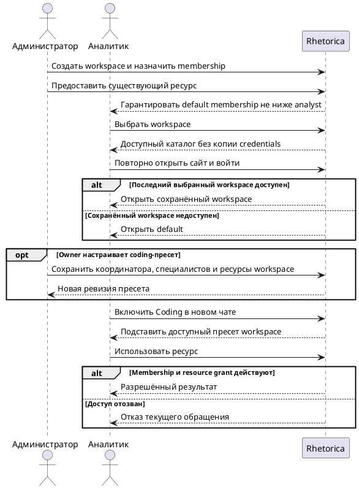

## Purpose

Управление workspace и доступом к существующим ресурсам приложения без копирования секретов.

## Requirements

### Requirement: FR-RH-025 — Участие в workspace

Система SHALL предоставлять пользователю выбор workspace, в которых у пользователя есть действующее membership.

**Use Cases:** UC-RH-19

#### Scenario: Участие в workspace

- **WHEN** администратор добавляет analyst в workspace engineering и пользователь открывает список workspace
- **THEN** пользователь видит engineering и может выбрать его

### Requirement: FR-RH-025.1 — Роли участников

Система SHALL ограничивать операции участника разрешениями назначенной роли owner, analyst или viewer.

**Use Cases:** UC-RH-19

#### Scenario: Роли участников

- **WHEN** viewer открывает доступный coding run и пытается запустить новый
- **THEN** просмотр доступен, а запуск отклонён

#### Scenario: Owner управляет участниками

- **WHEN** owner engineering добавляет существующего пользователя с ролью analyst
- **THEN** пользователь получает membership engineering, owner не получает этим системный admin-доступ к опасным настройкам агентов

#### Scenario: Analyst запускает разрешённый процесс

- **WHEN** analyst выбирает dbt-сценарий с настроенными ресурсами и grants
- **THEN** запуск разрешён без отдельной пользовательской роли developer

### Requirement: FR-RH-025.2 — Предоставление существующего ресурса

Система SHALL предоставлять workspace доступ к существующему ресурсу общего каталога без создания копии credentials.

**Use Cases:** UC-RH-19

#### Scenario: Предоставление существующего ресурса

- **WHEN** администратор предоставляет Trino-коннектор lake workspace engineering
- **THEN** engineering видит lake с тем же источником конфигурации без запроса нового пароля

#### Scenario: Shared ресурс нельзя передать транзитивно

- **WHEN** engineering получил lake от finance и пытается предоставить этот grant workspace marketing
- **THEN** передача отклонена; доступ marketing может выдать уполномоченный владелец исходного ресурса

### Requirement: FR-RH-025.3 — Отзыв доступа

Система SHALL отклонять последующие обращения к ресурсу после отзыва доступа workspace.

**Use Cases:** UC-RH-19, UC-RH-17

#### Scenario: Отзыв доступа

- **WHEN** администратор отзывает доступ engineering к lake во время coding run
- **THEN** следующий запрос этого run к lake отклонён

### Requirement: FR-RH-025.4 — Изоляция workspace

Система SHALL отклонять обращение участника к недоступному ресурсу другого workspace.

**Use Cases:** UC-RH-19

#### Scenario: Изоляция workspace

- **WHEN** analyst из engineering подставляет artifact ID из finance в запрос скачивания
- **THEN** тело artifact не возвращается

#### Scenario: Смена активного workspace

- **WHEN** аналитик начал run в engineering, затем переключился в finance и подставил run ID в запрос нового действия
- **THEN** run сохраняет binding engineering и не использует права или коннекторы finance

### Requirement: FR-RH-025.5 — Локальные ресурсы workspace

Система SHALL позволять уполномоченному участнику создавать локальные ресурсы в выбранном workspace через существующие редакторы.

**Use Cases:** UC-RH-19

#### Scenario: Локальное подключение

- **WHEN** администратор создаёт Trino-коннектор lake-local в engineering
- **THEN** коннектор доступен по политике engineering и не появляется в finance без явного предоставления

### Requirement: FR-RH-025.6 — Гарантированный default workspace

Система SHALL предоставлять каждому действующему пользователю неотзываемое membership в default workspace с ролью не ниже analyst.

**Use Cases:** UC-RH-19

#### Scenario: Новый пользователь получает default workspace

- **WHEN** администратор создаёт пользователя с ролью analyst
- **THEN** пользователь видит default workspace с действующим membership analyst

#### Scenario: Защита минимального доступа

- **WHEN** owner пытается отозвать default membership пользователя или назначить ему роль viewer
- **THEN** система отклоняет изменение и сохраняет действующую роль не ниже analyst

### Requirement: FR-RH-025.7 — Явное переключение workspace

Система SHALL предоставлять на странице workspace явное действие переключения в выбранный доступный workspace.

**Use Cases:** UC-RH-19

#### Scenario: Переключение workspace

- **WHEN** пользователь выбирает analytics и запускает действие переключения
- **THEN** следующий экран работает в контексте analytics

### Requirement: FR-RH-025.7.1 — Восстановление выбранного workspace

Система SHALL восстанавливать последний успешно выбранный пользователем workspace при возвращении на сайт и повторном входе, пока membership пользователя и workspace действуют.

**Use Cases:** UC-RH-19

#### Scenario: Повторный вход после выбора

- **WHEN** аналитик выбирает engineering, закрывает сайт и затем повторно входит в свой аккаунт
- **THEN** открывается engineering с доступными в нём чатами и ресурсами

#### Scenario: Неуспешный выбор сохраняет предпочтение

- **WHEN** аналитик выбрал engineering и затем попытался переключиться в недоступный finance
- **THEN** переключение отклоняется, а при следующем входе открывается engineering

### Requirement: FR-RH-025.7.1.1 — Возврат при недоступном сохранённом workspace

Система SHALL открывать default workspace при новом входе, если сохранённый workspace или membership пользователя перестали действовать.

**Use Cases:** UC-RH-19

#### Scenario: Membership отозвано между входами

- **WHEN** аналитик выбрал engineering, администратор отозвал его membership, затем аналитик снова входит
- **THEN** открывается default с правами текущего membership пользователя

#### Scenario: Workspace отключён между входами

- **WHEN** аналитик выбрал engineering, администратор отключил этот workspace, затем аналитик снова входит
- **THEN** открывается default

### Requirement: FR-RH-025.8 — Возврат из управления workspace

Система SHALL предоставлять на странице workspace действие возврата на главную страницу приложения.

**Use Cases:** UC-RH-19

#### Scenario: Возврат на главную

- **WHEN** пользователь запускает действие возврата на странице workspace
- **THEN** система открывает главную страницу приложения

### Requirement: FR-RH-025.9 — Создание workspace администратором

Система SHALL предоставлять системному администратору действие создания workspace на странице workspace.

**Use Cases:** UC-RH-19

#### Scenario: Администратор создаёт workspace

- **WHEN** системный администратор вводит идентификатор engineering и имя Engineering на странице workspace
- **THEN** система создаёт workspace Engineering и назначает администратора owner

### Requirement: FR-RH-025.10 — Отображение участников

Система SHALL отображать участника workspace по имени и логину без использования внутреннего user ID как пользовательской подписи.

**Use Cases:** UC-RH-19

#### Scenario: Owner просматривает участников

- **WHEN** owner открывает список участников с пользователем Anna Analyst и логином anna
- **THEN** система показывает Anna Analyst и @anna без внутреннего user ID в подписи

### Requirement: FR-RH-025.11 — Общие настройки ресурсов разработки

Система SHALL позволять владельцу workspace или системному администратору сохранять общий coding-пресет координатора, developer, QA, GitLab-проекта, целевой ветки, окружения и параметров dbt, который подставляется участникам при включении Coding в новом чате.

**Use Cases:** UC-RH-17, UC-RH-19

#### Scenario: Новый чат использует настройки workspace

- **WHEN** владелец сохраняет пресет с coding-координатором, developer, QA и проектом dags-dq, а участник включает Coding в новом чате этого workspace
- **THEN** чат выбирает сохранённого координатора и подставляет ресурсы, проверяя доступность ресурсов и разрешения на вызов специалистов

#### Scenario: Права на специалиста отозваны

- **WHEN** у координатора отозвано разрешение на вызов сохранённого QA
- **THEN** чат сообщает о недоступном пресете, а запуск с отозванным разрешением отклоняется

#### Scenario: Устаревшая ревизия настроек

- **WHEN** владелец сохраняет пресет с ревизией, которую другой владелец уже изменил
- **THEN** система возвращает конфликт и сохраняет актуальный пресет
