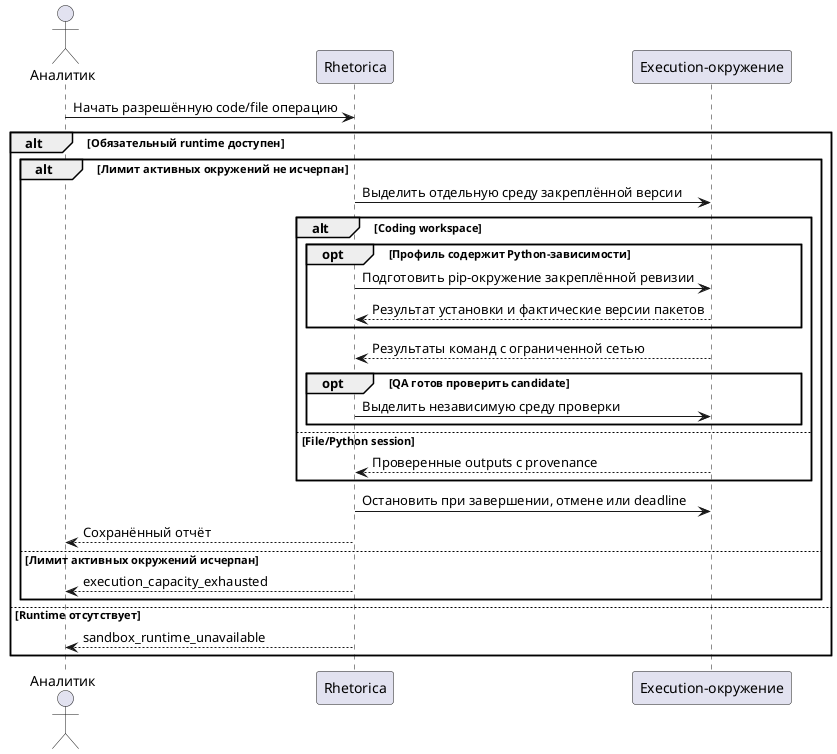

## Purpose

Изолированное выполнение недоверенного кода репозитория и file/Python операций с ограниченной сетью и управляемым временем жизни.

## Requirements

### Requirement: FR-RH-026 — Изоляция coding-окружения

Система SHALL выполнять команды разработки в отдельном непривилегированном окружении выбранного профиля.

**Use Cases:** UC-RH-17

#### Scenario: Изоляция coding-окружения

- **WHEN** запускается developer для dbt-проекта с разрешённым environment profile
- **THEN** команды работают с собственной копией репозитория и не получают host filesystem или service-account token

### Requirement: FR-RH-026.1 — Закрытая сеть

Система SHALL ограничивать исходящие обращения coding-окружения разрешёнными посредниками запуска.

**Use Cases:** UC-RH-17

#### Scenario: Закрытая сеть

- **WHEN** скрипт обращается напрямую к Trino, GitLab и cloud metadata
- **THEN** прямые обращения блокируются, доступный read-only dbt-инструмент продолжает работать через посредника

### Requirement: FR-RH-026.2 — Обязательная изоляция

Система SHALL отклонять выделение coding-окружения при отсутствии настроенного изолирующего runtime.

**Use Cases:** UC-RH-17

#### Scenario: Обязательная изоляция

- **WHEN** gVisor недоступен на выбранных узлах
- **THEN** run получает sandbox_runtime_unavailable без запуска privileged runner

### Requirement: FR-RH-026.3 — Закреплённое окружение

Система SHALL закреплять версию окружения на время coding run.

**Use Cases:** UC-RH-17

#### Scenario: Закреплённое окружение

- **WHEN** администратор публикует новый образ во время проверки candidate
- **THEN** текущая проверка использует исходный digest образа

### Requirement: FR-RH-026.4 — Очистка окружений

Система SHALL освобождать окружения завершённого, отменённого или просроченного запуска.

**Use Cases:** UC-RH-17

#### Scenario: Очистка окружений

- **WHEN** истекает deadline coding run
- **THEN** его процессы остановлены, временные окружения удаляются, сохранённый отчёт остаётся доступен владельцу

#### Scenario: Контроллер потерял состояние file-сессии

- **WHEN** execution controller перезапускается и обнаруживает принадлежащее deployment окружение без активной file-сессии
- **THEN** осиротевшее окружение удаляется, а Kubernetes завершает его по deadline и TTL даже при недоступном controller

### Requirement: FR-RH-026.5 — Раздельные среды developer и QA

Система SHALL изолировать выполнение QA от изменяемого окружения developer.

**Use Cases:** UC-RH-18

#### Scenario: Developer изменяет рабочую копию после передачи

- **WHEN** QA получил candidate abc, а developer изменил локальный validator или файл модели
- **THEN** QA продолжает проверку abc в отдельной среде с закреплёнными инструментами; новые файлы не входят в отчёт abc

### Requirement: FR-RH-026.6 — Управляемые профили окружения

Система SHALL позволять системному администратору создавать новую версию coding environment profile с ограничениями CPU, RAM, PIDs, диска, результата, времени и списком Python-пакетов с точными версиями без изменения deployment-owned runtime identity.

**Use Cases:** UC-RH-17

#### Scenario: Изменение ресурсов профиля

- **WHEN** системный администратор сохраняет новые resource limits существующего gVisor profile
- **THEN** система создаёт новую revision, новые runs могут выбрать её, а уже запущенные задачи сохраняют прежнюю revision и image digest

### Requirement: FR-RH-026.7 — Единый execution runtime

Система SHALL выполнять coding workspace и file/Python операции через общий изолирующий runtime без отдельного привилегированного fallback.

**Use Cases:** UC-RH-5, UC-RH-17

#### Scenario: Python-шаг и coding task используют общий runtime

- **WHEN** аналитик запускает Python-шаг сценария и coding task в одном deployment
- **THEN** обе операции используют один runner protocol и общую resource policy, а отдельный NsJail service не выделяется

### Requirement: FR-RH-026.8 — Общий лимит execution-окружений

Система SHALL ограничивать deployment-owned числом суммарное количество активных coding и file/Python execution-окружений.

**Use Cases:** UC-RH-5, UC-RH-17

#### Scenario: Общий лимит исчерпан

- **WHEN** одновременно активные coding и file/Python окружения заняли весь deployment-owned лимит
- **THEN** новая операция получает execution_capacity_exhausted без создания дополнительного окружения

### Requirement: FR-RH-026.9 — Python-зависимости профиля

Система SHALL до исполнения задач developer и QA устанавливать Python-пакеты закреплённой ревизии coding environment profile через pip из заданного HTTPS-индекса в отдельное Python-окружение каждой задачи.

**Use Cases:** UC-RH-17

#### Scenario: Подготовка зависимостей до разработки

- **WHEN** администратор сохраняет профиль с dbt-core==1.11.15 и pytest==8.3.5, а аналитик подтверждает новый coding run с этим профилем
- **THEN** developer и QA получают отдельные Python-окружения с указанными пакетами, а сохранённое evidence содержит ревизию рецепта и фактически разрешённые версии

#### Scenario: Установка не удалась

- **WHEN** pip не может установить заданную версию пакета в пределах deadline
- **THEN** задача завершается ошибкой подготовки до вызова модели соответствующего специалиста

#### Scenario: Рецепт изменён после старта

- **WHEN** администратор сохраняет новую ревизию списка Python-пакетов после запуска developer
- **THEN** developer и QA текущего run используют исходный рецепт, а новый run выбирает новую ревизию

### Requirement: FR-RH-026.10 — Evidence Python-окружения

Система SHALL сохранять для каждой coding-задачи evidence подготовки Python-окружения с ревизией профиля, digest рецепта и фактически установленными версиями пакетов.

**Use Cases:** UC-RH-17

#### Scenario: Проверка окружения developer и QA

- **WHEN** подготовка pip-окружений developer и QA завершилась успешно
- **THEN** каждая задача получает собственный артефакт с закреплённой ревизией, digest рецепта и списком установленных Python-пакетов
