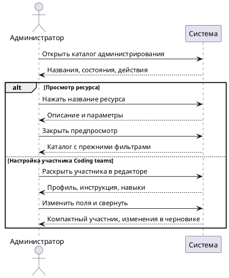

# Просмотр ресурсов администрирования

## Purpose

Компактный просмотр ресурсов администрирования позволяет находить нужное подключение, агента, skill или сценарий и открывать подробности только выбранного элемента.

## Requirements

### Requirement: FR-RH-027 — Просмотр ресурса из компактного каталога

Система SHALL открывать подробности выбранного подключения, агента, skill или сценария по нажатию на его название в каталоге администрирования.

**Use Cases:** UC-RH-6, UC-RH-7

Каталог показывает название, состояние и доступные действия; описания и параметры находятся в предпросмотре. Просмотр использует уже доступные пользователю сведения и сохраняет текущие фильтры каталога.

#### Scenario: Просмотр подключения после поиска
- **WHEN** администратор находит подключение по имени и нажимает его название
- **THEN** система показывает описание и параметры подключения без изменения его конфигурации
- **AND** после закрытия предпросмотра результат поиска остаётся выбранным

### Requirement: FR-RH-027.1 — Раскрываемые участники команды

Система SHALL предоставлять поля настройки выбранного участника Coding teams при раскрытии его компактной строки в редакторе команды.

**Use Cases:** UC-RH-7, UC-RH-17

Свёрнутая строка показывает аватарку профиля, имя участника, профиль и возможность. Изменённые значения сохраняются в черновике при сворачивании строки. Ошибки настройки обозначаются и в свёрнутом состоянии.

#### Scenario: Редактирование инструкции участника
- **WHEN** администратор раскрывает участника команды, меняет инструкцию и сворачивает строку
- **THEN** система сохраняет инструкцию в черновике команды
- **AND** при повторном раскрытии отображает изменённую инструкцию
