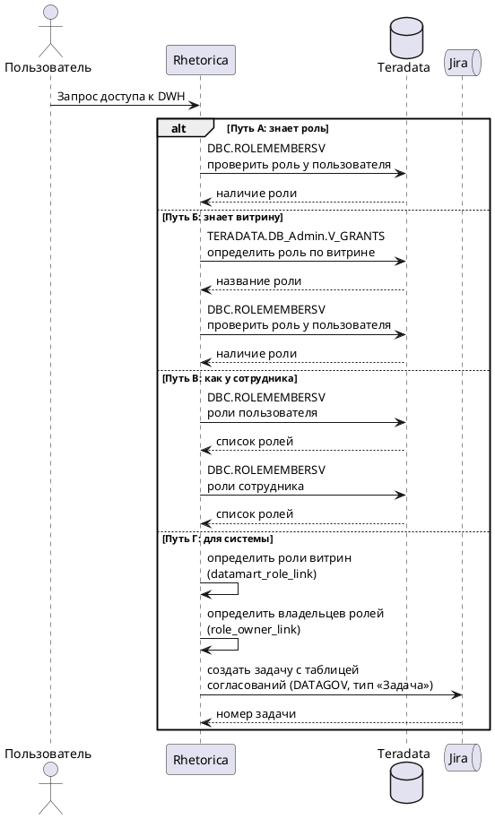
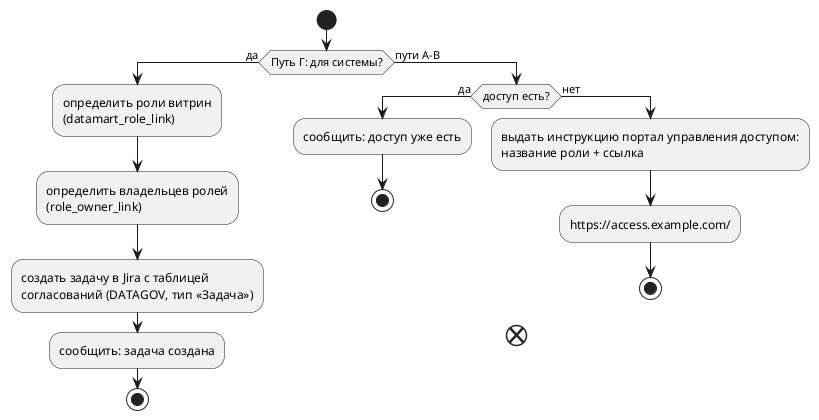

# UC-RH-9: Запросить доступ к DWH

## Purpose

Зафиксировать основной вариант использования, когда пользователь запрашивает доступ к данным DWH Teradata через чат Tag с Rhetorica. Четыре пути: по названию роли, по витрине, по аналогии с сотрудником и для системы (СУЗ или Схема).

## Requirements

### Requirement: UC-RH-9 — Запросить доступ к DWH

Система SHALL обрабатывать запрос пользователя на доступ к данным DWH Teradata одним из четырёх способов в зависимости от того, что знает пользователь: название роли, название витрины, логин сотрудника или тип системы (СУЗ/Схема).

**Основной актор:** пользователь платформы данных.

**Цель:** получить доступ к данным DWH через проверку ролей в Teradata и инструкцию по запросу в портал управления доступом либо создание задачи в Jira.

**Композиция:**

1. **Триггер** (FR-RH-011) — система распознаёт запрос доступа к DWH.
2. **Путь А — по роли** (FR-RH-012) — пользователь знает нужную роль; система проверяет её наличие.
3. **Путь Б — по витрине** (FR-RH-013) — пользователь знает витрину; система определяет роль через V_GRANTS и проверяет наличие.
4. **Путь В — по аналогии с сотрудником** (FR-RH-014) — система сравнивает роли пользователя и сотрудника.
5. **Путь Г — для системы** (FR-RH-015) — система создаёт задачу в Jira (DATAGOV).
6. **Инструкция портал управления доступом** (FR-RH-016) — для путей А–В при отсутствии доступа система выдаёт название роли и ссылку на портал управления доступом.

#### Sequence: Проверка доступа

#### Decision: Результат проверки

#### Scenario: Путь А — доступ по роли есть

- **WHEN** пользователь указывает название роли, и роль есть у пользователя в DBC.ROLEMEMBERSV
- **THEN** система сообщает, что доступ уже есть

#### Scenario: Путь А — доступа по роли нет

- **WHEN** пользователь указывает название роли, и роли нет у пользователя
- **THEN** система выдаёт название роли и инструкцию по запросу в портал управления доступом (FR-RH-016)

#### Scenario: Путь Б — доступ по витрине есть

- **WHEN** пользователь указывает название витрины, система определяет роль через TERADATA.DB_Admin.V_GRANTS, и роль есть у пользователя
- **THEN** система сообщает, что доступ уже есть

#### Scenario: Путь Б — доступа по витрине нет

- **WHEN** пользователь указывает название витрины, система определяет роль через TERADATA.DB_Admin.V_GRANTS, и роли нет у пользователя
- **THEN** система выдаёт название роли и инструкцию по запросу в портал управления доступом (FR-RH-016)

#### Scenario: Путь В — сравнение с сотрудником

- **WHEN** пользователь указывает логин сотрудника для сравнения
- **THEN** система сравнивает роли в DBC.ROLEMEMBERSV и возвращает недостающие роли с инструкцией по запросу в портал управления доступом (FR-RH-016), либо сообщение «все есть»

#### Scenario: Путь Г — создание задачи для системы

- **WHEN** пользователь запрашивает доступ для СУЗ или Схемы
- **THEN** система определяет согласующих через datamart_role_link и role_owner_link, создаёт задачу в Jira (проект DATAGOV, тип «Задача») с таблицей согласований в описании
